::: {.callout-important}
This tutorial and the underlying template repository require the [IIC-OSIC-TOOLS](https://github.com/iic-jku/IIC-OSIC-TOOLS) container with tag `2026.11` or later. All commands below must be executed from within the container, and the working directory must be a folder containing the corresponding `Makefile`.
:::

::: {.callout-note}
We happily accept [pull requests](https://github.com/iic-jku/ihp-sg13g2-ams-chip-template/pulls) to fix typos or add content! If you want to discuss something that is not clear, please [open an issue](https://github.com/iic-jku/ihp-sg13g2-ams-chip-template/issues)!
:::

# Tutorial Overview {#sec-overview}

This tutorial is a step-by-step walk-through of the open-source analog mixed-signal (AMS) chip flow based on the [`ihp-sg13g2-ams-chip-template`](https://github.com/iic-jku/ihp-sg13g2-ams-chip-template) repository for the ihp-sg13g2 130nm Open-PDK. It covers:

- [Overview](#sec-overview) and [Installation](#sec-installation) of [IIC-OSIC-TOOLS](https://github.com/iic-jku/IIC-OSIC-TOOLS)
- [Digital macro design](#sec-digital)
  - Design files written in SystemVerilog
  - Linting with [Verilator](https://github.com/verilator/verilator)
  - Simulation with [Icarus Verilog](https://github.com/steveicarus/iverilog) and [cocotb](https://github.com/cocotb/cocotb)
  - Viewing waveforms with [GTKWave](https://github.com/gtkwave/gtkwave) and [Surfer](https://gitlab.com/surfer-project/surfer)
  - Synthesis, placement, routing, and verification with [Yosys](https://github.com/YosysHQ/yosys), [OpenROAD](https://github.com/The-OpenROAD-Project/OpenROAD), and [LibreLane](https://github.com/librelane/librelane)
  - Logic equivalence check of the netlist against the RTL with [EQY](https://github.com/YosysHQ/eqy)
- [Analog macro design](#sec-analog)
  - Schematic entry in [Xschem](https://github.com/StefanSchippers/xschem)
  - Simulation with [Ngspice](https://github.com/danchitnis/ngspice-sf-mirror) and [VACASK](https://codeberg.org/arpadbuermen/VACASK)
  - Monte Carlo / mismatch characterisation with [CACE](https://github.com/fossi-foundation/cace)
  - Layout in [KLayout](https://github.com/KLayout/klayout)
  - Verification with DRC, LVS, PEX using [KLayout](https://github.com/KLayout/klayout), [Magic](https://github.com/rtimothyedwards/magic) + [Netgen](https://github.com/rtimothyedwards/netgen), plus [gdscheck](https://github.com/aesc-silicon/gdscheck) as a third DRC engine
- [RF macro design](#sec-rf)
  - Layouts written as KLayout Python scripts, and programmatic layouts with [GDSFactory](https://github.com/gdsfactory/gdsfactory)
  - EM simulation of RF passives with [AWS Palace](https://github.com/awslabs/palace) and [gds2palace](https://github.com/VolkerMuehlhaus/gds2palace_ihp_sg13g2)
  - Lumped-element models of the EM results with [snp2le](https://github.com/iic-jku/snp2le)
  - Large-signal RF simulation (PSS, PNOISE, PAC, ACSP) with [VACASK](https://codeberg.org/arpadbuermen/VACASK) and a post-layout simulation at 20 GHz
- [Top-level assembly and padframe generation](#sec-top) with logos and fill structures using SystemVerilog and the [LibreLane](https://github.com/librelane/librelane) flow.
- [Starting your own chip](#sec-new-chip) from the template with a single `make project` target.

The example design used throughout the tutorial contains:

- Two digital `counter_top` macros (8-bit synchronous up-counters)
- Two `inverter_top` macros, one used as a 4-channel CMOS digital inverter, one as a 2-channel analog inverter
- One `RM_IHPSG13_1P_1024x32_c2_bm_bist` single-port SRAM macro
- A 32-pad padframe (8 pads per side) with I/O, power, analog, and bidirectional pads
- The top-level chip assembly with power distribution network (PDN), logos, and fill structures

The tutorial ends with a set of exercises that apply the same flow to a modified counter, a ring oscillator using the inverters, a modified top-level floorplan and pinout, and the counter on another standard cell library. This way, all important steps of the flow are covered in a hands-on manner.

::: {.callout-tip}
The tutorial can be used both for self-study and as the basis for a workshop. Each section can be followed independently.
:::

::: {.callout-note}
After the tutorial, readers should be able to use the template repository for custom silicon projects and understand how to apply the open-source tools in the IIC-OSIC-TOOLS container to design, simulate, build, and verify AMS chips with the ihp-sg13g2 Open-PDK.
:::

## Guidelines & Cheatsheets

The following guidelines and cheatsheets should be helpful for the tutorial, for the use of the template repository in general, and for implementing your own custom silicon projects.

- [Designer's Guidelines](https://iic-jku.github.io/analog-circuit-design/aicd.html#sec-designers-etiquette)
- [Linux Cheatsheet](https://iic-jku.github.io/analog-circuit-design/aicd.html#sec-linux-cheatsheet)
- [SystemVerilog Cheatsheet](https://github.com/iic-jku/ihp-sg13g2-ams-chip-template/blob/main/doc/verilog/SystemVerilog_cheatsheet.pdf)
- [Verilog Cheatsheet](https://github.com/iic-jku/ihp-sg13g2-ams-chip-template/blob/main/doc/verilog/Verilog_cheatsheet.pdf)
- [Xschem Cheatsheet](https://iic-jku.github.io/analog-circuit-design/aicd.html#sec-xschem-cheatsheet)
- [Ngspice Cheatsheet](https://iic-jku.github.io/analog-circuit-design/aicd.html#sec-ngspice-cheatsheet)
- [KLayout Cheatsheet](https://github.com/iic-jku/ihp-sg13g2-ams-chip-template/blob/main/doc/klayout/klayout_cheatsheet.md)
- [KLayout Productivity Suite / Plugins](https://iic-jku.github.io/klayout-productivity-suite/doc/doc.html)
- [LibreLane Cheatsheet](https://github.com/iic-jku/ihp-sg13g2-ams-chip-template/blob/main/doc/librelane/librelane_cheatsheet.md)
- [ihp-sg13g2 Layout Calculation Cheatsheet](https://github.com/iic-jku/ihp-sg13g2-ams-chip-template/blob/main/doc/ihp-sg13g2-Open-PDK/sg13g2_os_layout_cheatsheet.xlsx)
- [ihp-sg13g2 LV NMOS / PMOS and HV NMOS / PMOS Techsweeps](https://github.com/iic-jku/ihp-sg13g2-ams-chip-template/tree/main/doc/sizing)

# Tools {#sec-tools}

Numerous open-source chip design tools cover the entire development workflow for purely digital, purely analog, or mixed analog-digital chips. Managing these many tools regarding installation, updates, and maintenance is complex, especially given the rapid pace of change. Therefore, the [Institute for Integrated Circuits and Quantum Computing](https://www.jku.at/en/institute-for-integrated-circuits-and-quantum-computing/) at [Johannes Kepler University](https://www.jku.at/) (JKU) Linz, Austria, decided to build an all-in-one Docker container ([IIC-OSIC-TOOLS](https://github.com/iic-jku/IIC-OSIC-TOOLS)) that is updated monthly and supports all essential tools and PDKs. This eliminates the need for the time-consuming individual installation of many tools, and a reproducible development environment (important for reproducing past tapeouts) is available within a GNU/Linux-based virtual machine.

## IIC-OSIC-TOOLS Overview

@fig-tools-overview shows a rough overview of the most important tools in the IIC-OSIC-TOOLS container. Additional tools are also included, which are documented on the associated [GitHub page](https://github.com/iic-jku/IIC-OSIC-TOOLS).
The open-source AMS flow used in this tutorial relies on several tools, namely [Xschem](https://github.com/StefanSchippers/xschem), [Magic](https://github.com/rtimothyedwards/magic), [Netgen](https://github.com/rtimothyedwards/netgen), [KLayout](https://github.com/KLayout/klayout), [Ngspice](https://github.com/danchitnis/ngspice-sf-mirror), [VACASK](https://codeberg.org/arpadbuermen/VACASK), [CACE](https://github.com/fossi-foundation/cace), [LibreLane](https://github.com/librelane/librelane), [Yosys](https://github.com/YosysHQ/yosys), [EQY](https://github.com/YosysHQ/eqy), [OpenROAD](https://github.com/The-OpenROAD-Project/OpenROAD), [Verilator](https://github.com/verilator/verilator), [cocotb](https://github.com/cocotb/cocotb), [GTKWave](https://github.com/gtkwave/gtkwave), and [Surfer](https://gitlab.com/surfer-project/surfer).
The container also ships with four PDKs: [SkyWater sky130A](https://github.com/rtimothyedwards/open_pdks), [GlobalFoundries gf180mcuD](https://github.com/rtimothyedwards/open_pdks), [IHP ihp-sg13cmos5l](https://github.com/IHP-GmbH/ihp-sg13cmos5l) and [IHP ihp-sg13g2](https://github.com/IHP-GmbH/IHP-Open-PDK) used by this template.

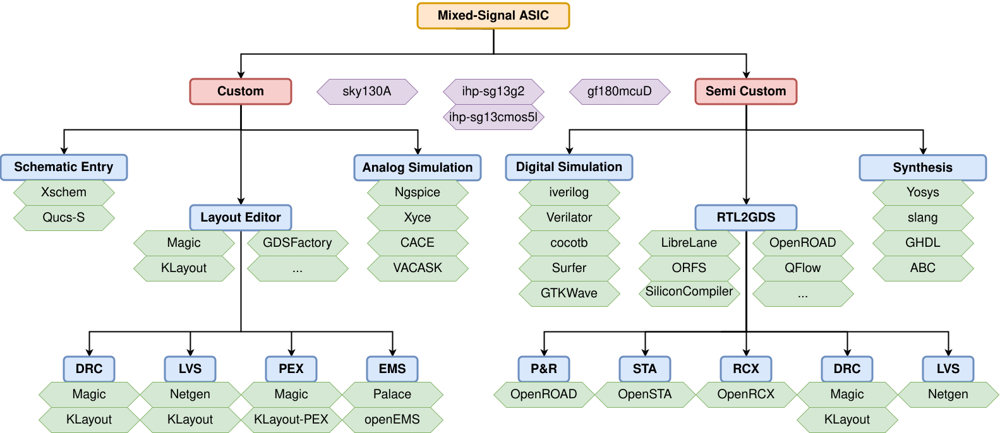{#fig-tools-overview}

## IIC-OSIC-TOOLS Installation {#sec-installation}

The container runs on Linux, macOS, and Windows. The installation instructions are documented in the container's [`README.md`](https://github.com/iic-jku/IIC-OSIC-TOOLS/blob/main/README.md#1-how-to-use-these-open-source-and-free-ic-design-tools). For this tutorial, we recommend the quick one-liner installation.

Additional video walk-throughs are available for Linux and Windows.

::: {.callout-note collapse="true"}

### Ubuntu / Linux installation

- [IIC-OSIC-TOOLS installation on Ubuntu](https://www.youtube.com/watch?v=l8kZUocmY5k)
:::

::: {.callout-note collapse="true"}

### Windows installation

- [IIC-OSIC-TOOLS installation on Windows (from 37:20 to 45:15)](https://www.youtube.com/watch?v=AiFTwKdS2V4)
:::

## PDK Selection {#sec-pdk}

As mentioned above, the container includes four Open-PDKs. To activate or switch the active PDK, the following two options are available. More detailed instructions can be found in the container's [`README.md`](https://github.com/iic-jku/IIC-OSIC-TOOLS/blob/main/README.md#2-installed-pdks).

1. **`.designinit` file:** Copy the [`.designinit`](https://github.com/iic-jku/ihp-sg13g2-ams-chip-template/blob/main/.designinit) file referencing the ihp-sg13g2 PDK into your `designs/` directory and restart the container. The PDK is then picked automatically every time the container is launched in that directory.

2. **On-the-fly switch:** Run

   ```sh
   sak-pdk ihp-sg13g2
   ```

   inside the container. This switches the active PDK for the current session without modifying any file. When called without arguments (`sak-pdk`), a list of installed PDKs is shown.

::: {.callout-tip}
By default, the container is already configured for `ihp-sg13g2`, so both options above are only needed when switching between PDKs. However, since this tutorial can also be used for all other PDKs, it is worth knowing how to switch the active PDK.
:::

Every `Makefile` in this repository guards against a mismatch. All targets except `help` and `clean` (plus `clean-all` at the top level) compare `$PDK` against `REQUIRED_PDK`, which defaults to `ihp-sg13g2`, and abort before any tool starts:

```sh
sak-pdk ihp-sg13cmos5l
make librelane
```

```text
Makefile:27: *** PDK is "ihp-sg13cmos5l", but this chip needs "ihp-sg13g2". Run `sak-pdk ihp-sg13g2` in this shell and retry, or pass REQUIRED_PDK= to skip this check.  Stop.
```

The check is a parse-time conditional at the top of each `Makefile`, not a prerequisite of each target, so it costs nothing and cannot be forgotten when a target is added. Without it a wrong PDK mixes technologies silently: LibreLane hardens against the wrong tech LEF and standard cells, DRC and LVS run against the wrong rule deck, Magic reads the wrong `magicrc`, and the results still look valid.

Since this tutorial can also be followed with another PDK, the expected PDK is a variable. Override it, or switch the check off entirely:

```sh
make <target> REQUIRED_PDK=<pdk>     # require a different PDK
make <target> REQUIRED_PDK=          # skip the check
```

# Repository Overview {#sec-repo}

## Purpose

This Makefile-driven repository simulates, builds, and fully verifies (DRC, LVS, PEX) a complete analog mixed-signal chip for the ihp-sg13g2 130nm Open-PDK, including padframe generation and top-level assembly. It uses:

- [**LibreLane**](https://github.com/librelane/librelane) for digital macro hardening, padframe generation and top-level assembly
- [**Xschem**](https://github.com/StefanSchippers/xschem) for schematic entry
- [**Ngspice**](https://github.com/danchitnis/ngspice-sf-mirror), [**VACASK**](https://codeberg.org/arpadbuermen/VACASK) and [**CACE**](https://github.com/fossi-foundation/cace) for analog simulation
- [**KLayout**](https://github.com/KLayout/klayout) for viewing and routing of the layout
- [**Magic**](https://github.com/rtimothyedwards/magic) + [**Netgen**](https://github.com/rtimothyedwards/netgen) and [**KLayout**](https://github.com/KLayout/klayout) for DRC, LVS and PEX verification
- [**gdscheck**](https://github.com/aesc-silicon/gdscheck) as a third, standalone DRC engine with its own rule decks
- [**AWS Palace**](https://github.com/awslabs/palace), [**gds2palace**](https://github.com/VolkerMuehlhaus/gds2palace_ihp_sg13g2) and [**snp2le**](https://github.com/iic-jku/snp2le) for the EM simulation of RF passives and their lumped-element models
- **SystemVerilog**, [**cocotb**](https://github.com/cocotb/cocotb), [**GTKWave**](https://github.com/gtkwave/gtkwave) and [**Surfer**](https://gitlab.com/surfer-project/surfer) for digital simulation

The repository is the starting point for your own custom silicon and provides a universal design flow solution: Just clone the repo, enter the IIC-OSIC-TOOLS container, and run `make all` to get a tapeout-ready analog mixed-signal chip. Focus on your design and do not worry about the tools and the design flow!

Furthermore, it serves as a regression test for the above-mentioned open-source tools and their dependencies using the ihp-sg13g2 Open-PDK.

## Examples

Examples based on this template are:

- [TinyWhisper](https://github.com/iic-jku/TinyWhisper): An Open-Source Fully-Integrated Multi-Mode Short-Wave Transmitter for Amateur Radio Applications in 130-nm CMOS
- [SPARX](https://github.com/iic-jku/SG13CMOS_SPARX): An Open-Source, Automated, Programmatically Generated, Frequency-Scalable Six-Port Receiver in 130-nm CMOS
- [Multi-Project Chip](https://github.com/iic-jku/gf180mcu-jku-projects) for the wafer.space gf180mcuD MPW run


## Directory Structure

The repository is organised into the following top-level folders. The full listing can be found in the [top-level README.md](https://github.com/iic-jku/ihp-sg13g2-ams-chip-template/blob/main/README.md#directory-structure).

| Folder       | Purpose                                                    |
| ------------ | ---------------------------------------------------------- |
| [`doc/`](https://github.com/iic-jku/ihp-sg13g2-ams-chip-template/tree/main/doc/) | Designer documentation, including [specifications](https://github.com/iic-jku/ihp-sg13g2-ams-chip-template/blob/main/doc/specifications.md), [pinout](https://github.com/iic-jku/ihp-sg13g2-ams-chip-template/blob/main/doc/pinout.md), [floorplan](https://github.com/iic-jku/ihp-sg13g2-ams-chip-template/blob/main/doc/floorplan.md), and the [PDK and tool cheatsheets](https://github.com/iic-jku/ihp-sg13g2-ams-chip-template/blob/main/doc/librelane/librelane_cheatsheet.md). |
| [`flow/`](https://github.com/iic-jku/ihp-sg13g2-ams-chip-template/tree/main/flow/) | LibreLane top-level configuration with [config.yaml](https://github.com/iic-jku/ihp-sg13g2-ams-chip-template/blob/main/flow/librelane/config.yaml), [pdn_cfg.tcl](https://github.com/iic-jku/ihp-sg13g2-ams-chip-template/blob/main/flow/librelane/pdn_cfg.tcl), [chip_top.sdc](https://github.com/iic-jku/ihp-sg13g2-ams-chip-template/blob/main/flow/librelane/chip_top.sdc), plus the [ArtistIC](https://github.com/pulp-platform/artistic) logo flow. |
| [`ip/`](https://github.com/iic-jku/ihp-sg13g2-ams-chip-template/tree/main/ip/) | External IP cells including bondpads, an RF pad, custom IO cells, and logos. |
| [`layout/`](https://github.com/iic-jku/ihp-sg13g2-ams-chip-template/tree/main/layout/) | Compressed GDS streams of the top-level chip, including chip_top.gds.gz and chip_top_logo_fill.gds.gz. |
| [`LICENSES/`](https://github.com/iic-jku/ihp-sg13g2-ams-chip-template/tree/main/LICENSES/) | License texts referenced by the SPDX headers and [REUSE.toml](https://github.com/iic-jku/ihp-sg13g2-ams-chip-template/blob/main/REUSE.toml) annotations. |
| [`macros/`](https://github.com/iic-jku/ihp-sg13g2-ams-chip-template/tree/main/macros/) | Recursive-style macros such as [counter/](https://github.com/iic-jku/ihp-sg13g2-ams-chip-template/tree/main/macros/counter/), [inverter/](https://github.com/iic-jku/ihp-sg13g2-ams-chip-template/tree/main/macros/inverter/) and [vco/](https://github.com/iic-jku/ihp-sg13g2-ams-chip-template/tree/main/macros/vco/), each with its own Makefile and README. |
| [`netlist/`](https://github.com/iic-jku/ihp-sg13g2-ams-chip-template/tree/main/netlist/) | Synthesis, schematic, layout, and PEX netlists used for top-level LVS and simulation. |
| [`packaging/`](https://github.com/iic-jku/ihp-sg13g2-ams-chip-template/tree/main/packaging/) | Automated bondplan generation: config, flow script, package and bondplan GDS, bonding diagrams, and bond report (see @sec-packaging). |
| [`release/`](https://github.com/iic-jku/ihp-sg13g2-ams-chip-template/tree/main/release/) | Tapeout submission artifacts grouped by version. |
| [`render/`](https://github.com/iic-jku/ihp-sg13g2-ams-chip-template/tree/main/render/) | Chip and macro renders used in the documentation. |
| [`rtl/`](https://github.com/iic-jku/ihp-sg13g2-ams-chip-template/tree/main/rtl/) | Top-level RTL sources, including [chip_top.sv](https://github.com/iic-jku/ihp-sg13g2-ams-chip-template/blob/main/rtl/chip_top.sv) and [chip_core.sv](https://github.com/iic-jku/ihp-sg13g2-ams-chip-template/blob/main/rtl/chip_core.sv). |
| [`schematic/`](https://github.com/iic-jku/ihp-sg13g2-ams-chip-template/tree/main/schematic/) | Xschem schematics and symbols for the top-level chip. |
| [`scripts/`](https://github.com/iic-jku/ihp-sg13g2-ams-chip-template/tree/main/scripts/) | Helper Python and shell scripts for the logo and fill step, the PEX symbol, the port checks, and `make project` (see @sec-new-chip). |
| [`testbenches/`](https://github.com/iic-jku/ihp-sg13g2-ams-chip-template/tree/main/testbenches/) | Xschem and cocotb testbenches for the top-level chip. |
| [`tutorial/`](https://github.com/iic-jku/ihp-sg13g2-ams-chip-template/tree/main/tutorial/) | This Quarto tutorial and its supporting materials. |
| [`verification/`](https://github.com/iic-jku/ihp-sg13g2-ams-chip-template/tree/main/verification/) | DRC, LVS, and signoff reports. |

## Workflow

The flow is driven by Makefiles. After cloning the repository and entering the IIC-OSIC-TOOLS container, every step is invoked via a `make` target. The default target of every `Makefile` is `help`, so `make` (without arguments) prints the list of available targets. Every `Makefile` checks the active PDK first and stops on a mismatch, see @sec-pdk. After entering the container, the starting folder is `/foss/designs/`.

```sh
git clone https://github.com/iic-jku/ihp-sg13g2-ams-chip-template.git
cd ihp-sg13g2-ams-chip-template
make help              # show available targets at the top level
```

::: {.callout-tip}
Instead of `git clone`, you can start by clicking the green "Use this template" button on the GitHub page to create your own copy of the repository. This way, you can push your changes to your own GitHub repository and even make it public if you want to share your custom silicon design with the community. When the copy is to become your own chip, `make project NAME=<name>` renames it and removes the template-only content, see @sec-new-chip.
:::

To find and open a design file, run `make open` in the container's VNC/noVNC desktop. It shows one button per design file of the folder, grouped by directory, and a click opens the file in its tool: Xschem for `.sch` and `.sym`, KLayout for `.gds`, GTKWave for waveforms and gvim for RTL, scripts and configs. The checkboxes select the file types, and the filter field keeps only the paths that contain the typed text. @fig-make-open shows the top level with only the schematics and symbols selected. The window is rescanned every 15 s, so files a running flow writes appear on their own. The [top-level README](https://github.com/iic-jku/ihp-sg13g2-ams-chip-template/blob/main/README.md#open-the-design-files) lists every file type and option.

{#fig-make-open}

Each macro under [`macros/`](https://github.com/iic-jku/ihp-sg13g2-ams-chip-template/tree/main/macros/) has its own `Makefile` and `README.md`, including macro-specific targets. These targets are invoked by the top-level build flow, but you can also run them directly from inside each macro folder. @fig-targets-overview shows how the Makefile targets across the repository are connected.

The colour scheme groups targets by the final deliverable they produce, so beginners can follow one colour from `make all` to the generated outputs:

- **Orange (top chip / main)**: This branch includes `make all` and all targets that contribute to the top-level chip GDS. In the `build-top` chain of the [top-level Makefile](https://github.com/iic-jku/ihp-sg13g2-ams-chip-template/blob/main/Makefile), these are `librelane-nodrc`, `copy-*`, `add-logo-fill`, and `render-gds`.
- **Yellow (bondpad IP)**: This branch includes `build-bondpad` and all targets inside [`ip/sg13g2_ip__bondpad_70x70/`](https://github.com/iic-jku/ihp-sg13g2-ams-chip-template/tree/main/ip/sg13g2_ip__bondpad_70x70/).
- **Teal (RF pad IP)**: This branch includes `build-rfpad` and all targets inside [`ip/sg13g2_ip__rfpad_70x70/`](https://github.com/iic-jku/ihp-sg13g2-ams-chip-template/tree/main/ip/sg13g2_ip__rfpad_70x70/).
- **Purple (logos IP)**: This branch includes `build-logos` and the two sub-Makefiles under [`ip/sg13g2_ip__jku/`](https://github.com/iic-jku/ihp-sg13g2-ams-chip-template/tree/main/ip/sg13g2_ip__jku/) and [`ip/sg13g2_ip__jku_names/`](https://github.com/iic-jku/ihp-sg13g2-ams-chip-template/tree/main/ip/sg13g2_ip__jku_names/).
- **Blue (digital macro)**: This branch includes `build-counter` and the [`macros/counter/`](https://github.com/iic-jku/ihp-sg13g2-ams-chip-template/tree/main/macros/counter/) Makefile.
- **Green (analog macro)**: This branch includes `build-inverter` and the [`macros/inverter/`](https://github.com/iic-jku/ihp-sg13g2-ams-chip-template/tree/main/macros/inverter/) Makefile.
- **Red (packaging)**: This branch includes `bondplan` and the automated bondplan flow in [`packaging/`](https://github.com/iic-jku/ihp-sg13g2-ams-chip-template/tree/main/packaging/) (see @sec-packaging).
- **Grey (simulation and verification)**: This branch includes intermediate targets that feed the coloured deliverables (`sim-all`, `build-all`, `build-macros`, `init-submodules`, `sim-*-cocotb`).

Solid arrows represent direct `$(MAKE) <target>` calls within a single Makefile. Dashed arrows represent calls that descend into a subdirectory: recursive `$(MAKE) -C <dir> all` calls into a sub-Makefile (one per coloured deliverable), or the Python bondplan flow in `packaging/`. The numbers on the second level indicate the execution order of `make all` (build, verify, simulate, package), and the vertical order inside the coloured boxes reflects the execution order of each sub-Makefile's `all` target.

{#fig-targets-overview}

### Top-level targets

The [top-level Makefile](https://github.com/iic-jku/ihp-sg13g2-ams-chip-template/blob/main/Makefile) provides:

| Target              | What it does                                                                                          |
| ------------------------------ | ---------------------------------------------------------------------- |
| `make help`         | Print the help banner and list every target with its description.                                     |
| `make open`         | Open the design files of this folder in the `sak-open.py` file browser (needs the VNC/X11 desktop).    |
| `make init-submodules` | Initialise and update git submodules (for example the ArtistIC logo flow).                         |
| `make sim-rtl-cocotb` / `sim-gl-cocotb` | Run the RTL / gate-level (GL) cocotb testbench for the top-level.                       |
| `make sim-gl-xschem` | Run the gate-level Xschem testbench in batch mode (`TB` defaults to `<CELL>_tb_tran`). Part of `sim-all`, but it may take a long time depending on the hardware used. |
| `make sim-view-cocotb` | Open the latest cocotb waveform in GTKWave (or Surfer with `WAVEFORM_VIEWER=surfer`).              |
| `make librelane` / `librelane-nodrc` | Run the LibreLane flow for the top-level (with / without DRC steps).                  |
| `make copy-reports` / `copy-gds` / `copy-netlist` / `copy-render` | Copy the latest LibreLane artifacts back into the source tree. |
| `make build-bondpad` / `build-rfpad` / `build-logos` | Build the bondpad, the RF pad and the logos under `ip/`.         |
| `make build-counter` / `build-inverter` / `build-macros` | Build the digital and analog macros individually or together. |
| `make build-top`    | Run LibreLane on the top-level, copy back all artifacts, add logos and fill structures, and render the final GDS. |
| `make build-all`    | Init submodules, build bondpad, build RF pad, build logos, build macros, and build top-level.             |
| `make klayout-verify` / `magic-verify` | Run DRC, LVS, and PEX with KLayout, or LVS and PEX with Magic, for a given cell.   |
| `make gdscheck-drc` (`DRC_LEVEL=<precheck\|macro\|regular>`, `GDSCHECK_SUITE=<suite>` or `GDSCHECK_DECKS=<decks>`) | Run the standalone gdscheck DRC for a given cell. |
| `make bondplan`     | Generate the bondplan (die in package, bondwires, pin table) in `packaging/` (see @sec-packaging).        |
| `make all`          | Full build, DRC verification, simulation, and bondplan generation.                        |
| `make release VERSION=2.1.0` | Copy GDS, netlists, and renders into `release/v.<VERSION>/` for tapeout submission.          |
| `make clean` / `make clean-all` | Delete the generated files of the chip top-level, or of the chip top-level plus the IPs and the macros. |
| `make project NAME=<name>` | Start a new chip from the template: remove the template-only content and rename `chip_top`, `chip_core` and `chip_logo` (see @sec-new-chip). |

See the [top-level README](https://github.com/iic-jku/ihp-sg13g2-ams-chip-template/blob/main/README.md) for more details and how to use the Makefile targets.

### Digital macro targets

The [counter Makefile](https://github.com/iic-jku/ihp-sg13g2-ams-chip-template/blob/main/macros/counter/Makefile) provides:

| Target                                            | What it does                                                                |
| ----------------------------------- | ----------------------------------------------------------------- |
| `make open`                                       | Open the design files of this folder in the `sak-open.py` file browser.     |
| `make lint-verilog` / `make lint-verilog-all`     | Lint a single cell or the full counter design with Verilator.               |
| `make sim-rtl-verilog`                            | Run the testbench with Icarus Verilog (`<CELL>_tb.sv`, falling back to `<CELL>_tb.v`). |
| `make sim-rtl-cocotb` / `sim-gl-cocotb`           | Run the cocotb RTL / gate-level simulation.                                 |
| `make sim-view-verilog` / `sim-view-cocotb`       | Open the latest waveform in GTKWave or Surfer.                              |
| `make librelane` (and `-nodrc`, `-magicdrc`, …)   | Run the LibreLane flow for the counter macro.                               |
| `make symbol-gl` (`FORCE=1`)                      | Scaffold the Xschem symbol `<CELL>.sym` from the ports of `netlist/pnl/<CELL>.pnl.v`. For a new macro, refuses to overwrite an existing symbol. |
| `make symbol-check`                               | Check that `<CELL>.sym` still describes those ports. Runs automatically before every XSPICE conversion. |
| `make generate-xspice`                            | Convert the LibreLane-extracted SPICE netlist into an XSPICE model for Xschem. |
| `make sim-gl-xschem` / `sim-view-xschem`          | Run the mixed-signal XSPICE simulation in Xschem (batch mode) and plot the results. `TB` defaults to `<CELL>_tb_tran` and `SCRIPT` to `plot_<CELL>`. |
| `make build-fpga`                                 | Run the full FPGA flow: lint, synthesis, P&R, and bitstream generation. The board is selected with `BOARD=` and defaults to the pico-ice. |
| `make build-top`                                  | Run LibreLane, copy reports, netlists, and final views, generate the XSPICE model, and render the final GDS. |
| `make lec` / `lec-mutant`                         | Prove the final netlist equivalent to the RTL with EQY (`LEC_NETLIST` selects another netlist), and check that the proof can fail. |
| `make symbol-pex`                                 | Build the Xschem PEX symbol `<CELL>_pex.sym` from `<CELL>.sym`. Runs automatically before every extraction. |
| `make klayout-pex` / `magic-pex` (`EXT_MODE=<1\|2\|3>`) | Extract the parasitics of the hardened macro from `final/gds/` into `netlist/pex/`. |
| `make all`                                        | Run lint, the FPGA build, the full macro build flow, the equivalence check, the parasitic extraction, and all simulations. |
| `make clean`                                      | Delete all generated files and folders of the macro, including the FPGA outputs. |

See the [counter README](https://github.com/iic-jku/ihp-sg13g2-ams-chip-template/blob/main/macros/counter/README.md) for more details and how to use the Makefile targets.

### Analog macro targets

The [inverter Makefile](https://github.com/iic-jku/ihp-sg13g2-ams-chip-template/blob/main/macros/inverter/Makefile) provides:

| Target                                            | What it does                                                                |
| ----------------------------------- | ----------------------------------------------------------------- |
| `make open`                                       | Open the design files of this folder in the `sak-open.py` file browser.     |
| `make sim-xschem` / `make sim-view-xschem`        | Run an Xschem testbench (batch mode) and plot its results with Python. `TB` defaults to `<CELL>_tb_tran` and `SCRIPT` to `plot_<CELL>`, override with `TB=<tb>` / `SCRIPT=<script>`. |
| `make sim-cace`                                   | Run [CACE](https://github.com/fossi-foundation/cace) Monte Carlo / mismatch characterisations. |
| `make klayout-drc` / `magic-drc` (`DRC_LEVEL=<precheck\|macro\|regular>`) | Run DRC using KLayout or Magic.                       |
| `make gdscheck-drc` / `gdscheck-drc-all` (`GDSCHECK_SUITE=<suite>` or `GDSCHECK_DECKS=<decks>`) | Run the standalone gdscheck DRC for a given cell, or for `inverter` and `inverter_top`. |
| `make klayout-lvs` / `magic-lvs`                  | Run LVS using KLayout or Magic + Netgen.                                    |
| `make symbol-pex`                                 | Build the Xschem PEX symbol `<CELL>_pex.sym` from `<CELL>.sym`. Runs automatically before every extraction. |
| `make klayout-pex` / `magic-pex` (`EXT_MODE=<1\|2\|3>`) | Run parasitic extraction in C, CC, or full-RC mode.                     |
| `make klayout-verify` / `magic-verify`            | Run DRC + LVS + PEX with KLayout, or LVS + PEX with Magic, for a given cell. |
| `make lef` / `make lib` / `make verilog`          | Generate the LEF, the Liberty stub, and the Verilog stub for top-level integration.   |
| `make check-boundary`                             | Check that the top cell layout carries the PR boundary box on layer 189 that the chip flow needs. |
| `make build-top`                                  | Build the analog macro deliverables: PR boundary check, LEF, LIB, Verilog stub, GDS and rendered layout image. |
| `make all`                                        | Run the KLayout, gdscheck and Magic verification, the analog macro build flow, and all simulations. |
| `make clean`                                      | Delete all generated files and folders of the macro, including the CACE outputs. |

See the [inverter README](https://github.com/iic-jku/ihp-sg13g2-ams-chip-template/blob/main/macros/inverter/README.md) for more details and how to use the Makefile targets.

### RF macro targets

The [vco Makefile](https://github.com/iic-jku/ihp-sg13g2-ams-chip-template/blob/main/macros/vco/Makefile) provides every target of the inverter except `sim-cace`, plus:

| Target                                            | What it does                                                                |
| ----------------------------------- | ----------------------------------------------------------------- |
| `make klayout-script` / `klayout-script-all`      | Write `layout/<CELL>.gds` with the KLayout Python script `scripts/layout/<CELL>.py`, or every layout, subcells first. |
| `make sim-em` (`NP=<processes>`)                  | Run the EM simulation of the coil with gds2palace and AWS Palace.           |
| `make copy-sparam` / `make view-em-sim`           | Copy the Touchstone file of the EM simulation to `verification/em/s-parameter/`, and plot it. |
| `make snp2le` (`LE_MODEL=<structure\|universal>`) | Fit a lumped-element model to the Touchstone file, for ngspice and VACASK.  |
| `make em-model`                                   | Run `sim-em`, `copy-sparam`, `snp2le` and the ACSP testbench of the coil model. |
| `make sim-corners` (`TB=<tb>`)                    | Run a start-up transient over MOS and resistor corners, temperatures, `VDD` and `vtune`. |
| `make sim-tune-lpe`                               | Run the post-layout tuning curve, one ngspice transient per tuning voltage at TT and 27 C. |
| `make klayout-pex-leads`                          | Extract `vco_top` without the coil and the varactor array for the post-layout testbench. |
| `make klayout-drc-regular`                        | Run the KLayout DRC of `vco_top` at the regular level, where only the densities the chip's fill meets may fail. |
| `make sim-powerup` (`SIM_JOBS=<n>`)               | Run the post-layout power-up and enable transient over the orders of `VDD` and `di_en`, hours on a compute host. |
| `make sim-trannoise` / `sim-trannoise-lpe` (`SEEDS=<n>`) | Run the transient noise of the schematic against PNOISE, or of the post-layout netlist, hours on a compute host. |
| `make sim-pss-lpe`                                 | Run the PSS, PNOISE and PAC of the post-layout netlist, about 1.5 hours on a compute host. |
| `make all`                                        | Write the layouts, verify, build and simulate, without the EM simulation, the corners and the long runs. |

See the [vco README](https://github.com/iic-jku/ihp-sg13g2-ams-chip-template/blob/main/macros/vco/README.md) and @sec-rf for more details.


# Digital Macro Implementation {#sec-digital}

The [`counter`](https://github.com/iic-jku/ihp-sg13g2-ams-chip-template/tree/main/macros/counter/) macro is the digital reference macro of the template. It is a parameterisable synchronous up-counter with synchronous active-high reset implemented with SystemVerilog in [`counter.sv`](https://github.com/iic-jku/ihp-sg13g2-ams-chip-template/blob/main/macros/counter/rtl/counter.sv). The top-level wrapper [`counter_top.sv`](https://github.com/iic-jku/ihp-sg13g2-ams-chip-template/blob/main/macros/counter/rtl/counter_top.sv) converts the chip's active-low reset to an active-high signal. The default width is 8 bits, so the counter wraps from 255 back to 0.

## Directory Structure

The counter design files are located in [`macros/counter/`](https://github.com/iic-jku/ihp-sg13g2-ams-chip-template/tree/main/macros/counter/), and the relevant folders are:

| Folder                                       | Content                                                                                  |
| ---------------------------------------- | ---------------------------------------------------------------------------------------- |
| [`rtl/`](https://github.com/iic-jku/ihp-sg13g2-ams-chip-template/tree/main/macros/counter/rtl/)             | SystemVerilog sources: [`constants.sv`](https://github.com/iic-jku/ihp-sg13g2-ams-chip-template/blob/main/macros/counter/rtl/constants.sv), [`counter.sv`](https://github.com/iic-jku/ihp-sg13g2-ams-chip-template/blob/main/macros/counter/rtl/counter.sv), [`counter_top.sv`](https://github.com/iic-jku/ihp-sg13g2-ams-chip-template/blob/main/macros/counter/rtl/counter_top.sv). |
| [`testbenches/`](https://github.com/iic-jku/ihp-sg13g2-ams-chip-template/tree/main/macros/counter/testbenches/) | `verilog/`, `cocotb/`, and `xschem/` testbenches with pre-configured GTKWave and Surfer view files. |
| [`flow/`](https://github.com/iic-jku/ihp-sg13g2-ams-chip-template/tree/main/macros/counter/flow/)           | LibreLane configuration (`config.yaml`, `pin_order.cfg`, `impl.sdc`, `signoff.sdc`). |
| [`final/`](https://github.com/iic-jku/ihp-sg13g2-ams-chip-template/tree/main/macros/counter/final/)         | Final deliverables (GDS, LEF, LIB per corner, NL, PNL, SPEF, VH) copied from the latest LibreLane run for top-level integration. |
| [`fpga/`](https://github.com/iic-jku/ihp-sg13g2-ams-chip-template/tree/main/macros/counter/fpga/)           | Optional FPGA emulation flow for three boards (pico-ice, iCEBreaker, ULX3S).    |
| [`netlist/`](https://github.com/iic-jku/ihp-sg13g2-ams-chip-template/tree/main/macros/counter/netlist/)     | `nl/`, `pnl/`, `spice/` and `xspice/` netlists (see [LibreLane cheatsheet](https://github.com/iic-jku/ihp-sg13g2-ams-chip-template/blob/main/doc/librelane/librelane_cheatsheet.md#3-netlists--circuit-views) for more details). |
| [`schematic/`](https://github.com/iic-jku/ihp-sg13g2-ams-chip-template/tree/main/macros/counter/schematic/) | Xschem symbol of the macro for use in mixed-signal Xschem testbenches.                                       |
| [`scripts/`](https://github.com/iic-jku/ihp-sg13g2-ams-chip-template/tree/main/macros/counter/scripts/)     | Helper scripts (XSPICE conversion, plotting, layout rendering).                        |
| [`verification/`](https://github.com/iic-jku/ihp-sg13g2-ams-chip-template/tree/main/macros/counter/verification/) | Yosys, antenna, STA, IR-drop, DRC, LVS, and manufacturability reports.            |
| [`render/`](https://github.com/iic-jku/ihp-sg13g2-ams-chip-template/tree/main/macros/counter/render/)       | Macro renders for documentation.                                                       |

::: {.callout-tip}
Read the [counter README](https://github.com/iic-jku/ihp-sg13g2-ams-chip-template/blob/main/macros/counter/README.md) first to get familiar with the folder layout and the available Makefile targets. Most of the commands below are documented there as well.
:::

## Reading the RTL

The macro is split into a parameterised counter and a top-level wrapper that converts the chip's active-low reset to the internal active-high reset of the counter.

### `counter.sv`

The logic is implemented in [`counter.sv`](https://github.com/iic-jku/ihp-sg13g2-ams-chip-template/blob/main/macros/counter/rtl/counter.sv). It is an $N$-bit synchronous up-counter with reset and enable, and it wraps at `CTR_MAX`. $N$ defaults to 8, so the counter counts from 0 to 255 and then wraps back to 0.

```{.systemverilog filename="macros/counter/rtl/counter.sv"}

```

### `counter_top.sv`

[`counter_top.sv`](https://github.com/iic-jku/ihp-sg13g2-ams-chip-template/blob/main/macros/counter/rtl/counter_top.sv) wraps the counter and converts the active-low reset (`reset_n_i`) to an active-high signal `reset`.

```{.systemverilog filename="macros/counter/rtl/counter_top.sv"}

```

Shared defaults are defined in [`constants.sv`](https://github.com/iic-jku/ihp-sg13g2-ams-chip-template/blob/main/macros/counter/rtl/constants.sv). For example, for the final implementation, the maximum counter value is defined in `constants.sv` with the variable `COUNTER_MAX_DEFAULT`. For the testbenches, `CLK_FREQ_DEFAULT` is defined there to set the default clock frequency (e.g. 50 MHz) for the simulations. They are exposed as `` `define `` macros instead of a SystemVerilog `package`, because Yosys 0.64 cannot parse `import pkg::*` in a module header.

::: {.callout-note}
Open the three RTL files (using `gedit` or `vim`), follow and understand the counter through reset, hold, increment, and wrap-around.
:::

## Linting

[Linting](https://en.wikipedia.org/wiki/Lint_(software)) is done with [Verilator](https://www.veripool.org/verilator/) and can be executed with the following commands.

```sh
cd macros/counter
make lint-verilog                # lint the full counter_top design
make lint-verilog CELL=counter   # lint only the standalone counter
make lint-verilog-all            # lint counter and counter_top in sequence
```

`make lint-verilog-all` is also the lint step called by `make all`.

## Simulation

### RTL with SystemVerilog testbench (Icarus Verilog)

A SystemVerilog testbench ([`counter_top_tb.sv`](https://github.com/iic-jku/ihp-sg13g2-ams-chip-template/blob/main/macros/counter/testbenches/verilog/counter_top_tb.sv)) checks reset, hold, increment, and wrap-around. Run it with the following commands.

```sh
make sim-rtl-verilog
make sim-view-verilog               # open in GTKWave (default)
make sim-view-verilog WAVEFORM_VIEWER=surfer
```

{#fig-counter-top-verilog-gtkwave}

### RTL and gate-level with cocotb

The [cocotb](https://www.cocotb.org/) testbench ([`counter_top_tb.py`](https://github.com/iic-jku/ihp-sg13g2-ams-chip-template/blob/main/macros/counter/testbenches/cocotb/counter_top_tb.py)) checks the same four cases (reset, hold, increment, and wrap-around) as the SystemVerilog testbench, but implements them in Python.

```sh
make sim-rtl-cocotb                # RTL simulation
make sim-gl-cocotb                 # post-synthesis gate-level simulation
make sim-view-cocotb               # view in GTKWave
make sim-view-cocotb WAVEFORM_VIEWER=surfer
```

{#fig-counter-top-cocotb-gtkwave}

The gate-level cocotb run uses the gate-level Verilog netlist produced after synthesis: [`netlist/nl/counter_top.nl.v`](https://github.com/iic-jku/ihp-sg13g2-ams-chip-template/tree/main/macros/counter/netlist/nl/). In this tutorial, this netlist for the counter already exists. For new designs, run `make build-top` first to execute the LibreLane flow. It also copies the netlists from the latest LibreLane run back into the source tree with `make copy-netlist`.

## LibreLane Hardening

The LibreLane flow synthesises, places, and routes the macro, runs the verification steps, and writes its final output files to `flow/final/`. The wrapper target `make build-top` runs the flow, renders the final GDS, and copies the reports, final folders, netlists, and render output back into the source tree.

```sh
make build-top
```

::: {.callout-tip}
The macro can also be built as an FPGA bitstream ([`fpga/`](https://github.com/iic-jku/ihp-sg13g2-ams-chip-template/tree/main/macros/counter/fpga/)) with `make build-fpga`. `counter_top` is synthesised straight onto board pins, without a board-top wrapper, and three boards are supported: pico-ice and iCEBreaker (Lattice iCE40) and ULX3S (Lattice ECP5). Pick one with `make build-fpga` for the default pico-ice, or `make -C fpga BOARD=ulx3s all` for another. IIC-OSIC-TOOLS carries the build chain for all three boards, so the bitstreams build inside the container, and only flashing needs the host, since the container has no USB access. Details are in [`fpga/README.md`](https://github.com/iic-jku/ihp-sg13g2-ams-chip-template/blob/main/macros/counter/fpga/README.md). The FPGA flow is not used in this tutorial and is only listed here for reference.
:::

### Sizing the Macro {#sec-hardening-sizing}

Three parameters in [`config.yaml`](https://github.com/iic-jku/ihp-sg13g2-ams-chip-template/blob/main/macros/counter/flow/librelane/config.yaml) decide how compact and how fast the hardened macro is.

```{.yaml filename="macros/counter/flow/librelane/config.yaml (code snippet)"}
# Layout / Floorplan Rules
DIE_AREA: [0, 0, 200, 100]
PL_TARGET_DENSITY_PCT: 40

# Valid values are AREA 0-3 and DELAY 0-4, LibreLane defaults to AREA 0
# DELAY favours speed, AREA favours cell area
# AREA 3 and DELAY 4 always add buffering and gate sizing, so AREA 3 can be larger than AREA 0
SYNTH_STRATEGY: DELAY 4
```

- **`DIE_AREA`** is the macro outline `[x0, y0, x1, y1]` in µm (`FP_SIZING: absolute`). The standard-cell rows fill a core area inside it, which is 188 µm × 68 µm for the counter. The aspect ratio matters as much as the area: the outline has to fit the slot of the macro in the top-level floorplan and leave room for the pins listed in [`pin_order.cfg`](https://github.com/iic-jku/ihp-sg13g2-ams-chip-template/blob/main/macros/counter/flow/librelane/pin_order.cfg).
- **`PL_TARGET_DENSITY_PCT`** is the cell density that global placement aims for. At 40 %, the placer spreads the cells so that most of the core stays free for the clock tree, the buffers added during timing repair, and the routing. The target should stay above the utilisation (cell area divided by free core area), which global placement prints as `Utilization` in its log. A lower target triggers the warning `[GPL-0302] Target density 0.4000 is too low for the available free area`, and global placement then raises the target to the utilisation on its own.
- **`SYNTH_STRATEGY`** selects the ABC script that Yosys uses for logic optimisation and technology mapping. The `AREA 0` to `AREA 3` scripts favour a small cell area, the `DELAY 0` to `DELAY 4` scripts favour short critical paths. `AREA 0` is the LibreLane default. `AREA 3` and `DELAY 4` always add buffering and gate sizing, so in the test runs below, the counter synthesised to 675 µm² with `AREA 0`, 704 µm² with `DELAY 0`, 720 µm² with `AREA 3`, and 742 µm² with `DELAY 4`. The best strategy for a design is found by trying.

No formula gives the right values up front. They are found iteratively. A run of a small macro takes only a few minutes (`make librelane-nodrc` skips the DRC steps), and the following procedure converges within a handful of runs.

1. **Start large and balanced.** Set a generous `DIE_AREA`, several times the cell area that Yosys reports in [`verification/stat.rpt`](https://github.com/iic-jku/ihp-sg13g2-ams-chip-template/blob/main/macros/counter/verification/stat.rpt), and a balanced strategy such as `AREA 0` or `DELAY 0`. This run finishes quickly and gives the reference values for cell area, utilisation, and timing slack.
2. **Shrink the die until placement complains.** Reduce `DIE_AREA` step by step and leave `PL_TARGET_DENSITY_PCT` unchanged. The first complaint is the `[GPL-0302]` warning, which means the die is now too small for the target density. The run can still finish, but shrinking further ends in a hard error, typically `[DPL-0036] Detailed placement failed` once the buffers added by design repair, clock tree synthesis, or timing repair no longer fit.
3. **Step back.** Enlarge the die again until the warning is gone and run the full flow. The result places, routes, and meets timing at the configured density, and it is the starting point for the next step. A denser macro is possible by raising `PL_TARGET_DENSITY_PCT` on purpose, at the cost of less room for routing and timing repair.
4. **Trade timing slack for area.** Read the worst setup slack in the slowest corner (`nom_slow_1p08V_125C`). If there is margin left, switch to a strategy with a smaller cell area (the `Chip area` line in `*-yosys-synthesis/reports/stat.rpt` of the run) and repeat steps 2 and 3, since a smaller cell area allows a smaller die. If setup fails, move towards `DELAY`, up to `DELAY 4`, or give the placer more room.

Each iteration changes only two values and reads back a few numbers, so the loop can also be scripted or handed to a coding agent. After every run, check the following in the run folder `flow/librelane/runs/<run>/`:

- `warning.log`: the `[GPL-0302]` warning, among others.
- `final/metrics.csv`: `design__instance__utilization`, `timing__setup__ws`, `timing__hold__ws`, and `route__drc_errors`.
- `*-openroad-stapostpnr/summary.rpt`: worst setup and hold slack and the violation counts in all six STA corners. `make copy-reports` copies it to [`verification/stapostpnr_summary.rpt`](https://github.com/iic-jku/ihp-sg13g2-ams-chip-template/blob/main/macros/counter/verification/stapostpnr_summary.rpt).

The counter sits far from these limits. In test runs at the configured 200 µm × 100 µm, global placement reported a utilisation of 6.3 % against the target of 40 %, and the worst setup slack was 13.4 ns of the 20 ns clock period. At the same target density, the counter placed without the warning at 100 µm × 60 µm (34 % utilisation), warned but still routed and met timing at 70 µm × 60 µm (52 %), and failed detailed placement at 60 µm × 60 µm (62 %). The runs that finished kept about 13.5 ns of setup slack. With `AREA 0` instead of `DELAY 4`, the 60 µm × 60 µm die routed and met timing as well, which is step 4 at work. Repeating these runs is a good first exercise.

::: {.callout-note}
The configuration sets `GRT_ALLOW_CONGESTION: true`, so global routing continues despite overflow. A die that is too small to route then shows up as detailed routing DRC errors, and the `Checker.TrDRC` step stops the flow.
:::

::: {.callout-important}
A new die size changes the LEF of the macro. Update its placement in the `MACROS` block of the top-level [`config.yaml`](https://github.com/iic-jku/ihp-sg13g2-ams-chip-template/blob/main/flow/librelane/config.yaml) and in [`doc/floorplan.md`](https://github.com/iic-jku/ihp-sg13g2-ams-chip-template/blob/main/doc/floorplan.md) (see @sec-top). The copy targets take the newest run in `flow/librelane/runs/`, so finish with `make build-top` on the final values.
:::

### Standard Cell Libraries {#sec-hardening-libraries}

The PDK in the IIC-OSIC-TOOLS container ships three standard cell libraries, and the counter hardens on the first one: the IHP low-voltage library `sg13g2_stdcell` (IHP LV), the IHP high-voltage library `sg13g2_stdcell_hv` (IHP HV), and version 1.1 of [`ez130_8t`](https://iip.ethz.ch/ez-library/ihp130-8t.html) (ETH LV), an [open library from ETH Zurich](https://arxiv.org/abs/2609.29965) on the same thin-oxide transistors as IHP LV, available since image tag `2026.10`. The following numbers are read from the library views.

| | IHP LV | IHP HV | ETH LV |
|---|---|---|---|
| Library | `sg13g2_stdcell` | `sg13g2_stdcell_hv` | `ez130_8t` |
| Row height | 3.78 µm | 7.14 µm | 3.36 µm |
| Tracks per row at 0.42 µm pitch | 9 | 17 | 8 |
| Site width | 0.48 µm | 0.48 µm | 0.42 µm |
| Transistors | `sg13_lv_*` | `sg13_hv_*` | `sg13_lv_*` |
| Liberty corners | 1.08 V to 1.65 V (6) | 3.0 V to 3.6 V (3) | 1.08 V to 1.32 V (3) |
| Cells in Liberty / LEF | 84 / 84 | 84 / 84 | 214 / 220 |
| Combinational functions | 28 | 28 | 61 |
| Buffer drive strengths | 5 | 5 | 13 |
| Inverter (`inv_1`, `INVX3`) | 5.44 µm² | 13.71 µm² | 4.23 µm² |
| Flip-flop with asynchronous reset (`dfrbpq_1`, `DFFRQX3`) | 48.99 µm² | 147.37 µm² | 28.22 µm² |
| Flip-flop without reset (`DFFQX1`) | none | none | 22.58 µm² |
| Well and substrate ties | in every cell | in every cell | separate `WELLTAP` cell |
| Dynamic power data in Liberty | yes | no | yes |
| Views besides Liberty, LEF, GDS, Verilog, CDL | SPICE, Xschem, VACASK | SPICE, Xschem | none |
| LibreLane configuration in the PDK | yes | yes | no |

So IHP LV is a 9-track library and ETH LV an 8-track library. IHP HV is neither: its thick-oxide cells need 17 tracks. Rows of different height do not abut, so the library is a choice per macro.

Every combinational function of IHP LV also exists in ETH LV, and ETH LV adds 33 more. IHP HV has the same cell set as IHP LV. ETH LV additionally has:

- **Arithmetic:** the full adder `FAX1`, the half adder `HAX2`, the minority gate `MIN3X*`, and the three-input `XOR3X*` and `XNOR3X*`.
- **Multiplexer:** the inverting `MUXI2X*`.
- **Complex gates:** `AO211`, `AO22`, `AO31`, `AOI211`, `AOI31`, `OA21`, `OA211`, `OAI22`, `OAI211`, `OAI221`, `OAI31`, `AOAI211` and `OAOI211`.
- **Gates with inverted inputs:** `AND3B`, `OR3B`, `NAND4B`, `NAND4BB`, `NOR3B`, `NOR4B`, `NOR4BB`, `AOI21B`, `AOI2B1`, `AOI2B2`, `AOI2B2B`, `AOI2BB2`, `OAI2BB2` and `OAI2B2B`.
- **Sequential cells:** the flip-flop without reset `DFFQX*`, the flip-flop banks `DFFRQ2X*` (2 bits) and `DFFRQ4X*` (4 bits, double height) with a shared clock and reset, which the open flow does not infer, and the active-low latch without reset `LATNQX*`.
- **Physical cells:** `WELLTAP`, `FILLER16`, `DECAP16`, `DECAP32`, and the antenna diodes `ANTENNA2`, `ANTENNA4` and `ANTENNA8`.

IHP LV keeps a few cells that ETH LV lacks: the bus keeper `sg13g2_sighold`, the scan flip-flop with set and reset `sg13g2_sdfbbp_1`, and three delay gates against the single `DLY1X2`.

The drive digit is not comparable between the libraries. `BUFX3` has the `max_capacitance` of `sg13g2_buf_1` (0.3 pF), `BUFX12` that of `sg13g2_buf_4` and `BUFX48` that of `sg13g2_buf_16`. A cell with the same drive is smaller by the ratio of the sites, (0.42 × 3.36) / (0.48 × 3.78) = 0.78, and the flip-flops shrink more than that. `INVX1`, `INVX2` and `INVX3` even share one footprint and differ only in transistor width, so a higher digit costs no area but more input capacitance.

The library is selected in [`config.yaml`](https://github.com/iic-jku/ihp-sg13g2-ams-chip-template/blob/main/macros/counter/flow/librelane/config.yaml). `STD_CELL_LIBRARY` alone is not enough, because the configuration also names the Liberty files and the corners of IHP LV. For IHP HV, replace the block from `# Define Standard Cells` to `DEFAULT_CORNER` with the following lines. The PDK configuration of the library supplies the rest.

<details>
<summary>Configuration for IHP HV</summary>

```yaml
# Define Standard Cells
STD_CELL_LIBRARY: sg13g2_stdcell_hv

# Technology LIBs
LIB:
  "*_fast_3p60V_m40C":
    - pdk_dir::libs.ref/sg13g2_stdcell_hv/lib/sg13g2_stdcell_hv_fast_3p60V_m40C.lib

  "*_slow_3p00V_125C":
    - pdk_dir::libs.ref/sg13g2_stdcell_hv/lib/sg13g2_stdcell_hv_slow_3p00V_125C.lib

  "*_typ_3p30V_25C":
    - pdk_dir::libs.ref/sg13g2_stdcell_hv/lib/sg13g2_stdcell_hv_typ_3p30V_25C.lib

# Corners
STA_CORNERS:
  - nom_fast_3p60V_m40C
  - nom_slow_3p00V_125C
  - nom_typ_3p30V_25C

DEFAULT_CORNER: nom_typ_3p30V_25C
```

</details>

ETH LV takes more. The image ships its views but no LibreLane configuration, so `STD_CELL_LIBRARY: ez130_8t` stops right away with `no files matched glob pattern .../ez130_8t/lef/sg13g2_tech.lef`. Keep the name of the default library instead and replace everything it implies. Replace the same block with the first of the following two listings, and save the second one as `tracks_ez130.info` next to `config.yaml`.

<details>
<summary>Configuration for ETH LV</summary>

```yaml
# Define Standard Cells
# The name stays at the PDK default, every view it implies is replaced below
STD_CELL_LIBRARY: sg13g2_stdcell

# Views
TECH_LEFS:
  "*": pdk_dir::libs.ref/ez130_8t/lef/ez130_sg13g2_tech.lef
CELL_LEFS: [pdk_dir::libs.ref/ez130_8t/lef/ez130_8t.lef]
CELL_GDS: [pdk_dir::libs.ref/ez130_8t/gds/ez130_8t.gds]
CELL_VERILOG_MODELS: [pdk_dir::libs.ref/ez130_8t/verilog/ez130_8t.v]
CELL_SPICE_MODELS: [pdk_dir::libs.ref/ez130_8t/cdl/ez130_8t.cdl]
CELL_CDLS: [pdk_dir::libs.ref/ez130_8t/cdl/ez130_8t.cdl]
FP_TRACKS_INFO: dir::tracks_ez130.info

# Well and substrate ties
WELLTAP_CELL: WELLTAP
FP_TAPCELL_DIST: 20

# Role cells, matched to the IHP LV defaults on max_capacitance
SYNTH_DRIVING_CELL: BUFX12/Y
SYNTH_CLK_DRIVING_CELL: BUFX12/Y
SYNTH_BUFFER_CELL: BUFX3/A/Y
SYNTH_TIEHI_CELL: TIEHI/Y
SYNTH_TIELO_CELL: TIELO/Y
FILL_CELLS: [FILLER1, FILLER2, FILLER4, FILLER8, FILLER16]
DECAP_CELLS: [DECAP4, DECAP8, DECAP16, DECAP32]
CELL_PAD_EXCLUDE: ["FILLER*", "DECAP*"]
TRISTATE_CELLS: ["TBUFX*", "TINVX*"]
DIODE_CELL: ANTENNA2/A
PDN_RAIL_WIDTH: 0.32
CTS_ROOT_BUFFER: BUFX48
CTS_CLK_BUFFERS: [BUFX24, BUFX12, BUFX6]

# Technology LIBs
LIB:
  "*_fast_1p32V_m40C":
    - pdk_dir::libs.ref/ez130_8t/lib/ez130_8t_ff_1p32v_m40c.lib

  "*_slow_1p08V_125C":
    - pdk_dir::libs.ref/ez130_8t/lib/ez130_8t_ss_1p08v_125c.lib

  "*_typ_1p20V_25C":
    - pdk_dir::libs.ref/ez130_8t/lib/ez130_8t_tt_1p20v_25c.lib

# Corners
STA_CORNERS:
  - nom_fast_1p32V_m40C
  - nom_slow_1p08V_125C
  - nom_typ_1p20V_25C

DEFAULT_CORNER: nom_typ_1p20V_25C
```

</details>

<details>
<summary>Track File for ETH LV</summary>

```text
Metal1 X 0.21 0.42
Metal1 Y 0.0 0.42
Metal2 X 0.21 0.42
Metal2 Y 0.0 0.42
Metal3 X 0.21 0.42
Metal3 Y 0.0 0.42
Metal4 X 0.21 0.42
Metal4 Y 0.0 0.42
Metal5 X 0.21 0.42
Metal5 Y 0.0 0.42
TopMetal1 X 0.0 3.36
TopMetal1 Y 0.0 3.36
TopMetal2 X 0.0 4.0
TopMetal2 Y 0.0 4.0
```

</details>

- `TECH_LEFS`: `ez130_8t` has its own technology LEF with a 0.42 µm vertical routing pitch and the site of 0.42 µm × 3.36 µm. The stock `sg13g2_tech.lef` does not fit the cells.
- `FP_TRACKS_INFO`: the file follows that LEF. With the tracks of the PDK, detailed routing still reports 0 errors, but on the counter Magic then flags 41 and KLayout 5 `M1.b` errors.
- `WELLTAP_CELL`: the cells carry no well and substrate ties. Without tap cells, routing, LVS, antenna and timing stay clean, and only DRC fails: 3914 `LU.a` and `LU.b` errors in Magic and 49 `LU.b` errors in KLayout. With taps every 20 µm the counter gets 103 tap cells (436 µm²).
- `CELL_SPICE_MODELS`: the library ships no SPICE view, so the CDL also serves LVS.
- Role cells: the digit is matched on `max_capacitance`, as explained above. A smaller clock buffer is worth trying, see the bonus of @sec-exercise6.
- Not in the block, since the counter does not need them: `SYNTH_LATCH_MAP` and `SYNTH_TRISTATE_MAP` still name IHP LV cells, so a design with latches or tri-states needs its own maps. `SYNTH_EXCLUDED_CELL_FILE` and `PNR_EXCLUDED_CELL_FILE` still list IHP LV cells, which is harmless apart from the `[STA-0122] cell 'sg13g2_lgcp_1' not found` warnings, but they leave the clock gates and the scan flip-flop of ETH LV selectable.

With these changes `make librelane` runs through on all three libraries with 0 DRC, LVS and antenna errors and timing met. The targets after LibreLane are still written for IHP LV:

| Target | IHP HV | ETH LV |
|---|---|---|
| `make librelane`, `librelane-nodrc` | works | works |
| `make copy-final`, `copy-netlist`, `copy-render`, `render-gds`, `magic-pex` | works | works |
| `make copy-reports`, and with it `make build-top` | stops, it names the six IHP LV corners | stops for the same reason |
| `make generate-xspice` | exits 0 with an empty model, because the recipe names the IHP LV Liberty. With the HV Liberty in the recipe and 3.3 V in the testbench, `make sim-gl-xschem` counts | exits 0 with an empty model, and `spi2xspice.py` cannot read the ETH Liberty yet |
| `make sim-gl-cocotb` | passes with `SCL=sg13g2_stdcell_hv` | fails with `SCL=ez130_8t`: the library has no `sg13g2_udp.v` and no Verilog models for `WELLTAP` and `FILLER*`. It passes after dropping that source and adding empty modules |

::: {.callout-warning}
`make copy-reports` deletes `verification/` before it stops, and `make copy-final` and `make copy-netlist` overwrite committed files. Restore them with `git restore .` in `macros/counter/` after trying another library.
:::

::: {.callout-important collapse="true"}
## Consequences at the chip top-level

The library of a macro also has consequences at the chip top-level. The template chip runs its core at 1.5 V ([`doc/specifications.md`](https://github.com/iic-jku/ihp-sg13g2-ams-chip-template/blob/main/doc/specifications.md)), which is outside the 1.08 V to 1.32 V of ETH LV, so a chip with an ETH LV macro has to run its core at 1.2 V. A test run of the chip with the ETH LV counter routes with 0 errors and LVS matches, where LVS at the chip top-level compares the macro by its pins and its interior is checked in its own LibreLane run. It takes three changes in the top-level [`config.yaml`](https://github.com/iic-jku/ihp-sg13g2-ams-chip-template/blob/main/flow/librelane/config.yaml): remove the three corners above 1.32 V from `STA_CORNERS` and from the `lib` list of `counter_top`, set `DEFAULT_CORNER: nom_typ_1p20V_25C`, and add `STA_MACRO_PRIORITIZE_NL: false`, which makes STA read the timing model in `final/lib/` of the macro and not its netlist. Without that line STA finds no Liberty for the ETH LV cells and turns them into black boxes, so all paths through the counter disappear, and only the `Creating black box` lines in `sta.log` give it away. With it, the worst setup slack through a counter is +10.43 ns against +10.50 ns with IHP LV in the same mode, while the worst path of the chip starts at the SRAM and reads +2.30 ns with both. The hold slack from `rst_n_PAD` into `counter2` drops to +0.11 ns against +0.36 ns in the fast corner at 1.32 V. The full-chip DRC was not part of that test. An IHP HV macro needs a 3.3 V domain and level shifters towards the core, which the template chip does not have.
:::

## Viewing the Macro

After the flow finishes, the macro layout can be inspected with KLayout. The container provides the `ke` alias for `klayout -e` (edit mode). With the following command, the final GDS from the latest LibreLane run is opened in KLayout. With the keys `0`, `1`, `2`, ..., `9` you can view different layers as explained in the [KLayout cheatsheet](https://github.com/iic-jku/ihp-sg13g2-ams-chip-template/blob/main/doc/klayout/klayout_cheatsheet.md) or in the [klayout-layer-shortcuts](https://github.com/iic-jku/klayout-layer-shortcuts) plugin.

```sh
ke final/gds/counter_top.gds
```

{#fig-counter-top-layout}

The LibreLane render is copied to [`render/img/counter_top_librelane.png`](https://github.com/iic-jku/ihp-sg13g2-ams-chip-template/tree/main/macros/counter/render/img/), and the high-resolution renders from `sak-render.py` are saved as `counter_top_white.png` and `counter_top_black.png` in the same folder. The verification reports are written to [`verification/`](https://github.com/iic-jku/ihp-sg13g2-ams-chip-template/tree/main/macros/counter/verification/).

## RTL Mixed-Signal Simulation with Xschem

For an introduction to Ngspice and Verilog RTL co-simulation with Xschem, see Stefan Schippers' video: [Ngspice + Verilog Co-Simulation in Xschem](https://www.youtube.com/watch?v=PPd7jkcHOgA). This RTL mixed-signal simulation is currently not included in this repository, but it will be added in a future update.

## Gate-Level Mixed-Signal Simulation with Xschem

A more accurate validation step is the gate-level mixed-signal simulation in Xschem with the Ngspice XSPICE event-driven engine. The LibreLane-extracted SPICE netlist (`netlist/spice/<CELL>.spice`, copied from the latest run by `copy-netlist`) is converted into an XSPICE model with the following command, which is also executed automatically as part of `make build-top`.

```sh
make generate-xspice
```

The conversion pipeline is `.spice → .xspice` (`spi2xspice.py`), followed by a pin-reorder pass with `sak-pin-reorder.py` (a SAK tool installed in the IIC-OSIC-TOOLS container) to match the Xschem symbol
([`schematic/xschem/counter_top.sym`](https://github.com/iic-jku/ihp-sg13g2-ams-chip-template/tree/main/macros/counter/schematic/xschem/)).

::: {.callout-note}
The pins are matched **by name**: every pin in the Xschem symbol carries a `sim_pinname=<netlist_name>` property, so the alphabetically sorted ports of the extracted netlist are mapped correctly regardless of their order. Since `make build-top` regenerates the XSPICE model right after copying the netlists, the model always matches the current LibreLane run.
:::

### The symbol is a source file

The macro is hardened, so it has no schematic, and Xschem's "make symbol from a schematic" (key `a`) has nothing to work from. `schematic/xschem/counter_top.sym` is drawn by hand, and everything downstream bends to it: the pin order of the XSPICE model and of the extracted PEX netlists is sorted to match it. It is therefore never regenerated by a build. The testbench wires to pin **coordinates**, and a pin one grid step off its wire floats without any error, so a build that moved pins would quietly break the simulation instead of failing it.

Two targets support that arrangement without taking ownership of the file away from you.

```sh
make symbol-gl      # scaffold schematic/xschem/<CELL>.sym, for a new macro
make symbol-check   # verify the committed symbol, runs inside generate-xspice
```

`symbol-gl` reads the ports of the powered netlist `netlist/pnl/<CELL>.pnl.v` and writes a first-cut symbol in which every port is a pin with its direction, its bus range and its `sim_pinname`. The geometry follows Xschem's own symbol generator, so loading the result and saving it again returns it unchanged. It is a scaffold: rename the pins to house style (`clock_i` becomes `di_clock`, `counter_value_o[0..7]` becomes `do_b[0..7]`), arrange them, draw the body, then commit it. Renaming is safe because `sim_pinname` holds the binding to the netlist. The target refuses to overwrite an existing symbol, because that is where the hand work lives.

`symbol-check` is the half that runs in the build. It compares the committed symbol against the same netlist and fails if a port was added, removed, renamed, given a different width, or drawn with the wrong direction. Its most useful check is that **every pin declares `sim_pinname`**: a single pin missing the property drops `sak-pin-reorder.py` out of name matching and into matching by position, which is wrong for an alphabetically sorted netlist and can mis-wire the macro without any error at all.

::: {.callout-tip}
For a new digital macro the order is: harden it once, `make copy-netlist`, `make symbol-gl`, arrange the symbol in Xschem, and only then wire the testbench to it and run `make all`.
:::

### Running the gate-level testbench

The Xschem testbench ([`counter_top_tb_tran.sch`](https://github.com/iic-jku/ihp-sg13g2-ams-chip-template/tree/main/macros/counter/testbenches/xschem/)) can be opened and simulated interactively.

```sh
cd testbenches/xschem
xschem counter_top_tb_tran.sch
```

{#fig-counter-top-tb-tran-schematic}

In Xschem, hold **`Ctrl`** and click the **Simulate** button in the schematic to launch the simulator. Once the simulation has finished, you can hold **`Ctrl`** and click the **Load waves** arrow to load the simulation results into the integrated waveform viewer.

::: {.callout-tip}
This testbench also shows multiple ways to connect and display bus signals in Xschem. For more information, refer to the [Xschem documentation: Use Bus/Vector notation for signal bundles / arrays of instances](https://xschem.sourceforge.io/stefan/xschem_man/tutorial_busses.html).
:::

::: {.callout-note}
The green arrows in Xschem are called "launchers" and are essentially a series of Tcl commands. Since Xschem is fully scriptable via Tcl, repetitive tasks can be easily automated. Select a launcher and press `q` (Properties) to inspect or modify its underlying Tcl commands. This is also the beauty of Xschem and the reason why it is possible to also run simulations non-interactively, generate netlists, and run LVS with only Makefile targets, as you will see below.
:::

The same simulation can also be run non-interactively from the Makefile, and the result can be plotted from Python.

```sh
make sim-gl-xschem
make sim-view-xschem SCRIPT=plot_counter_top
```

`sim-gl-xschem` runs in batch mode: it netlists the testbench with `xschem netlist` and then calls `ngspice -b` directly, so `make` blocks until the run finishes and sees its exit status. The testbench is selected with `TB=<testbench_name>` (default: `<CELL>_tb_tran`). Since the run is headless, the `plot` commands in the testbench's `.control` block are a no-op. The testbench exports its results with `wrdata` to [`testbenches/xschem/plot_simulations/data/`](https://github.com/iic-jku/ihp-sg13g2-ams-chip-template/tree/main/macros/counter/testbenches/xschem/plot_simulations/data), from where `sim-view-xschem` plots them with Matplotlib.

{#fig-counter-top-tb-tran-sim}

## Parasitic Extraction (PEX)

The XSPICE model above is a *gate-level* view of the macro: every standard cell becomes an XSPICE primitive driven by its Liberty delay, and the wiring is ideal. Parasitic extraction gives the *transistor-level* view instead. It reads the hardened layout [`final/gds/counter_top.gds`](https://github.com/iic-jku/ihp-sg13g2-ams-chip-template/tree/main/macros/counter/final/gds/) and writes a SPICE netlist into [`netlist/pex/`](https://github.com/iic-jku/ihp-sg13g2-ams-chip-template/tree/main/macros/counter/netlist/pex/) in which every standard cell is flattened to transistors and the wiring carries the resistances and capacitances measured from the layout.

```sh
make magic-pex                            # full-RC, the default EXT_MODE=3
make magic-pex EXT_MODE=1                 # C-decoupled, fastest
make klayout-pex                          # the same with kpex, which runs Magic internally
make magic-pex EXT_MODE=3 THRESHOLD=5000 MINRES=500 MINDELAY=2   # full-RC with custom extresist settings
```

Both targets read `final/gds/<CELL>.gds`, so `make build-top` (or at least `make copy-final`) has to have run first, and both abort with a clear message if it is missing. They start by running `make symbol-pex`, which derives `schematic/xschem/counter_top_pex.sym` from `counter_top.sym` so the PEX symbol can never go stale, and they finish by reordering the extracted `.subckt` ports to that symbol's pin order with `sak-pin-reorder.py` and verifying them with `scripts/check_pex_ports.py`. For `counter_top`, the full-RC default extracts 4401 transistors and roughly 2100 capacitors and 4600 resistors. Magic's `extresist` step is not deterministic, so the exact R and C counts move slightly from run to run while the transistor count stays the same.

The transient testbench already `.include`s the extracted netlist next to the XSPICE model, and it carries two spare DUT instances above the schematic, `x2` of `counter_top.sym` and `x3` of `counter_top_pex.sym`, both parked with `spice_ignore=true`. Swapping the wired-up `x1` for `x3` turns the run into a post-layout simulation.

::: {.callout-warning}
A post-layout run simulates every transistor of the macro. In the IIC-OSIC-TOOLS container, 60 ns of transient take about 80 s, while the full 10 µs gate-level XSPICE run of the same testbench finishes in under 2 s. The XSPICE model stays the right tool for functional runs. Use the extracted netlist on short, targeted stimuli to check timing and signal integrity.
:::

::: {.callout-note}
The testbench uses looser Ngspice tolerances than the analog macro (`reltol=1e-3 abstol=1e-12 gmin=1e-12 rshunt=1e14`). Full-RC extraction splits the nets into fragments, and some of the resulting nodes have no DC path to ground, so with the analog macro's settings the post-layout run aborts at the initial timepoint with `Timestep too small`. The gate-level XSPICE run gives the same result either way.
:::

## Logic Equivalence Check {#sec-lec}

A gate-level simulation checks the netlist only for the stimuli of its testbench. A logic equivalence check (LEC) needs no testbench: a formal solver proves that the netlist does what the RTL does, for every input sequence. It catches a netlist that no longer matches the RTL, for example because the RTL was edited after the last `make build-top`, and any change of function by the flow.

```sh
make lec                         # final/nl/counter_top.nl.v against the RTL
make lec LEC_NETLIST=<netlist>   # another netlist, e.g. the synthesis netlist of a run
make lec LEC_TIMEOUT=<seconds>   # another time limit per partition (default: 300)
make lec-mutant                  # check that lec catches a difference
```

`make lec` writes an [EQY](https://github.com/YosysHQ/eqy) script to `flow/eqy/counter_top.eqy` and runs it in `flow/eqy/work/`. EQY pairs the signals of both designs by name, splits the design into partitions, and proves each of them. On the counter, these are 8 partitions, one per bit of `counter_value_o`, and the target exits with 0 only when all of them are equivalent. The RTL is read with a different front end than synthesis used, so that a front end that misreads the RTL cannot make the same mistake on both sides. The standard cells get their function from the Liberty file of the PDK, and a cell without a function fails the run.

`make lec-mutant` changes two copies of the netlist, one with a `sg13g2_nand2_1` swapped for a `sg13g2_nor2_1` and one with a flop clocked by `enable_i`. It passes only if a partition of `lec` reports `FAIL` on each: a check that cannot fail proves nothing, and neither does a `lec` that never ran a proof.

::: {.callout-tip}
## See it fail

Change `COUNTER_MAX_DEFAULT` in `rtl/constants.sv` from 255 to 199 and run `make lec` without rebuilding. The netlist is now stale, and EQY reports bits 3, 6 and 7 of `counter_value_o` as not equivalent. The counterexample is the waveform `trace.vcd` in `flow/eqy/work/strategies/<partition>/sby/<partition>/engine_0/`. It holds the counter at 199 with `enable_i` high: the RTL wraps to 0 and the netlist steps to 200, and these are the three bits that differ. Change the constant back afterwards.
:::

::: {.callout-note}
`make lec` has limits. It checks function, not timing, so static timing analysis and gate-level simulation stay. A register the RTL leaves unknown (`X`), for example after deleting its reset, matches any netlist. And because it pairs registers by name, it can fail on a correct netlist or run into its time limit: `sg13g2_dfrbpq_1` only resets to 0, so synthesis stores a register that resets to 1 inverted, and the match by name then compares the complement. Such a macro needs extra match rules.
:::

## Lint, Build, Verify and Simulate Everything

The full lint, build, verification, and simulation chain is run with the following command.

```sh
make all
```

This calls `lint-verilog-all`, `build-fpga`, `build-top`, `lec`, `lec-mutant`, `magic-pex`, and `sim-all` in sequence. The simulations run after the build, so the gate-level simulations run on the netlists, the XSPICE model and the extracted netlist produced by this build. `klayout-pex` is commented out in the recipe, since it is a second full extraction that nothing in the flow consumes. DRC and LVS are already covered by the LibreLane verification steps, so `lec` and `lec-mutant` are the only extra verification targets of the digital macro.

# Analog Macro Implementation {#sec-analog}

The [`inverter`](https://github.com/iic-jku/ihp-sg13g2-ams-chip-template/tree/main/macros/inverter/) macro is the analog reference macro of the template. It is a 4-channel CMOS inverter, drawn at transistor level, and verified with a comprehensive verification chain:

- Layout vs. Schematic ([LVS](https://en.wikipedia.org/wiki/Layout_versus_schematic)) with KLayout or Magic + Netgen,
- Design Rule Checking ([DRC](https://en.wikipedia.org/wiki/Design_rule_checking)) with KLayout or Magic,
- Parasitic Extraction ([PEX](https://en.wikipedia.org/wiki/Parasitic_extraction)) with KLayout or Magic,
- [Monte Carlo](https://en.wikipedia.org/wiki/Monte_Carlo_method) simulation of process and mismatch variations with CACE.

Two instances are used in the chip core. One is used as a 4-channel digital inverter (`inverter1`), and the other as a 2-channel analog inverter (`inverter2`). See the [chip specifications](https://github.com/iic-jku/ihp-sg13g2-ams-chip-template/blob/main/doc/specifications.md) for the full picture.

::: {.callout-note}
An inverter can act as a digital circuit (when the input is driven by a digital signal and the output is switching between the supply rails). Here, we characterise the inverter as an analog circuit, meaning that we are interested in its continuous voltage transfer characteristic and its small-signal voltage gain.
:::

@fig-inverter-circuit shows the circuit of one channel. The NMOS $M_1$ and the PMOS $M_2$ form the complementary inverter. The transistors $M_\mathrm{dummy1}$ and $M_\mathrm{dummy2}$ are dummy devices. They do not contribute to the circuit function but improve matching in the layout, because the active transistors then see identical neighbouring structures on both sides.

{#fig-inverter-circuit width=45%}

## Directory Structure

The inverter design files are located in [`macros/inverter/`](https://github.com/iic-jku/ihp-sg13g2-ams-chip-template/tree/main/macros/inverter/), and the relevant folders are:

| Folder                                          | Content                                                                                  |
| ------------------------------------------- | ---------------------------------------------------------------------------------------- |
| [`schematic/xschem/`](https://github.com/iic-jku/ihp-sg13g2-ams-chip-template/tree/main/macros/inverter/schematic/xschem/) | Xschem schematics and symbols (`inverter.sch`, `inverter.sym`, `inverter_top.sch`, `inverter_top.sym`, and the generated `inverter_top_pex.sym`). |
| [`layout/`](https://github.com/iic-jku/ihp-sg13g2-ams-chip-template/tree/main/macros/inverter/layout/)         | The unit cell `inverter.gds`, the editing source `inverter_top.klay.gds` with its library map `inverter_top.klay.klib`, and the exported `inverter_top.gds`. |
| [`testbenches/xschem/`](https://github.com/iic-jku/ihp-sg13g2-ams-chip-template/tree/main/macros/inverter/testbenches/xschem/) | Transient, ac open-loop, dc input sweep, and top-level transient testbenches.      |
| [`netlist/`](https://github.com/iic-jku/ihp-sg13g2-ams-chip-template/tree/main/macros/inverter/netlist/)       | `schematic/` (CDL for KLayout LVS / SPICE for Magic + Netgen LVS), `layout/` (extracted for LVS), `pex/` (SPICE).           |
| [`scripts/`](https://github.com/iic-jku/ihp-sg13g2-ams-chip-template/tree/main/macros/inverter/scripts/)       | Sizing notebooks (`sizing/`), the PR boundary check (`check_boundary.py`), and the PEX port check (`check_pex_ports.py`). |
| [`verification/`](https://github.com/iic-jku/ihp-sg13g2-ams-chip-template/tree/main/macros/inverter/verification/) | `drc/`, `lvs/`, and `cace/` (process, mismatch, supply sweeps).                       |
| [`final/`](https://github.com/iic-jku/ihp-sg13g2-ams-chip-template/tree/main/macros/inverter/final/)           | Build deliverables for the top-level integration (LEF, LIB, Verilog stub, GDS).          |
| [`render/`](https://github.com/iic-jku/ihp-sg13g2-ams-chip-template/tree/main/macros/inverter/render/)         | Macro renders for documentation.                                                         |

::: {.callout-tip}
Read the [inverter README](https://github.com/iic-jku/ihp-sg13g2-ams-chip-template/blob/main/macros/inverter/README.md) first to get familiar with the folder layout and the available Makefile targets. Most of the commands below are documented there as well.
:::

## Getting Started with Xschem {#sec-xschem-intro}

Xschem is a schematic capture tool where circuits are built from symbols, wires, and net labels. Everything is stored in plain text files (`.sch` for schematics, `.sym` for symbols), which makes them friendly for version control and search-and-replace in a text editor.

Always start Xschem from the schematic or testbench folder of the macro, so that the local `xschemrc` is picked up. It sources the PDK configuration, adds the macro's schematic and testbench folders to the symbol search path, and pins the netlist directory to `testbenches/xschem/simulations/`, where Ngspice runs and writes its results.

```sh
cd macros/inverter/schematic/xschem
xschem                  # empty session
xschem inverter.sch     # or load a schematic directly at startup
```

The most important shortcuts are listed in @tbl-xschem-keys. A complete list is available in Xschem under `Help > Keys` and in the [Xschem Cheatsheet](https://iic-jku.github.io/analog-circuit-design/aicd.html#sec-xschem-cheatsheet).

| Shortcut | Action |
| :--- | :--- |
| `Ins` | Insert a symbol from the component library |
| `w` | Draw a wire |
| `m` | Move the selected objects |
| `c` | Copy the selected objects |
| `Del` | Delete the selected objects |
| `q` | Edit the properties of the selected object |
| `Shift + R` | Rotate the selection |
| `Shift + F` / `Shift + V` | Mirror the selection horizontally / vertically |
| `u` / `Shift + U` | Undo / redo |
| `f` | Zoom full |
| `Ctrl + s` | Save |
| `Ctrl + o` | Open a schematic or symbol |
| `e` | Descend into the schematic of the selected symbol |
| `i` | Descend into the symbol view of the selected symbol |
| `Ctrl + e` | Return to the parent schematic |
| `a` | Make a symbol from the current schematic |
| `Shift + T` | Toggle the `spice_ignore` flag on the selected instances (excluded from the netlist) |
| `n` | Generate a netlist |

: Essential Xschem shortcuts. {#tbl-xschem-keys}

::: {.callout-tip}
Since Xschem is a text-based schematic editor, you can also open `*.sch` and `*.sym` files in a text editor and modify them there. This is especially useful for search-and-replace operations.
:::

## Schematic-Level Simulation

Go to the Xschem testbench folder and start Xschem.

```sh
cd macros/inverter/testbenches/xschem
xschem
xschem <testbench_name>.sch # load a testbench schematic directly at startup
```

Four testbenches are available in
[`testbenches/xschem/`](https://github.com/iic-jku/ihp-sg13g2-ams-chip-template/tree/main/macros/inverter/testbenches/xschem/).

- [`inverter_tb_tran.sch`](https://github.com/iic-jku/ihp-sg13g2-ams-chip-template/blob/main/macros/inverter/testbenches/xschem/inverter_tb_tran.sch), single-channel transient response (see @fig-inverter-tb-tran-schematic),
- [`inverter_tb_ac_ol.sch`](https://github.com/iic-jku/ihp-sg13g2-ams-chip-template/blob/main/macros/inverter/testbenches/xschem/inverter_tb_ac_ol.sch), open-loop ac characterisation (see @fig-inverter-tb-ac-ol-schematic),
- [`inverter_tb_dc_vout.sch`](https://github.com/iic-jku/ihp-sg13g2-ams-chip-template/blob/main/macros/inverter/testbenches/xschem/inverter_tb_dc_vout.sch), dc input sweep (see @fig-inverter-tb-dc-vout-schematic),
- [`inverter_top_tb_tran.sch`](https://github.com/iic-jku/ihp-sg13g2-ams-chip-template/blob/main/macros/inverter/testbenches/xschem/inverter_top_tb_tran.sch), top-level transient on `inverter_top` (see @fig-inverter-top-tb-tran-schematic).

Load a testbench in Xschem by pressing **`Ctrl + o`**. Each testbench is operated with the three launcher buttons in the schematic. Hold **`Ctrl`** and click **Simulate** to netlist the schematic and start Ngspice. Once the simulation has finished, hold **`Ctrl`** and click **Load waves** to load the results into the integrated waveform viewer (the embedded graphs), or **Annotate OP** to back-annotate the operating point into the schematic. **Simulate** also regenerates the FET `.save` file described in @sec-tb-ac, so the operating-point annotation always matches the devices currently in the schematic. The following figures show the testbench schematics, the plotted results follow in @sec-batch-sim.

{#fig-inverter-tb-tran-schematic}

{#fig-inverter-tb-ac-ol-schematic}

{#fig-inverter-tb-dc-vout-schematic}

{#fig-inverter-top-tb-tran-schematic}

### Anatomy of the AC Testbench {#sec-tb-ac}

We look at the ac testbench in detail, because it contains every ingredient a complete analog testbench needs. Open [`inverter_tb_ac_ol.sch`](https://github.com/iic-jku/ihp-sg13g2-ams-chip-template/blob/main/macros/inverter/testbenches/xschem/inverter_tb_ac_ol.sch) (see @fig-inverter-tb-ac-ol-schematic) and identify the following parts:

**1. The device under test.** An instance `x1` of `inverter.sym`. Two spare instances `x2` (`inverter.sym`) and `x3` (`inverter_pex.sym`) are also placed, with the attribute `spice_ignore=true` so they are excluded from the netlist. They are used later for the post-layout comparison in @sec-postlayout.

**2. Supplies and bias.** A voltage source `VDD` with `value={VDD}` powers the circuit between the `VDD` rail and ground. The input source `vin` has the value

```spice
dc {Vcm} ac 1
```

The `dc {Vcm}` part biases the input at the switching threshold $V_\mathrm{cm} = V_\mathrm{DD}/2$, where the inverter has its highest gain. The `ac 1` part sets the small-signal stimulus amplitude to $1\,\mathrm{V}$. This does not overdrive the circuit, because the ac analysis linearises the circuit around the operating point. With an input of exactly 1, the output magnitude directly equals the voltage gain, so `v(vout)/v(vin)` is a normalised transfer function.

**3. The load.** A capacitor `C1` with `value={Cload}` ($10\,\mathrm{pF}$) loads the output. A load resistor `R1` with `value={Rload}` is placed as well but disabled with `spice_ignore=true`. Toggle it with `Shift + T` if you want to study resistive loading.

**4. The model includes.** A `code_shown.sym` block named `MODEL` pulls in the PDK device models with the typical corner:

```spice
.lib cornerMOSlv.lib mos_tt
.lib cornerMOShv.lib mos_tt
.lib cornerHBT.lib hbt_typ
.lib cornerRES.lib res_typ
.lib cornerCAP.lib cap_typ
.lib cornerDIO.lib dio_tt
```

The bare file names work because the container points Ngspice at the `.spiceinit` of the active PDK (`$PDK_ROOT/$PDK/libs.tech/ngspice/.spiceinit`), which adds the PDK model directory to the Ngspice source path and loads the compiled PSP OSDI models. To simulate a different process corner, replace `mos_tt` with, for example, `mos_ss` or `mos_ff`.

**5. The control block.** A second `code_shown.sym` block named `NGSPICE` contains the parameters, simulator options, and the `.control` section:

```spice
.include ../../../netlist/pex/inverter_magic_pex_3.spice
.param VDD=1.5
.param Vcm=VDD/2
.temp 27
.param Cload=10p
.param Rload=1k
.options savecurrents klu method=gear reltol=1e-4 abstol=1e-15 gmin=1e-15
.control
save all

* User Constants
let f_min = 0.1
let f_max = 10G
let fdc = 1

* Operating Point Analysis
op
remzerovec
write @schname.raw
set appendwrite

* AC Analysis
ac dec 101 $&const.f_min $&const.f_max
remzerovec
write @schname.raw
...
.endc
```

Read it top to bottom:

- The `.include` line loads the extracted PEX netlist from [`netlist/pex/`](https://github.com/iic-jku/ihp-sg13g2-ams-chip-template/tree/main/macros/inverter/netlist/pex/), which defines the subcircuit `inverter_pex`. It is not used while `x1` is active, but it must be present for the post-layout swap in @sec-postlayout. The extracted netlists are tracked in the repository, so a fresh clone simulates right away, and `make magic-pex CELL=inverter` refreshes them (see @sec-pex).
- The `.param` lines define the supply, the input bias, and the load as parameters, so one edit changes the whole testbench. The `.temp` line sets the simulation temperature in °C. It is an Ngspice directive of its own, not a parameter.
- The `.options` line selects the KLU sparse solver and tightens the tolerances for a clean ac result.
- Inside `.control`, first an operating point analysis (`op`) runs and its result is written to the `.raw` file. This is what **Annotate OP** reads.
- Then the ac analysis sweeps 101 points per decade from $0.1\,\mathrm{Hz}$ to $10\,\mathrm{GHz}$ and appends the result to the same `.raw` file.

**6. The measurements.** After the analysis, the control block computes the open-loop gain and extracts the key numbers:

```spice
let Aol = v(vout)/v(vin)
let Aol_dB = vdb(Aol)
let Aol_arg = 180/PI*cphase(Aol)

* DC open-loop gain
meas ac Adc_ol_dB find Aol_dB when frequency = fdc

* 3dB cut-off frequency
let Aol_fc = Adc_ol_dB - 3
meas ac fc find frequency when Aol_dB = Aol_fc

* Unity Gain Bandwidth (Aol=1 or Aol_dB = 0dB)
meas ac UGB when Aol_dB=0 fall=1

* Phase Margin at Aol=1 or Aol_dB = 0dB
meas ac arg_0dB find Aol_arg when Aol_dB=0
let PM = 180-abs(arg_0dB)
```

The phase starts at $180°$ because the inverter is an inverting amplifier. With the sizing from @sec-sizing you should measure approximately $A_\mathrm{ol} = 31.3\,\mathrm{dB}$, $f_\mathrm{c} = 2.9\,\mathrm{MHz}$, and $\mathrm{UGB} = 107\,\mathrm{MHz}$ (see @fig-inverter-tb-ac-ol-sim).

**7. The data export.** The final `wrdata` command writes the traces to [`plot_simulations/data/`](https://github.com/iic-jku/ihp-sg13g2-ams-chip-template/tree/main/macros/inverter/testbenches/xschem/plot_simulations/data), so the Python plotting script and the batch flow from @sec-batch-sim can use them.

**8. Graphs and the save file.** The embedded graph boxes display magnitude and phase after **Load waves**. A small `SAVE` code block pulls in the FET save file:

```spice
.include [file rootname [file tail [xschem get schname]]].save
```

The Tcl expression evaluates to the bare file name of the current schematic, for example `inverter_tb_ac_ol.save`, so the include resolves inside `testbenches/xschem/simulations/`, where Ngspice runs. That file holds a `.save` line for every transistor parameter (`ids`, `gm`, `gds`, `vth`, ...), which is what the `annotate_fet_params` symbols inside the inverter and the **Annotate OP** launcher read back from the `.raw` file. Without it, Ngspice would not store these internal device quantities and the annotation would stay empty.

You never have to create the file by hand: both the **Simulate** launcher and `make sim-xschem` (see @sec-batch-sim) write it before every run with `write_data [save_params]`. Since `testbenches/xschem/simulations/` is generated and git-ignored, a fresh clone works right away. Xschem's **IHP > Create FET .save file** menu entry writes the same file manually.

::: {.callout-tip}
The dc and transient testbenches follow exactly the same pattern. Only the analysis command changes: `dc Vgsp 0 $&VDD 1m` sweeps the input source in $1\,\mathrm{mV}$ steps, and `tran 1u 5m` simulates $5\,\mathrm{ms}$ with a sine input `sin({Vcm} 10m 1k)`, a $10\,\mathrm{mV}$ amplitude at $1\,\mathrm{kHz}$. Both testbenches add a `.csparam VDD=VDD` line next to the `.param` line, because a parameter is visible inside the `.control` block (as `$&VDD`) only through `.csparam`. In the dc sweep, at which input voltage does `vout` cross $V_\mathrm{cm} = 0.75\,\mathrm{V}$? The simulation reports approximately $0.745\,\mathrm{V}$, slightly below $V_\mathrm{DD}/2$.
:::

### Batch Simulation with the Makefile {#sec-batch-sim}

Every testbench can also be run non-interactively through the Makefile, which is useful for reproducible results and scripting.

```sh
cd macros/inverter
make sim-xschem                         # run the default testbench (inverter_top_tb_tran)
make sim-xschem TB=<testbench_name>     # run another testbench non-interactively
make sim-view-xschem SCRIPT=plot_inverter      # plot results of inverter with Python
make sim-view-xschem SCRIPT=plot_inverter_top  # plot results of inverter_top with Python
```

`sim-xschem` runs in batch mode: it netlists the testbench with `xschem netlist` and then calls `ngspice -b` directly, so `make` blocks until the run finishes and sees its exit status. The testbench is selected with `TB=<testbench_name>` and defaults to `<CELL>_tb_tran`. Since the run is headless, the `plot` commands in the testbench's `.control` block are a no-op. Every testbench exports its results with `wrdata` to [`testbenches/xschem/plot_simulations/data/`](https://github.com/iic-jku/ihp-sg13g2-ams-chip-template/tree/main/macros/inverter/testbenches/xschem/plot_simulations/data) instead.

The Makefile target `sim-view-xschem` calls the Python plotters in [`testbenches/xschem/plot_simulations/`](https://github.com/iic-jku/ihp-sg13g2-ams-chip-template/tree/main/macros/inverter/testbenches/xschem/plot_simulations), selected with the `SCRIPT` variable (default: `plot_<CELL>`), to parse the raw simulation output and plot the results with Matplotlib. The following figures show some of these plotted results.

{#fig-inverter-tb-ac-ol-sim width=90%}

{#fig-inverter-tb-dc-vout-sim width=80%}

{#fig-inverter-top-tb-tran-sim width=80%}

::: {.callout-tip}
The full simulation suite, including all four testbenches plus the CACE flow (see @sec-cace), is triggered with `make sim-all`.
:::

## Schematic-Level Drawing

To inspect or modify the underlying circuit of a symbol, mark the symbol and press **`e`** to descend into the underlying circuit, then **`Ctrl + e`** to go back up. To inspect or modify the graphical symbol of a device, mark the symbol and press **`i`** to descend into the symbol drawing, then **`Ctrl + e`** to go back up again.

### Drawing the Inverter Schematic {#sec-draw-schematic}

@fig-inverter-schematic displays the schematic of the `inverter` cell with additional small-signal parameters for the NMOS and PMOS transistors at the chosen operating point. To view these small-signal parameters, hold **`Ctrl`** and click **Annotate OP** after the simulation has finished. Afterwards, descend into the inverter schematic.

{#fig-inverter-schematic width=65%}

To draw this schematic from scratch, start Xschem in `macros/inverter/schematic/xschem/` and go through the following steps. The reference is [`inverter.sch`](https://github.com/iic-jku/ihp-sg13g2-ams-chip-template/blob/main/macros/inverter/schematic/xschem/inverter.sch), and the device geometry comes from the sizing in @sec-sizing (see @tbl-inverter-sizing-geom).

1. **Place the transistors.** Press `Ins`, and pick `sg13_lv_nmos.sym` and `sg13_lv_pmos.sym` from the `sg13g2_pr` PDK library. Place the NMOS $M_1$ at the bottom and the PMOS $M_2$ at the top.
2. **Set the device parameters.** Select a transistor and press `q`. Enter the values from @tbl-inverter-sizing-geom, for example for $M_1$: `l=1.0u`, `w=20.0u`, `ng=20`, `m=1`. Note that `w` is the total width and `ng` is the number of fingers. Keep `spiceprefix=X`, because the PSP transistor models of the PDK are SPICE subcircuits and must be instantiated with an `X` prefix. Keep `mm_ok=1` as well, it is the per-instance switch of the PDK's mismatch models, which the CACE mismatch runs in @sec-cace rely on.
3. **Place the dummy transistors.** Copy each device with `c` and change the properties to the dummy sizing (`w=2.0u`, `ng=2` for the NMOS and `w=12.0u`, `ng=2` for the PMOS). Wire all four terminals of each dummy to its supply rail (gate, source, drain, and bulk of $M_\mathrm{dummy1}$ to `VSS`, those of $M_\mathrm{dummy2}$ to `VDD`), so the dummies are off and only their geometry matters.
4. **Wire the circuit.** Press `w` and connect the gates of $M_1$ and $M_2$ to the input net, the drains to the output net, the NMOS source and bulk to `VSS`, and the PMOS source and bulk to `VDD`.
5. **Add the pins.** Press `Ins` and place `ipin.sym` for the input `vin`, `iopin.sym` for the output `vout`, and `iopin.sym` for `VDD` and `VSS`. The pin names define the port names of the subcircuit later used for LVS, so name them exactly `vin`, `vout`, `VDD`, and `VSS`.
6. **Annotate (optional).** Place `annotate_fet_params.sym` next to $M_1$ and $M_2$ and set `ref=M1` and `ref=M2`. After a simulation, these display the operating-point parameters of the devices directly in the schematic, as visible in @fig-inverter-schematic.
7. **Save** with `Ctrl + s` as `inverter.sch`.

### Drawing the Inverter Symbol {#sec-draw-symbol}

To use the inverter in a testbench or in the 4-channel `inverter_top.sch`, it needs a symbol. @fig-inverter-symbol shows the finished symbol, the reference is [`inverter.sym`](https://github.com/iic-jku/ihp-sg13g2-ams-chip-template/blob/main/macros/inverter/schematic/xschem/inverter.sym).

{#fig-inverter-symbol width=30%}

1. **Auto-generate the symbol.** With `inverter.sch` open, press `a`. Xschem creates `inverter.sym` with one pin per schematic pin, placed on a rectangular outline.
2. **Open the symbol.** Load it with `Ctrl + o` (or select a placed instance and press `i`).
3. **Redraw the shape.** Delete the auto-generated rectangle and draw the triangle with the output bubble using the line (`l`) and arc tools. Keep the pin boxes, they carry the electrical information (`name` and `dir` attributes).
4. **Arrange the pins.** Place `vin` on the left, `vout` on the right, `VDD` on top, and `VSS` at the bottom. Add the small text labels with `t`.
5. **Check the global properties.** Press `q` with nothing selected. The symbol must have `type=subcircuit` and `format="@name @pinlist @symname"`. With `type=subcircuit`, Xschem descends into `inverter.sch` during netlisting and emits the full transistor-level subcircuit. Keep the `spectre_format` line that Xschem wrote next to it, see the note in @sec-pex.
6. **Save** the symbol.

You can now place the symbol in any schematic with `Ins`. The 4-channel [`inverter_top.sch`](https://github.com/iic-jku/ihp-sg13g2-ams-chip-template/blob/main/macros/inverter/schematic/xschem/inverter_top.sch) places four instances of it, and its symbol `inverter_top.sym` is drawn the same way. The PEX symbols `inverter_pex.sym` and `inverter_top_pex.sym` are not drawn by hand, `make symbol-pex` derives them (see @sec-pex).

## Process Variation and Mismatch (CACE) {#sec-cace}

[CACE](https://github.com/fossi-foundation/cace) drives Ngspice via a
characterisation YAML file ([`verification/cace/inverter.yaml`](https://github.com/iic-jku/ihp-sg13g2-ams-chip-template/blob/main/macros/inverter/verification/cace/inverter.yaml)) to run Monte Carlo simulations and produce process and mismatch variation plots.

```sh
make sim-cace
```

Plots are written to [`verification/cace/results/inverter/`](https://github.com/iic-jku/ihp-sg13g2-ams-chip-template/tree/main/macros/inverter/verification/cace/results/inverter).
This step is mainly relevant for advanced designers who want to characterise the analog macro across PVT corners. The following figures show the results of the CACE simulations for 200 iterations.

@fig-inverter-cace-aol shows the process (left) and mismatch (right) variations of the dc open-loop gain $A_\mathrm{ol}$, while @fig-inverter-cace-aol-vdd plots its variation across several process corners at one fixed supply voltage.

::: {#fig-inverter-cace-aol layout-ncol=2 fig-cap="CACE process (left) and mismatch (right) variations of $A_\\mathrm{ol}$."}
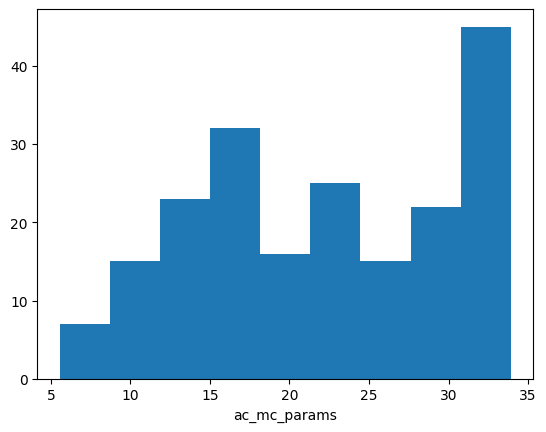{width=100%}

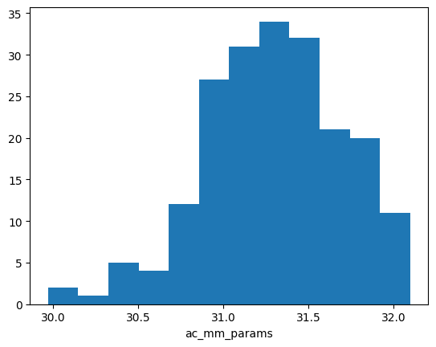{width=100%}
:::

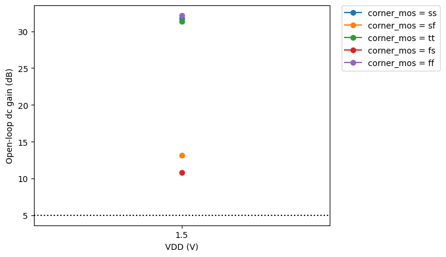{#fig-inverter-cace-aol-vdd width=75%}

@fig-inverter-cace-fcu shows the process (left) and mismatch (right) variations of the open-loop lower cut-off frequency $f_\mathrm{cu}$, while @fig-inverter-cace-fcu-vdd plots its variation across several process corners at one fixed supply voltage.

::: {#fig-inverter-cace-fcu layout-ncol=2 fig-cap="CACE process (left) and mismatch (right) variations of $f_\\mathrm{cu}$."}
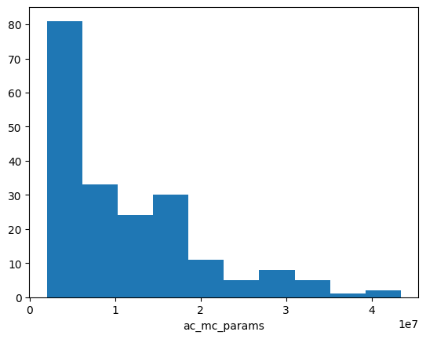{width=100%}

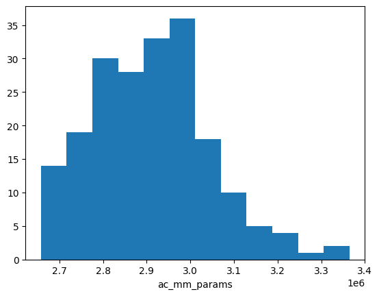{width=100%}
:::

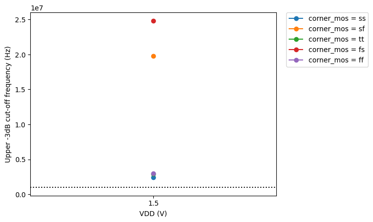{#fig-inverter-cace-fcu-vdd width=75%}

::: {.callout-note}
Note that the above process and mismatch variation results are poor for an analog circuit. Also, the open-loop gain varies significantly across corners. This is because the example is only a simple inverter without a compensation technique. For a practical single-ended inverter amplifier, one would at least add a feedback resistor from output to input to stabilise the operating point and therefore the gain across corners. If you want to see improved variation results, you can try adding a feedback resistor in the `inverter.sch` schematic and running the CACE flow again.
:::

::: {.callout-tip}
In the `inverter.yaml` characterisation file, more parameter sweeps can be added, for example, across temperature, supply voltages or load capacitance.
:::

::: {.callout-important}
Do not `print()` from a CACE postprocess hook. The hooks in [`verification/cace/scripts/`](https://github.com/iic-jku/ihp-sg13g2-ams-chip-template/tree/main/macros/inverter/verification/cace/scripts/) post-process the raw Ngspice results before CACE evaluates them against the specification, and CACE 2.11.0 redirects their stdout into its own rich logger, which writes back to stdout. The first `print()` therefore recurses without end, and `make sim-cace` hangs instead of failing. That is why the debug prints in [`inverter_tb_ac.py`](https://github.com/iic-jku/ihp-sg13g2-ams-chip-template/blob/main/macros/inverter/verification/cace/scripts/inverter_tb_ac.py) are commented out. Write intermediate values to a file if you need to inspect them.
:::

## Transistor Sizing {#sec-sizing}

During simulation, it could happen that some specifications are not fulfilled and that the inverter must be resized. In this tutorial, the inverter is sized with the $g_\mathrm{m}/I_\mathrm{D}$ method (see [Transistor Sizing Using $g_\mathrm{m}/I_\mathrm{D}$ Methodology](https://iic-jku.github.io/analog-circuit-design/aicd.html#sec-gmid-method) for theoretical background). Instead of relying on textbook square-law equations, the method looks up the actual device behaviour from pre-characterised SPICE simulations, parameterised by $g_\mathrm{m}/I_\mathrm{D}$. An overview of these techsweeps can be found in the folder [`doc/sizing/`](https://github.com/iic-jku/ihp-sg13g2-ams-chip-template/tree/main/doc/sizing). The chosen $g_\mathrm{m}/I_\mathrm{D}$ point sets the inversion level of the transistor and therefore the trade-off between intrinsic gain (high $g_\mathrm{m}/I_\mathrm{D}$, weak inversion) and bandwidth (low $g_\mathrm{m}/I_\mathrm{D}$, strong inversion). These trade-offs are discussed in @sec-tradeoffs. For each chosen operating point the lookup tables return all relevant figures of merit ($I_\mathrm{D}/W$, $g_\mathrm{m}/g_\mathrm{ds}$, $g_\mathrm{m}/C_\mathrm{gg}$, $S_\mathrm{TH}$, etc.) at the actual bias condition, which is then used to compute $W$ for a given drain current.

### Design Trade-offs: Choosing $g_\mathrm{m}/I_\mathrm{D}$ and $L$ {#sec-tradeoffs}

Before sizing anything, two numbers have to be picked: the transconductance efficiency $g_\mathrm{m}/I_\mathrm{D}$ and the channel length $L$. Everything else follows from them, so it is worth understanding what each one buys and what it costs.

$g_\mathrm{m}/I_\mathrm{D}$ says how much transconductance you get per ampere of bias current, in $\mathrm{S/A}$ or $\mathrm{V^{-1}}$. It is a normalised, technology-independent measure of the **inversion level** of the device.

@fig-tradeoffs shows the trade-offs in one picture. The arrows point from the centre towards the corner where each design parameter reaches its **best** value, so the same parameter is at its worst in the opposite direction.

 in the Analog Circuit Design course at JKU.](fig/inverter_top/tradeoffs_gmid.svg){#fig-tradeoffs width=75%}

Read it corner by corner:

- **Strong inversion, short $L$** (bottom left): $f_\mathrm{T}$ and input impedance $Z_\mathrm{in}$ are maximal, gate capacitance $C_\mathrm{gg}$ and area are minimal. This is the high-speed corner.
- **Strong inversion, medium $L$** (left): minimal thermal noise PSD $S_\mathrm{TH}$ and maximal current density $I_\mathrm{D}/W$.
- **Moderate inversion, short $L$** (bottom): the speed-efficiency product $f_\mathrm{T} \cdot g_\mathrm{m}/I_\mathrm{D}$ is maximal, the best overall compromise between bandwidth and current.
- **Moderate inversion, long $L$** (top): the output resistance $r_\mathrm{ds} = 1/g_\mathrm{ds}$ is maximal. This is where current sources belong.
- **Weak inversion, long $L$** (top right): intrinsic gain $g_\mathrm{m}/g_\mathrm{ds}$ is maximal, while flicker corner frequency $f_\mathrm{co}$, noise factor $\gamma$, flicker noise $S_\mathrm{FL}$, offset $V_\mathrm{OS}$, and power $P$ are minimal. This is the low-power, low-noise, high-gain corner.
- **Weak inversion, medium $L$** (right): overdrive $V_\mathrm{od}$ and $V_\mathrm{ds,sat}$ are minimal, so this corner gives the most voltage headroom.

Two corners stay empty on purpose. Strong inversion with a long channel and weak inversion with a short channel optimise nothing, they combine the drawbacks of both settings, so in practice they make little sense.

::: {.callout-tip}
## Rules of thumb

Fast circuits use **strong inversion with short channels**. Low-power and low-noise circuits use **weak inversion with long channels**. Current sources use **moderate inversion with longer channels**, to maximise their output resistance. Everything else starts in moderate inversion and is moved from there.
:::

::: {.callout-note}
## Where does our inverter sit?

The sizing below lands at $g_\mathrm{m}/I_\mathrm{D} = 3.76\,\mathrm{V^{-1}}$ with $L = 1\,\mathrm{\mu m}$, which is deep strong inversion with a comparatively long channel, that is the corner the map leaves empty. This is a deliberate compromise for this example, not an oversight: the stage has to drive a $10\,\mathrm{pF}$ load, which demands a lot of $g_\mathrm{m}$ and therefore a lot of current, while the long channel keeps the intrinsic gain and the matching of this very simple circuit acceptable. It also explains the modest simulated gain of about $31\,\mathrm{dB}$. Keep the map in mind when you size your own blocks, where you are free to choose the operating point rather than inheriting it.
:::

### Sizing the Inverter {#sec-sizing-inverter}

The full sizing flow for the inverter is implemented in the Jupyter notebook [`scripts/sizing/sizing_inverter.ipynb`](https://github.com/iic-jku/ihp-sg13g2-ams-chip-template/blob/main/macros/inverter/scripts/sizing/sizing_inverter.ipynb). The notebook uses [`pygmid`](https://github.com/dreoilin/pygmid) to query the pre-characterised ihp-sg13g2 NMOS/PMOS lookup tables ([`sg13g2_lv_nmos.mat`](https://github.com/iic-jku/ihp-sg13g2-ams-chip-template/blob/main/macros/inverter/scripts/sizing/data/sg13g2_lv_nmos.mat) and [`sg13g2_lv_pmos.mat`](https://github.com/iic-jku/ihp-sg13g2-ams-chip-template/blob/main/macros/inverter/scripts/sizing/data/sg13g2_lv_pmos.mat)). An overview of the $g_\mathrm{m}/I_\mathrm{D}$ MOSFET characterisation procedure can be found [here](https://iic-jku.github.io/analog-circuit-design/aicd.html#sec-techsweep-testbench).

The Jupyter notebook `sizing_inverter.ipynb` runs through the following steps:

1. Define the design targets: $V_\mathrm{DD} = 1.5\,\mathrm{V}$, $V_\mathrm{cm,in} = V_\mathrm{cm,out} = V_\mathrm{DD}/2 = 0.75\,\mathrm{V}$, $I_\mathrm{out} = 0.75\,\mathrm{mA}$, $C_\mathrm{load} = 10\,\mathrm{pF}$ and $L = 1\,\mathrm{\mu m}$. $L$ is chosen longer than the minimum to increase intrinsic gain and reduce mismatch, but at the cost of increased area and reduced bandwidth.
2. Look up $g_\mathrm{m}/I_\mathrm{D}$, $g_\mathrm{m}/g_\mathrm{ds}$, $g_\mathrm{m}/C_\mathrm{gg}$ and $I_\mathrm{D}/W$ based on $L$ and the operating-point voltages.
3. Compute the required widths $W = I_\mathrm{D} / (I_\mathrm{D}/W)$ for NMOS and PMOS, and derive the resulting $W_\mathrm{PMOS}/W_\mathrm{NMOS}$ ratio.
4. Round the continuous widths to a practical finger configuration with equal finger counts for NMOS and PMOS (for better layout matching) and recompute the small-signal parameters with the final widths.
5. Estimate the open-loop gain $A_\mathrm{ol} = -g_\mathrm{m,tot} / g_\mathrm{ds,tot}$ and the output resistance $R_\mathrm{out} = 1/g_\mathrm{ds,tot}$ of the complementary inverter stage.

The resulting device geometry is summarised in @tbl-inverter-sizing-geom.

| Device  | $L$ ($\mathrm{\mu m}$) | Fingers ($\mathrm{NF}$) | $W$ / Finger ($\mathrm{\mu m}$) | Total $W$ ($\mathrm{\mu m}$) |
| :------ | :----------------------: | :-----------------: | :-------------------------------: | :----------------------------: |
| NMOS $M_1$ | 1.0                   | 20              | 1.0                               | 20.0                           |
| PMOS $M_2$ | 1.0                   | 20              | 6.0                               | 120.0                          |
| NMOS $M_\mathrm{dummy1}$ | 1.0     | 2               | 1.0                               | 2.0                            |
| PMOS $M_\mathrm{dummy2}$ | 1.0     | 2               | 6.0                               | 12.0                           |

: Sized device geometry of the complementary inverter and its dummy devices. {#tbl-inverter-sizing-geom}

With these final widths the notebook computes the small-signal parameters listed in @tbl-inverter-sizing-ss. As a reference, compare these values with the OP annotations in @fig-inverter-schematic.

| Parameter                                                  | NMOS $M_1$      | PMOS $M_2$      | Inverter (NMOS $\parallel$ PMOS)        |
| :--------------------------------------------------------- | :-------------: | :-------------: | :-------------------------------------: |
| Drain current $I_\mathrm{D}$ ($\mathrm{mA}$)                                           | 0.89       | 0.78       | --                               |
| Transconductance efficiency $g_\mathrm{m}/I_\mathrm{D}$ ($\mathrm{V^{-1}}$)            | 3.76       | 3.76       | --                               |
| Inversion level                                                                        | strong     | strong     | --                               |
| Transconductance $g_\mathrm{m}$ ($\mathrm{mS}$)                                        | 3.35       | 2.92       | --                               |
| Output conductance $g_\mathrm{ds}$ ($\mathrm{\mu S}$)                                | 116        | 29         | --                               |
| Gate capacitance $C_\mathrm{gg}$ ($\mathrm{fF}$)                                        | 154.32     | 824.86     | --                               |
| Transit frequency $f_\mathrm{T} = g_\mathrm{m}/(2\pi\,C_\mathrm{gg})$ ($\mathrm{GHz}$)  | 2.91       | 0.54       | --                               |
| Thermal noise PSD $S_\mathrm{TH}$ at $1\,\mathrm{Hz}$ ($\mathrm{pV^2/Hz}$)              | 38.95      | 73.98      | --                               |
| Flicker corner frequency $f_\mathrm{co}$ ($\mathrm{MHz}$)                               | 3.87       | 2.28       | --                               |
| $g_\mathrm{m,tot} = g_\mathrm{m,NMOS} + g_\mathrm{m,PMOS}$ ($\mathrm{mS}$)              | --         | --         | 6.28                             |
| $g_\mathrm{ds,tot} = g_\mathrm{ds,NMOS} + g_\mathrm{ds,PMOS}$ ($\mathrm{\mu S}$)      | --         | --         | 145                              |

: Calculated small-signal parameters with final widths. {#tbl-inverter-sizing-ss}

From these values, the open-loop dc gain $A_\mathrm{ol}$, the output resistance $R_\mathrm{out}$, the open-loop cut-off frequency $f_\mathrm{cu}$, and the unity-gain frequency $f_\mathrm{T}$ with a dominant capacitive load $C_\mathrm{load} = 10\,\mathrm{pF}$ can be estimated as

$$
|A_\mathrm{ol}| = \frac{g_\mathrm{m,tot}}{g_\mathrm{ds,tot}} = \frac{6.28\,\mathrm{mS}}{145\,\mathrm{\mu S}} = 43.2 = 32.72\,\mathrm{dB},
$$

$$
R_\mathrm{out} = \frac{1}{g_\mathrm{ds,tot}} = \frac{1}{145\,\mathrm{\mu S}} = 6.89\,\mathrm{k\Omega},
$$

$$
f_\mathrm{cu} = \frac{1}{2\pi\,R_\mathrm{out}\,C_\mathrm{load}} = \frac{1}{2\pi \cdot 6.89\,\mathrm{k\Omega} \cdot 10\,\mathrm{pF}} = 2.31\,\mathrm{MHz},
$$

$$
f_\mathrm{T} = \frac{g_\mathrm{m,tot}}{2\pi\,C_\mathrm{load}} = \frac{6.28\,\mathrm{mS}}{2\pi \cdot 10\,\mathrm{pF}} = 100\,\mathrm{MHz}.
$$

@tbl-inverter-sizing-vs-ac compares these hand-calculated values against the open-loop ac simulation result from [`inverter_tb_ac_ol`](https://github.com/iic-jku/ihp-sg13g2-ams-chip-template/blob/main/macros/inverter/testbenches/xschem/inverter_tb_ac_ol.sch) (see @fig-inverter-tb-ac-ol-sim).

| Quantity                  | $g_\mathrm{m}/I_\mathrm{D}$ calculation | ac open-loop simulation |
| :------------------------ | :-------------------------------------: | :---------------------: |
| Open-loop dc gain $A_\mathrm{ol}$ | $32.72\,\mathrm{dB}$                | $31.33\,\mathrm{dB}$   |
| Open-loop cut-off frequency $f_\mathrm{cu}$   | $2.31\,\mathrm{MHz}$                | $2.89\,\mathrm{MHz}$   |
| Unity-gain frequency $f_\mathrm{T}$ | $100\,\mathrm{MHz}$            | $107\,\mathrm{MHz}$    |

: Calculated vs. simulated open-loop characteristics of the inverter. {#tbl-inverter-sizing-vs-ac}

::: {.callout-tip}
The notebook is fully parametric. Changing $L$, the target $g_\mathrm{m}/I_\mathrm{D}$ or $I_\mathrm{out}$ and re-running the cells immediately produces a new sizing point, so it can be used as a starting template for sizing other simple analog blocks with the ihp-sg13g2 lookup tables. Try it out yourself by decreasing the transistor length to $L = 0.5\,\mathrm{\mu m}$ and see how the small-signal parameters and the resulting open-loop gain and cut-off frequency change. What would you expect based on the trade-offs above?
:::

## Getting Started with KLayout {#sec-klayout-intro}

The layout is created and edited in KLayout. Open it in edit mode with `ke`, an alias for `klayout -e` provided by the container. With the ihp-sg13g2 PDK active, KLayout loads the `sg13g2` technology, which brings the layer properties, the `SG13_dev` PCell library, and the `SG13G2 PDK` menu with the DRC and LVS runners.

```sh
ke                              # empty session
ke layout/inverter_top.klay.gds # or open a layout directly at startup
```

Some basics before drawing:

- **Database unit.** When creating a new layout (`File > New Layout`), set the database unit (DBU) to $0.001\,\mathrm{\mu m}$. This is important for the IHP Open-PDK. The [KLayout cheatsheet](https://github.com/iic-jku/ihp-sg13g2-ams-chip-template/blob/main/doc/klayout/klayout_cheatsheet.md) explains how to rescale a layout that was started with the wrong DBU.
- **Layer roles.** Each drawing layer has three roles: `MetalX.drawing` carries the actual geometry, `MetalX.pin` marks the pin shapes, and `MetalX.text` carries the pin labels used by LVS.
- **PCells.** The PDK provides parametric cells (PCells) in the `SG13_dev` library, for example `nmos`, `pmos`, resistors (`rppd`, `rsil`, `rhigh`), capacitors (`cmim`, `moscap_n`, `moscap_p`), taps (`ntap1`, `ptap1`), the `guard_ring`, and `via_stack`. Select a placed PCell and press `Q` to edit its parameters.

The most important shortcuts are listed in @tbl-klayout-keys, taken from the [KLayout cheatsheet](https://github.com/iic-jku/ihp-sg13g2-ams-chip-template/blob/main/doc/klayout/klayout_cheatsheet.md) in this repository.

| Shortcut | Action |
| :--- | :--- |
| `Q` | Properties of the selected object / PCell |
| `M` | Move quickly |
| `A` | Align tool |
| `C` | Copy object |
| `P` | Path / drawing tool (double-click to finish) |
| `R` | Draw rectangle |
| `T` | Place text |
| `Shift + P` | Set pin (input, output, ...) for LVS |
| `O` | Place vias during routing (path mode) |
| `E` / `Ctrl + E` | Descend into / ascend from an instance |
| `Shift + R` | Rotate instance by 90° |
| `Shift + H` / `Shift + V` | Flip instance horizontally / vertically |
| `F` | Zoom full |
| `U` / `Shift + U` | Undo / redo |
| `K` / `Shift + K` | Ruler+ / clear all rulers |
| `0` ... `9` | Layer focus (see @tbl-klayout-plugins) |

: Essential KLayout shortcuts with the productivity plugins installed. {#tbl-klayout-keys}

Most of these shortcuts come from the [KLayout Productivity Suite](https://github.com/iic-jku/klayout-productivity-suite), a collection of plugins developed at JKU that make manual layout much faster. The suite is installed in the IIC-OSIC-TOOLS container, so nothing has to be set up. The full documentation with animations is [here](https://iic-jku.github.io/klayout-productivity-suite/doc/doc.html). A short summary:

| Plugin | What it does |
| :----- | :----------- |
| **Move Quickly Tool** (`M`) | Rapid repositioning of shapes and instances with mouse or keyboard, including diagonal moves and multi-object selection |
| **Align Tool** (`A`) | Align objects to each other by clicking reference features (middle, corner, or edge markers) |
| **Pin Tool** (`Shift + P`) | Place LVS-ready pins (pin shape plus text label) with automatic layer detection from the current layer selection |
| **Layer Shortcuts** (`0` ... `9`) | Fast layer visibility switching: `1` ... `7` focus on one metal with its vias, `8` gate poly, `9` diffusion, `0` shows the default layers, `,` hides them, `Shift + 1` ... `Shift + 9` extend the current focus by one more layer group |
| **Netlist Import** (`File > Import > Netlist`) | Import a SPICE netlist and place the cell instances with technology-specific mapping. Great for starting a layout from the schematic netlist |
| **Library Manager** (`File > Cell Library Manager`) | Manage hierarchical layouts and cell libraries, and export a clean layout for tapeout |
| **Auto Backup** (`File > Automatic Backups`) | Periodic layout backups with configurable interval and rotation |
| **Vector File Export** (`File > Export Vector File`) | Export the layout view as PDF or SVG |

: The KLayout productivity plugins in a nutshell. {#tbl-klayout-plugins}

## Inspect / Edit the Layout {#sec-inspect-layout}

After the schematic is finalised and the design targets are met, the layout can be created. The layout of the `inverter` cell is hierarchical, and the top-level cell `inverter_top` contains four instances of the `inverter` cell. Around the 4-channel inverter layout, a power ring is drawn on `Metal5` and `TopMetal1` layers, which is connected to the `VDD` and `VSS` pins of the four inverters. This power ring is required for top-level integration, connecting the macro power to the chip's PDN.

With the following command, the GDS of the 4-channel inverter is opened in KLayout as shown in @fig-inverter-top-layout. Use the layer shortcuts `0`, `1`, `2`, ..., `9` from @tbl-klayout-plugins to view the individual layers.

```sh
ke layout/inverter_top.klay.gds
```

`inverter_top.klay.gds` is the source of truth. After modifying the layout, export a clean `.gds` file (for example `inverter_top.gds`) by pressing `File > Export Layout For Tapeout`, which resolves every PCell and library reference into a static cell so the result opens without the PDK loaded. Never hand-edit the exported file: keeping the two in step by editing both is how they drift apart, and the drift is invisible because the sign-off targets only look at the exported one. All verification flows (DRC, LVS, and PEX with both KLayout and Magic) accept either `.gds` or `.klay.gds`, while the build targets (LEF export, GDS copy, and rendering) use the exported `.gds`.

::: {.callout-warning}
The export re-evaluates the PCells against the **installed** PDK, so device geometry can change without anyone touching the layout, and the exported file is the only place that shows it. The sibling SG13CMOS5L template hit this for real: for the identical stored parameters its `SG13_dev` `pmos` draws the `NWell` (`31/0`) 0.11 µm tighter on every side than the geometry frozen into its exported GDS, which pulled the two mirrored pmos wells away from the hand-drawn `NWell` straps that bridge them and produced four `NW.b1` markers (min. PWell width between NWell regions) that no sign-off target saw. Measured on the 2026.08 container, this PDK still draws the wider well, so the two are not interchangeable: a layout carried between the templates has to be re-exported under the target PDK and re-checked, not copied. Re-run DRC, LVS and PEX after every export.
:::

::: {.callout-important}
Never delete the box on the `prBoundary` layer (`189/0`) that frames the macro, and make sure a re-drawn layout still carries it. The chip flow derives the bounding box of every macro from this layer: Magic maps all datatypes of layer 189 to its boundary layer, and LibreLane's `Magic.StreamOut` step reads that boundary back for every macro it places. A layout without the box fails the whole chip build with `Failed to extract PR boundary from GDSII view of macro 'inverter_top'`, two flows away from the layout that caused it. Treat the box as part of the layout: keep it in the KLayout editing source `inverter_top.klay.gds` so every re-export carries it, and hide it at render time with `sak-render.py -x` if it spoils a chip shot. `make check-boundary` catches a missing box in the macro build, see @sec-build-deliverables.
:::

{#fig-inverter-top-layout width=75%}

KLayout also supports a 2.5D viewer, which can be used to inspect the layout. To open the 2.5D viewer, press `SG13G2 PDK > BEOL 2.5D Viewer`. @fig-inverter-top-layout-3D shows the `inverter_top` layout in the 2.5D viewer.

{#fig-inverter-top-layout-3D width=100%}

### Drawing the `inverter` Unit Cell {#sec-draw-layout}

The hierarchy starts with the unit cell. [`layout/inverter.gds`](https://github.com/iic-jku/ihp-sg13g2-ams-chip-template/tree/main/macros/inverter/layout/) is its editing source, and `inverter_top.klay.gds` pulls it in as a library through `inverter_top.klay.klib`, so the four instances follow every edit of the unit cell. To draw the unit cell from scratch, open KLayout with `ke` and go through the following steps. The finished result is the `inverter` cell inside @fig-inverter-top-layout.

1. **Create the cell.** `File > New Layout`, top cell name `inverter`, DBU $0.001\,\mathrm{\mu m}$.
2. **Place the transistor PCells.** Drag `nmos` and `pmos` from the `SG13_dev` library into the layout. Place the PMOS row above the NMOS row.
3. **Match the schematic.** Select each PCell and press `Q`. Set the same `w`, `l`, and `ng` values as in the schematic (@tbl-inverter-sizing-geom): the NMOS with $20 \times 1.0\,\mathrm{\mu m}$ fingers and the PMOS with $20 \times 6.0\,\mathrm{\mu m}$ fingers, both with $L = 1.0\,\mathrm{\mu m}$. As in the schematic, `w` is the total width that the PCell splits into `ng` fingers. Add the two dummy devices next to the active devices in the same way.
4. **Substrate and well contacts.** Tie the substrate to `VSS` and the n-well of the PMOS to `VDD` with `ptap1` / `ntap1` contacts (or a `guard_ring`).
5. **Route.** Connect the gates (input), the drains (output), and the source rails with `Metal1` and `Metal2`. Use the path tool `P`, place vias with `O` or with `via_stack` PCells. Keep signal routing on the lower metals within a macro. Use the layer shortcuts `1`, `2`, `8`, `9` to focus on the layer you are working on.
6. **Add the pins.** Select the target metal layer and press `Shift + P` to place the pins `vin`, `vout`, `VDD`, and `VSS`. The pin tool places the pin shape on `MetalX.pin` and the label on `MetalX.text`, which is exactly what LVS expects.
7. **Save** as `layout/inverter.gds`. Then open `inverter_top.klay.gds`, check the four instances and the power ring, and export `inverter_top.gds` as described above.

::: {.callout-tip}
The layout drawing order follows the matching rules of analog design: active devices in the centre with common orientation, dummies at the edges, and taps close to the devices. Also check the layout tips in the [KLayout cheatsheet](https://github.com/iic-jku/ihp-sg13g2-ams-chip-template/blob/main/doc/klayout/klayout_cheatsheet.md).
:::

## DRC, LVS, and PEX

The inverter macro can be verified with two verification flows, either with KLayout or with Magic + Netgen. Each flow covers DRC, LVS, and PEX. Magic + Netgen provides only non-interactive command-line flows, while KLayout also has interactive GUI-based DRC and LVS.

### Design Rule Check

The non-interactive DRC can be run with the following Makefile targets (all three use `sak-drc.sh`). The `CELL` variable can be set to run DRC on a specific cell, or it defaults to `inverter_top` if not set. The `DRC_LEVEL` variable selects the KLayout DRC level and the gdscheck suite: `precheck`, `macro` (default), or `regular`. It is ignored by `magic-drc`, since Magic has no selectable rule decks and always runs the full rule set compiled into the PDK's Magic tech file.

| Check | `precheck` | `macro` _(default)_ | `regular` |
| --- | :---: | :---: | :---: |
| Foundry precheck rule set | ✓ | ✓ | ✓ |
| Pin / label | ✓ | ✓ | ✓ |
| Full FEOL + BEOL rules | – | ✓ | ✓ |
| Off-grid / angle | – | ✓ | ✓ |
| Recommended rules | – | ✓ | ✓ |
| Extra rules | – | – | ✓ |
| Density (full-chip fill) | – | – | ✓ |
| Antenna | – | – | ✓ |

```sh
make klayout-drc [CELL=<cellname>] [DRC_LEVEL=<precheck|macro|regular>] [DRC_JOBS=<n>]   # default CELL=inverter_top, default DRC_LEVEL=macro
make magic-drc [CELL=<cellname>]    # default CELL=inverter_top
make gdscheck-drc [CELL=<cellname>] [DRC_LEVEL=<precheck|macro|regular>] [GDSCHECK_SUITE=<suite>|GDSCHECK_DECKS=<decks>] [DRC_JOBS=<n>]   # default CELL=inverter_top
```

`DRC_JOBS` caps the number of KLayout processes of one run and sets the gdscheck threads. The default of 4 KLayout processes (fewer on a machine with fewer CPUs) and gdscheck on every CPU suits the macros, and larger values only pay off for the full chip on a server.

[gdscheck](https://github.com/aesc-silicon/gdscheck) is a standalone DRC engine with its own rule decks built into the binary. `DRC_LEVEL` maps onto its suites (`precheck` runs `precheck`, which includes the density rules, `macro` runs `core` and `regular` runs `main`), and `GDSCHECK_SUITE` replaces this mapping (`precheck`, `core`, `main`, `density`, `antenna` or `recommended`). `GDSCHECK_DECKS` runs single rule decks instead of a suite, comma-separated (for example `cont,via1`, `gdscheck list-decks --process ihp-sg13g2` lists them). The layer decks include their fill and density rules, so a single cell can fail a layer deck on a fill or density rule that `macro` does not check. Upstream calls gdscheck experimental, so it is a third opinion next to KLayout and Magic, not a sign-off, and the `make all` of the inverter runs it after the KLayout verification.

::: {.callout-note}
The `pmos` cell of the inverter is the `SG13_dev` `pmos` PCell with `guardRingType` set to `nwell`, which draws an nBuLay ring under its n+ tap ring. Magic reports `NBL.f` between that ring and the PMOS diffusion inside it and `NBL.d` against the NWell next to it, and gdscheck 0.2.0 reports `NBL.f`, while the KLayout deck passes the layout ([IHP-Open-PDK#954](https://github.com/IHP-GmbH/IHP-Open-PDK/issues/954), fixed in gdscheck after 0.2.0 by [aesc-silicon/gdscheck#51](https://github.com/aesc-silicon/gdscheck/pull/51)). KLayout is the sign-off deck. Until the fixes are in the container, `magic-drc` and `gdscheck-drc` fail on `inverter` and `inverter_top`, so the `make all` flows leave the Magic DRC out and stop at gdscheck until then.
:::

Reports are written into per-cell run folders (`<CELL>.magic.drc/` for Magic, `<CELL>.klayout.drc/` for KLayout, `<CELL>.gdscheck.drc/` for gdscheck) inside [`verification/drc/`](https://github.com/iic-jku/ihp-sg13g2-ams-chip-template/tree/main/macros/inverter/verification/drc/). The run folders are wiped at the start of each run, so they always reflect the latest run only.

A successful KLayout run ends with the line

```text
INFO    | KLayout DRC Check Passed: No DRC violations detected in the layout.
```

and a clean Magic report `<CELL>.magic.drc.rpt` lists `COUNT: 0` for the cell, which the inverter does not reach because of the guard ring markers above.

::: {.callout-tip}
In KLayout, a non-interactive DRC run can be launched from the GUI by pressing **`F9`**. The DRC options can be modified by pressing **`F10`**.

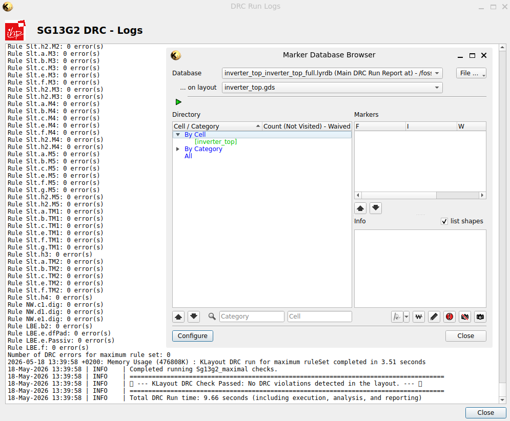{width=100%}
:::

### Layout-Versus-Schematic

The non-interactive LVS can be run with the following Makefile targets. The `CELL` variable can be set to run LVS on a specific cell, or it defaults to `inverter_top` if not set.

```sh
make klayout-lvs [CELL=<cellname>]  # default CELL=inverter_top, uses CDL netlist exported from Xschem
make magic-lvs [CELL=<cellname>]    # default CELL=inverter_top, uses SPICE netlist exported from Xschem
```

The schematic netlist is exported automatically by the matching `*-lvs-netlist` sub-target and moved to [`netlist/schematic/`](https://github.com/iic-jku/ihp-sg13g2-ams-chip-template/tree/main/macros/inverter/netlist/schematic/). The extracted layout netlist is moved to
[`netlist/layout/`](https://github.com/iic-jku/ihp-sg13g2-ams-chip-template/tree/main/macros/inverter/netlist/layout/) and the reports are written into per-cell run folders (`<CELL>.magic.lvs/` for Magic + Netgen, `<CELL>.klayout.lvs/` for KLayout) inside [`verification/lvs/`](https://github.com/iic-jku/ihp-sg13g2-ams-chip-template/tree/main/macros/inverter/verification/lvs/). The run folders are wiped at the start of each run, so they always reflect the latest run only.

Substrate and well contacts are not devices for LVS in either flow (KLayout skips the `ntap1` / `ptap1` device extraction, Magic extracts them as substrate connections), so the taps in the layout need no matching device in the schematic. A successful KLayout run prints:

```text
| Status           | PASS                                    |
| Mode             | COMPARE                                 |
| Outcome          | Comparison mode: PASS (netlists match). |
| Warnings         | 0                                       |
| Errors           | 0                                       |
```

The Magic + Netgen flow reports:

```text
Cell pin lists are equivalent.
Device classes inverter_top and inverter_top are equivalent.

Final result: Circuits match uniquely.
```

::: {.callout-note}
The Netgen report additionally states `Netlists match uniquely with property errors` and lists one warning per transistor about a `mm_ok` property that exists only on the schematic side. It is the mismatch switch of the Xschem symbol (see @sec-draw-schematic), which the layout PCell does not carry, so the two netlists cannot agree on it. This is expected with the current PDK and can be ignored as long as the final result reads `Circuits match uniquely.`
:::

::: {.callout-tip}
In KLayout, a non-interactive LVS run can be launched from the GUI by pressing **`F11`**. The LVS options can be modified by pressing **`F12`**, where the schematic netlist `inverter_top_klayout.cdl` has to be selected manually. Set `deep` as the run mode.

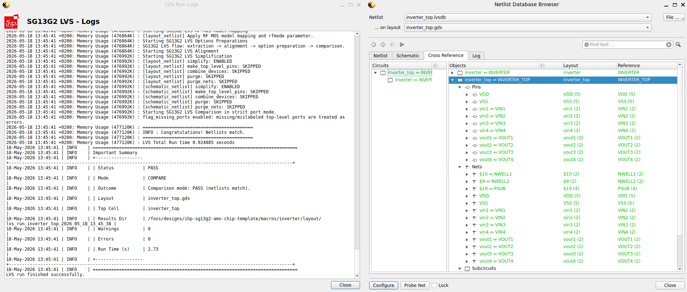{width=100%}
:::

### Parasitic Extraction {#sec-pex}

The non-interactive PEX can be run with the following Makefile targets. The `CELL` variable can be set to run PEX on a specific cell, or it defaults to `inverter_top` if not set. The `EXT_MODE` variable can be set to choose between different extraction modes,

- `EXT_MODE=1` for C-decoupled mode,
- `EXT_MODE=2` for C-coupled mode,
- `EXT_MODE=3` for full-RC extraction.

If not set, it defaults to `EXT_MODE=3`.

For full-RC extraction (`EXT_MODE=3`), `magic-pex` also exposes the `sak-pex.sh` `extresist` tuning parameters (ignored in `EXT_MODE=1`/`2`):

- `THRESHOLD` - extresist threshold in mOhm (`-t`, default `10000` = 10 Ohm),
- `MINRES` - extresist minimum resistance in mOhm (`-r`, default `1000` = 1 Ohm),
- `MINDELAY` - extresist minimum delay in ps (`-y`, default `1`; `0` = gate by resistance).

```sh
make klayout-pex [CELL=<cellname>] [EXT_MODE=<1|2|3>]   # default CELL=inverter_top, default EXT_MODE=3 (full-RC)
make magic-pex [CELL=<cellname>] [EXT_MODE=<1|2|3>] [THRESHOLD=<mOhm>] [MINRES=<mOhm>] [MINDELAY=<ps>]   # default CELL=inverter_top, default EXT_MODE=3 (full-RC)
```

PEX writes a SPICE netlist into [`netlist/pex/`](https://github.com/iic-jku/ihp-sg13g2-ams-chip-template/tree/main/macros/inverter/netlist/pex/). The subcircuit is named `<CELL>_pex`, and the pin order is rearranged to match the Xschem PEX symbol ([`inverter_top_pex.sym`](https://github.com/iic-jku/ihp-sg13g2-ams-chip-template/blob/main/macros/inverter/schematic/xschem/inverter_top_pex.sym)).

That PEX symbol is generated, not maintained by hand. Both PEX targets start by running `make symbol-pex`, which copies `schematic/xschem/<CELL>.sym` to `schematic/xschem/<CELL>_pex.sym` and changes `type=subcircuit` into `type=primitive`. Everything else is inherited, above all the pin order that `sak-pin-reorder.py` sorts the extracted netlist to. The `primitive` type keeps Xschem from descending into a schematic of the same name, so the instance is netlisted as it stands and its subcircuit comes from the included PEX netlist instead. Because the symbol is rebuilt before every extraction, it cannot go stale when a pin is added, removed or renamed, and it can be built on its own with `make symbol-pex [CELL=<cellname>]`. Edit `<CELL>.sym`, never the generated `<CELL>_pex.sym`.

After the reorder, both PEX targets run [`scripts/check_pex_ports.py`](https://github.com/iic-jku/ihp-sg13g2-ams-chip-template/blob/main/macros/inverter/scripts/check_pex_ports.py) on the extracted netlist and fail if a port of the subcircuit is not connected to any element inside it. A floating port usually means a missing or misspelled pin label in the layout, and it is better caught here than as a silently open input in the post-layout simulation.

::: {.callout-note}
Every symbol in this template carries `spectre_format="@name ( @pinlist ) @symname"` next to its `format` line. Xschem writes that line itself whenever a symbol is generated from a schematic's pin list (key `a`), and only the Spectre netlister reads it, which is also the one that drives VACASK. The SPICE netlister used for Ngspice ignores it. Do not delete it: without it, instances of that symbol are silently dropped from a Spectre/VACASK netlist and its `subckt` line comes out with an empty port list, with no warning at all.
:::

::: {.callout-note}
Note that [KLayout-PEX (KPEX)](https://github.com/iic-jku/klayout-pex) is currently under development and therefore the Magic engine is used internally for the actual extraction.
:::

### Post-Layout Simulation {#sec-postlayout}

Now we close the loop and simulate the extracted layout in the same testbenches. Every testbench already carries a spare instance of the PEX symbol (`x3`, see @sec-tb-ac), and the PEX symbol has the same pin positions as the cell symbol, so the swap takes a few key presses:

1. Open a testbench, for example `inverter_tb_ac_ol.sch`.
2. Select the active instance `x1` (`inverter.sym`) and press `Shift + T` to set its `spice_ignore` flag. It is now excluded from the netlist.
3. Select the spare instance `x3` (`inverter_pex.sym`), move it with `m` onto the position of `x1`, and press `Shift + T` to activate it. Its pins land on the same wires, so nothing else changes.
4. The `.include ../../../netlist/pex/inverter_magic_pex_3.spice` line at the top of the control block now supplies the subcircuit definition. If you extracted with a different `EXT_MODE` or with KLayout, adapt the file name (for example `inverter_klayout_pex_3.spice`).
5. Re-run the simulation with `Ctrl` + click on **Simulate**.

The same swap works in `inverter_top_tb_tran.sch` with `inverter_top_pex.sym` and `inverter_top_magic_pex_3.spice`, which is the post-layout view that `make all` refreshes before it simulates (see @sec-full-analog-flow).

Compare the post-layout results against the schematic-level results. What differences do you see, and why?

Think about it before simulating. The extracted netlist adds the wiring resistance and the capacitance of every drawn wire to the circuit. The dc transfer characteristic should barely change, because almost no current flows into the parasitics at dc. In the ac response, the added output and internal capacitances and the interconnect resistance shift the poles, so expect a slightly reduced bandwidth and small changes in the measured gain. If your post-layout results deviate strongly, that is usually a sign of a layout problem, for example a too narrow or too long wire on a critical net.

### Run Full Verification Flow at Once

If you want to run the full verification flow at once, the verify targets bundle DRC, LVS, and PEX with KLayout and LVS and PEX with Magic in one command.

```sh
make klayout-verify [CELL=<cellname>]   # default CELL=inverter_top
make magic-verify [CELL=<cellname>]     # default CELL=inverter_top
```

`magic-verify` leaves the Magic DRC out until the fixes for the guard ring markers described above are in the container, `make magic-drc` runs it on its own. gdscheck has no LVS or PEX, so it is not part of these bundles. Run it with `make gdscheck-drc [CELL=<cellname>]`, or with `make gdscheck-drc-all` for `inverter` and `inverter_top`.

## Build Deliverables for Top-Level Integration {#sec-build-deliverables}

For the inverter to be picked up by the top-level LibreLane flow, it must expose a **[LEF](https://en.wikipedia.org/wiki/LEF/DEF)** (abstract pin / blockage view), a **[Liberty timing library](https://chipverify.com/rtl-synthesis/introduction-to-liberty-format)** stub, and a **Verilog stub**. The Verilog stub is referenced by [`rtl/chip_top.sv`](https://github.com/iic-jku/ihp-sg13g2-ams-chip-template/blob/main/rtl/chip_top.sv) for top-level integration. These files can be built with individual Makefile targets or via `build-top`.

```sh
make check-boundary   # check the PR boundary box on layer 189 in layout/inverter_top.gds
make lef              # final/lef/inverter_top.lef
make lib              # final/lib/inverter_top.lib
make verilog          # final/vh/inverter_top.vh
make build-top        # the four steps above plus copy-gds and render-gds
```

`make build-top` runs `check-boundary` first, so a top cell without the PR boundary box fails the macro build in a second with a message that names the layer, instead of failing the chip flow much later (see the callout in @sec-inspect-layout). The check runs [`scripts/check_boundary.py`](https://github.com/iic-jku/ihp-sg13g2-ams-chip-template/blob/main/macros/inverter/scripts/check_boundary.py), which also reports the size of the box and warns when the drawn geometry extends beyond it, because the top-level flow places the macro by the boundary and anything outside it may overlap a neighbour.

`make build-top` also copies the GDS to [`final/gds/`](https://github.com/iic-jku/ihp-sg13g2-ams-chip-template/tree/main/macros/inverter/final/gds/) and renders the macro to [`render/img/inverter_top_white.png` and `render/img/inverter_top_black.png`](https://github.com/iic-jku/ihp-sg13g2-ams-chip-template/tree/main/macros/inverter/render/img/), as displayed in @fig-inverter-top-layout.

## Full Analog Macro Flow {#sec-full-analog-flow}

The full verification, build, and simulation chain is run with the following command.

```sh
make all
```

This calls `klayout-verify-all`, `gdscheck-drc-all`, `magic-verify-all`, `build-top`, and `sim-all` (Xschem + CACE) in sequence. The simulations run last, so the `inverter_top` testbench includes the PEX netlist produced by this run. Depending on the hardware used, a full pass can take a few minutes, especially the CACE simulation step.


# RF Macro Implementation {#sec-rf}

The [`vco`](https://github.com/iic-jku/ihp-sg13g2-ams-chip-template/tree/main/macros/vco/) macro is the RF reference macro of the template: a 20 GHz LC voltage-controlled oscillator (VCO) built from CMOS devices only. It follows the analog flow of @sec-analog (Xschem, DRC, LVS and PEX with KLayout and Magic) and adds the steps an RF block needs on top:

- **Layouts from scripts.** Every layout is written by a KLayout Python script (@sec-rf-layout).
- **EM simulation of the passives.** The tank coil is simulated with [AWS Palace](https://github.com/awslabs/palace), set up from its layout by [gds2palace](https://github.com/VolkerMuehlhaus/gds2palace_ihp_sg13g2) (@sec-rf-em).
- **Lumped-element models.** [snp2le](https://github.com/iic-jku/snp2le) turns the S-parameters of the EM simulation into netlists for ngspice and VACASK (@sec-rf-snp2le).
- **Large-signal RF analyses.** [VACASK](https://codeberg.org/arpadbuermen/VACASK) computes the S-parameters of the coil model (ACSP), the periodic steady state of the oscillator (PSS), its phase noise (PNOISE) and its tuning gain (PAC) (@sec-rf-sim).
- **Post-layout simulation at 20 GHz.** The extracted netlist of the macro is simulated with the EM model of the coil in place: the start-up over corners (@sec-rf-corners), the power-up and the enable (@sec-rf-powerup), and the phase noise from transient noise (@sec-rf-trannoise).

The VCO is a simple design to learn the RF flow on, not an optimized one. It goes through each step once, and the [vco README](https://github.com/iic-jku/ihp-sg13g2-ams-chip-template/blob/main/macros/vco/README.md) lists where it falls short and what a better design would change.

::: {.callout-note}
The VCO is not part of the chip top-level yet. Its integration needs a quiet analog pad of its own for the macro's `VDD`, RF pads or a divider for the 20 GHz output, and a gap in the chip power grid, since the coil occupies both TopMetal layers. The open steps are listed under [Open Points](https://github.com/iic-jku/ihp-sg13g2-ams-chip-template/blob/main/macros/vco/README.md#open-points) in the README.
:::

## Circuit {#sec-rf-circuit}

The core follows a published design, the 27 GHz cross-coupled VCO of Jung and Park ([Electronics Letters, 2008](https://doi.org/10.1049/el:20080527)), scaled to 20 GHz and to the devices of this PDK. @fig-vco-top-schematic shows the macro and @tbl-vco-cells its cells. It needs four pins besides its outputs: the supply `VDD`, `VSS`, the enable `di_en` and the tuning voltage `vtune`.

| Cell | Function |
| :--- | :--- |
| `vco_top` | the macro: bias, tap feed, core and buffer, and the pins |
| `vco_core` | LC tank and negative resistance: the coil, the cross-coupled NMOS pair, the varactor array, and the decoupling capacitors of the center tap `vdd_core` |
| `vco_ind` | the center-tapped tank coil: the PDK `inductor3` for LVS, the lumped-element model `vco_ind_le` for simulation |
| `vco_var` | the varactor array: three `sg13_hv_svaricap`, gates on the tank, wells on `vtune` |
| `vco_buf` | AC-coupled differential output buffer with 50 $\Omega$ back-termination |
| `vco_feed` | the feed of the center tap from `VDD`: the switch `MPs` and the resistor `Rct` |
| `vco_bias` | the 100 $\mu$A reference from `VDD`, the enable logic, the two bias voltages of the buffer, each behind an RC low-pass filter, and the RF decoupling of `vbg_buf` |

: Cells of the `vco` macro. {#tbl-vco-cells tbl-colwidths="[15,85]"}

{#fig-vco-top-schematic}

The core in @fig-vco-core-schematic has no current source. The center tap of the coil hangs on a resistor from `VDD` (@fig-vco-feed-schematic), so it finds its own voltage, 0.76 V post-layout, which sets the common mode of the tank and the gate-source voltage of the pair at once, and with it the current and the amplitude. A slow corner draws less current, so the tap rises and gives the pair more gate voltage, a fast corner the other way round. The varactors sit with their gates on the tank and their wells on `vtune`, so a tuning voltage from 0 V to `VDD` = 1.5 V sweeps them across their capacitance transition around 0 V gate-to-well voltage. A differential pair buffers the tank into two outputs with 50 $\Omega$ back-termination. `di_en` low opens the switch of the tap and of the reference, so the core, the buffer and the bias stop. The [Circuit](https://github.com/iic-jku/ihp-sg13g2-ams-chip-template/blob/main/macros/vco/README.md#circuit) section of the README explains the sizing and why the design ended up this way.

{#fig-vco-core-schematic}

{#fig-vco-feed-schematic width=60%}

::: {.callout-tip}
## Why a Resistor and Not a Current Source
A current source on the center tap sets the tank's common mode by the pair's gate-source voltage at a fixed current, so the noise of the bias moves the varactors' operating point, and with it the frequency. A PMOS mirror from `VDD` in place of `Rct` gives -98.3 dBc/Hz at 1 MHz behind a 190 k$\Omega$ and 10 pF filter and -88.8 dBc/Hz without one, against -101.3 dBc/Hz with the resistor. The resistor has its own price: noise on `VDD` reaches the tap and the frequency, so the macro's `VDD` needs a quiet pad of its own.
:::

| Parameter | Target | Schematic | Post-layout |
| :--- | :--- | :--- | :--- |
| Oscillation frequency at `vtune` = 0.75 V | 20 GHz | 22.55 GHz | 20.00 GHz |
| Tuning range, `vtune` from 0 V to 1.5 V | about 2 GHz | 21.64 GHz to 24.04 GHz | 19.34 GHz to 21.18 GHz |
| Phase noise at 1 MHz offset | reported | -101.2 dBc/Hz (PNOISE), -99.4 dBc/Hz (transient noise) | -101.5 dBc/Hz (PNOISE), -101.1 dBc/Hz (transient noise) |
| Output power per output into 50 $\Omega$ | -10 dBm or more | -8.3 dBm | -10.0 dBm |
| Supply current from `VDD` = 1.5 V | | 11.6 mA | 10.9 mA |
| Disabled | | | 9 nA, no oscillation |

: Results of the `vco` at TT and 27 C. The schematic frequency is from the PSS, the post-layout one from the transient of @sec-rf-postlayout, and both output powers are the fundamental from the PSS. {#tbl-vco-results}

## Directory Structure {#sec-rf-dirs}

The design files are located in [`macros/vco/`](https://github.com/iic-jku/ihp-sg13g2-ams-chip-template/tree/main/macros/vco/). The folders of the inverter are all there (@sec-analog), plus the ones for the layout scripts and the EM simulation:

| Folder | Content |
| :--- | :--- |
| [`schematic/xschem/`](https://github.com/iic-jku/ihp-sg13g2-ams-chip-template/tree/main/macros/vco/schematic/xschem/) | Schematics and symbols of the seven cells, the generated PEX symbols, and `vco_ind_le.sym` for the coil model. |
| [`scripts/layout/`](https://github.com/iic-jku/ihp-sg13g2-ams-chip-template/tree/main/macros/vco/scripts/layout/) | One KLayout Python script per cell and the shared helpers `vco_layout.py`. |
| [`layout/`](https://github.com/iic-jku/ihp-sg13g2-ams-chip-template/tree/main/macros/vco/layout/) | The GDS of every cell, written by its script. |
| [`scripts/`](https://github.com/iic-jku/ihp-sg13g2-ams-chip-template/tree/main/macros/vco/scripts/) | The checks of the inverter, the post-layout extraction helpers `drop_subcells.py`, `pex_caps.py` and `spice2spectre.py`, and the scripted runs `sim_corners.py`, `sim_powerup.py` and `sim_trannoise.py`. |
| [`verification/em/`](https://github.com/iic-jku/ihp-sg13g2-ams-chip-template/tree/main/macros/vco/verification/em/) | `scripts/palace_vco_ind.py` (the EM setup), `layout/` (the EM layout with its ports), `palace_model/` (the Palace configuration and results) and `s-parameter/` (the Touchstone file the model is fitted to). |
| [`netlist/`](https://github.com/iic-jku/ihp-sg13g2-ams-chip-template/tree/main/macros/vco/netlist/) | `schematic/`, `layout/` and `pex/` as in the inverter, plus the coil model for ngspice (`spice/vco_ind_le.spice`) and for VACASK (`spectre/vco_ind_le.inc`), and the post-layout netlist for VACASK (`spectre/vco_top_leads.inc`). |
| [`testbenches/xschem/`](https://github.com/iic-jku/ihp-sg13g2-ams-chip-template/tree/main/macros/vco/testbenches/xschem/) | The ngspice and VACASK testbenches, the post-layout wrapper `vco_top_lpe.sch`, a patched model file in `models/`, and the plot scripts in `plot_simulations/`. |
| [`verification/drc/`, `verification/lvs/`, `final/`, `render/`](https://github.com/iic-jku/ihp-sg13g2-ams-chip-template/tree/main/macros/vco/) | Reports, deliverables and renders, as in the inverter. |

The [Makefile](https://github.com/iic-jku/ihp-sg13g2-ams-chip-template/blob/main/macros/vco/Makefile) has every target of the inverter and adds the RF steps. @tbl-rf-flow lists the flow in the order of its steps.

| Step | Tools | Make target | Output |
| :--- | :--- | :--- | :--- |
| Layout generation | KLayout Python | `klayout-script`, `klayout-script-all` | `layout/` |
| DRC | KLayout, gdscheck, Magic | `klayout-drc`, `klayout-drc-regular`, `gdscheck-drc`, `magic-drc` | `verification/drc/` |
| LVS | Xschem, KLayout, Magic, Netgen | `klayout-lvs`, `magic-lvs` | `verification/lvs/`, `netlist/schematic/`, `netlist/layout/` |
| PEX | KPEX, Magic | `klayout-pex-leads`, `klayout-pex`, `magic-pex` | `netlist/pex/`, `netlist/spectre/` |
| EM simulation | gds2palace, AWS Palace | `sim-em` | `verification/em/layout/`, `verification/em/palace_model/` |
| S-parameters | | `copy-sparam`, `view-em-sim` | `verification/em/s-parameter/` |
| Lumped-element model | snp2le | `snp2le`, `em-model` | `netlist/spice/`, `netlist/spectre/` |
| Circuit simulation | Xschem, ngspice, VACASK | `sim-xschem`, `sim-all`, `sim-corners` | `testbenches/xschem/plot_simulations/` |
| Post-layout tuning curve | ngspice | `sim-tune-lpe` | `testbenches/xschem/plot_simulations/figures/` |
| Power-up and enable | ngspice | `sim-powerup` | `testbenches/xschem/plot_simulations/` |
| Transient noise | VACASK | `sim-trannoise`, `sim-trannoise-lpe` | `testbenches/xschem/plot_simulations/data/` |
| Post-layout PSS | VACASK | `sim-pss-lpe` | `testbenches/xschem/plot_simulations/data/` |
| Plots | Python | `sim-view-xschem` | `testbenches/xschem/plot_simulations/figures/` |
| Deliverables | Magic, `sak-render.py` | `build-top` | `final/`, `render/img/` |
| Everything but EM and the long runs | all of the above | `all` | |

: Flow steps of the `vco` and their Makefile targets. {#tbl-rf-flow tbl-colwidths="[20,22,30,28]"}

`make all` runs `klayout-script-all`, `klayout-verify-all`, `gdscheck-drc-all`, `magic-verify-all`, `build-top` and `sim-all`, in about 28 minutes on a compute host. It leaves out the EM simulation of the coil, which takes 35 minutes on a compute host, the corners, and the two long runs: the power-up transient and the transient noise take hours each. Their results are committed, so `make all` simulates with the coil model of the last EM run.

## Layout Generation {#sec-rf-layout}

A layout can be drawn by hand, generated by a parametric library, or written as a script. This template and its RF sibling [SPARX](https://github.com/iic-jku/SG13CMOS_SPARX) have an example of each:

| Method | Example | Strong at | Weak at |
| :--- | :--- | :--- | :--- |
| Hand drawing in KLayout | the `inverter` (@sec-draw-layout) | full control, learning the rules, small cells | every change is manual, and a GDS diff shows nothing a reviewer can read |
| GDSFactory generator | the SPARX receiver | parametric passives, a whole chip from a few design inputs | a structure needs a generator before it can be drawn |
| KLayout Python scripts written by an AI coding agent | the `vco` | a design in review: every change is a script diff, and every layout is rebuilt in seconds | the agent sees the layout through DRC, LVS and PEX only, so the designer reviews it in KLayout |

: Three ways to a layout. {#tbl-layout-methods tbl-colwidths="[24,20,28,28]"}

### Drawing by Hand

Hand drawing works for RF cells as it does for the inverter in @sec-draw-layout. Place the PDK's `inductor3` PCell from the `SG13_dev` library for a coil, set its parameters with `Q`, route it, and export the layout with `File > Export Layout For Tapeout`. Three rules matter more at RF than in an analog cell:

- **Keep the coil's keep-out free.** The PCell draws a keep-out of the outer diameter plus 60 $\mu$m with the `IND` layer and the no-fill layers, so no fill lands under or next to the windings. Keep the other circuits out of it as well.
- **Close no loop around the coil.** A closed ring of metal around a coil, a guard ring or a supply ring, carries the induced eddy current and lowers its inductance and its Q.
- **Short and wide leads.** At 20 GHz, the lead from the coil to the transistors is part of the tank, see @sec-rf-postlayout.

### Programmatic Layout with GDSFactory

[GDSFactory](https://github.com/gdsfactory/gdsfactory) is a Python library for parametric layouts. The [IHP-GDSFactory-Addon](https://github.com/iic-jku/IHP-GDSFactory-Addon) wraps the PCells and the layer stack of the IHP Open-PDK for it, and adds a library of RF structures: transmission lines and corners, the branch-line coupler, the Wilkinson power divider, coupled-line and hairpin bandpass filters, a directional coupler and a quarter-wave transformer.

SPARX, a 160 GHz six-port receiver, is built that way. Its generator takes the design frequency as the only design input, computes every line width and length from closed-form models, and writes the complete chip with fill, pads and seal ring, together with the EM sub-structures and their port markers. The EM simulation therefore always solves the structures that are in the chip.

```sh
make build-layout            # the 160 GHz chip
make build-layout FREQ=77    # the same receiver for 77 GHz
```

The [Programmatic Layout Generation](https://iic-jku.github.io/SG13CMOS_SPARX/#sec-layout) chapter of the SPARX documentation explains the generator, and its [Design Flow](https://iic-jku.github.io/SG13CMOS_SPARX/#sec-flow) chapter the Makefile targets around it.

### KLayout Python Scripts Written by an AI Coding Agent

Every layout of the `vco` is a KLayout Python script in [`scripts/layout/`](https://github.com/iic-jku/ihp-sg13g2-ams-chip-template/tree/main/macros/vco/scripts/layout/), run in batch mode, which writes `layout/<CELL>.gds`. Nothing is drawn by hand: to change a layout, change its script, rerun it, and rerun DRC and LVS.

```sh
make klayout-script CELL=vco_ind   # klayout -b -r scripts/layout/vco_ind.py
make klayout-script-all            # every cell, subcells before the cells that place them
```

The scripts use the Python API of KLayout (`pya`) and the PCells of the PDK. The coil, for example, is the `inductor3` PCell with its pin labels, shortened from [`vco_ind.py`](https://github.com/iic-jku/ihp-sg13g2-ams-chip-template/blob/main/macros/vco/scripts/layout/vco_ind.py):

```python
ly = pya.Layout()
ly.dbu = 0.001
top = ly.create_cell("vco_ind")
# subE=0, not False: the PCell draws the backside etch layer LBE for the boolean False
ind = ly.create_cell("inductor3", "SG13_dev", {"w": "4u", "s": "4u", "d": "52u", "nr_r": 2, "subE": 0})
top.insert(pya.CellInstArray(ind.cell_index(), pya.Trans()))
top.flatten(-1, True)                    # no PCell context left in the GDS
for text, (layer, datatype), x, y in LABELS:
    top.shapes(ly.layer(layer, datatype)).insert(pya.DText(text, x, y))
ly.write(out_file, opt)
```

The scripts of the larger cells place transistors, resistors and capacitors from the PDK's `SG13_dev` library and route them with the helpers of [`vco_layout.py`](https://github.com/iic-jku/ihp-sg13g2-ams-chip-template/blob/main/macros/vco/scripts/layout/vco_layout.py), which build a transistor with its wiring, snap every coordinate to the 5 nm grid, merge each metal into one polygon per connected piece, and check every DC path against the current limits of the process (@sec-rf-current-density).

These scripts were written by an AI coding agent that ran the flow in the IIC-OSIC-TOOLS container. It worked from the schematic, a floorplan and the rules of the template: it wrote a script, ran it, ran DRC and LVS, read the reports, and changed the script until both were clean. The designer reviewed the layout in KLayout and the script as a diff. The loop works because every step is a Make target that writes a text report. What it does not replace is the review: a layout that passes DRC and LVS can still be a poor RF layout. The first core of this macro joined the source bar of the pair to `VSS` through one via stack, and only the post-layout netlist showed the 14.7 $\Omega$ in series with the core current (@sec-rf-postlayout).

::: {.callout-tip}
## What the Scripts Had to Learn
Some of the traps the agent ran into are worth knowing for any KLayout script:

- A KLayout batch script that ends in `SystemExit` exits with code 0 and prints nothing, so a failed check leaves the old GDS in place. Raise `RuntimeError` instead, which KLayout reports and `make` stops on.
- PDK PCells write their terminal names as texts (`inductor3` its `LA`, `LB` and `LC`). KLayout LVS names a net after each text, and a net with a second name fails the strict port check. Repeat the PCell's names in the pin labels, or drop the texts once the cell is flat.
- The resistor and MIM PCells compute a dimension from R or C by default. Pass `Calculate="R"` and `Calculate="C"` to keep the drawn width and length.
- KLayout LVS does not combine parallel devices (`m`) with a multi-finger device, so a transistor drawn as one device with 30 fingers is `ng=30` in the schematic.
- A metal line that touches the first source stripe of a transistor can short a net that DRC cannot see. Here the enable line of the tap's switch did, and only LVS found it.
:::

@fig-vco-top-layout shows the result. The coil and its keep-out take 60 % of the 143 $\mu$m by 215.5 $\mu$m macro, and the core's tank lines run straight down from the coil's feeds to the pair and the varactors below. The bias sits on the left, the decoupling capacitors of the center tap on the right, the buffer under the core and the tap feed in the bottom right corner, next to the supply straps along the bottom edge. The [Generate the Layouts](https://github.com/iic-jku/ihp-sg13g2-ams-chip-template/blob/main/macros/vco/README.md#generate-the-layouts-with-klayout-python-scripts) section of the README describes the floorplan of every cell.

{#fig-vco-top-layout}

## DRC, LVS and PEX {#sec-rf-verify}

The verification targets are those of the inverter, see @sec-analog: `klayout-drc`, `gdscheck-drc`, `magic-drc`, `klayout-lvs`, `magic-lvs`, `klayout-pex`, `magic-pex` and the `*-verify` targets, all with `CELL=<cellname>`. What differs is which check can run on which cell:

| Cell | KLayout | gdscheck | Magic |
| :--- | :--- | :--- | :--- |
| `vco_bias`, `vco_buf`, `vco_feed` | DRC, LVS | DRC | LVS, PEX |
| `vco_var`, `vco_ind`, `vco_core` | DRC, LVS | DRC | |
| `vco_top` | DRC, regular DRC, LVS, PEX without the coil and the varactor array (`klayout-pex-leads`) | DRC | PEX for the pin list of the Verilog stub |

: Checks per cell, as `klayout-verify-all`, `gdscheck-drc-all` and `magic-verify-all` run them. {#tbl-vco-checks}

The gaps have three reasons:

- **Magic extracts the varactor as two two-terminal halves** and does not extract the PDK inductor, so Netgen cannot compare a cell that holds either.
- **KPEX cannot read Magic's extraction of the varactor**, which Magic writes as a Verilog-A device. Every cell above the array inherits it.
- **An RC extraction of a coil is not its RF model.** It misses the inductance and the coupling: KPEX turns `vco_ind` into a single 42 fF capacitor. The model of the coil is its EM simulation, see @sec-rf-em.

The KLayout `macro` level of `klayout-drc` leaves out the density rules, and with them rules a macro has to meet on its own, such as the minimum metal areas `Mn.d` and `pSD.b`. So `klayout-verify-all` also runs `klayout-drc-regular` on `vco_top`, which fails on any rule but the global densities that only the chip's fill can meet.

The Magic DRC stays out of the flows, as in the inverter: `magic-drc` reports `LU.d` and `Cnt.a` on `sg13_hv_svaricap` and `MIM.e` and `Slt.c` on `cap_cmim`. A bare PCell of each, with none of this macro's wiring, reports the same rules and KLayout passes them, so they belong to the PDK's cells or Magic's rule deck and get fixed upstream.

### Current Density {#sec-rf-current-density}

No DRC deck checks electromigration, so the layout scripts do. Every DC path of the macro, each wire and each via array, is held against the limits of the process for 11 years at 105 C, for example 2 mA per $\mu$m of width on Metal2 to Metal5 and 0.4 mA per cut of Via1 to Via4:

```python
check_wire("drain plate of MPs", "Metal3", width, I_CORE)
check_cuts("tap's stack, top", "TopVia1", n_cuts, I_CORE)
```

The currents are the highest of the post-layout corners at that temperature, FF with the strong resistor corner and `VDD` at 1.65 V: 5.9 mA in the core and 7.6 mA in the buffer's tail. A script prints the ratio of each path and stops above 1, so a layout that would wear out does not get written. The highest ratio is 0.76, on the drain plate of the tap's switch. Two things came out of it: a source stripe at the finger pitch of a short transistor cannot be wider than 0.16 $\mu$m on Metal1, so those transistors carry a Metal2 strip over every source stripe, and the macro's `VDD` strap moved from 2 $\mu$m of Metal4, rated for 4 mA, to TopMetal1.

### Parasitic Extraction at 20 GHz

The post-layout netlist of the macro comes from `klayout-pex-leads`: one extraction of `vco_top` without the coil and the varactor array, which have models of their own.

```sh
make klayout-pex-leads   # netlist/pex/vco_top_leads_klayout_pex_3.spice and netlist/spectre/vco_top_leads.inc
```

- [`drop_subcells.py`](https://github.com/iic-jku/ihp-sg13g2-ams-chip-template/blob/main/macros/vco/scripts/drop_subcells.py) writes `vco_top` without the two subcells and puts a port where each of their pins lands on the remaining metal. The coil model and the varactor array then attach where they really connect, and the extraction keeps all the wiring between them and the pins of the macro.
- **The full-RC thresholds are ten times finer than in the inverter**: `THRESHOLD=1000` (1 $\Omega$), `MINRES=100` (0.1 $\Omega$) and `MINDELAY=0`. At the defaults, every net except `VSS` came out without resistance, the tank leads included. With the coil's own 2.4 $\Omega$ per side, a lead of 1 $\Omega$ is part of the tank.
- **The capacitances come from a C-coupled run of the same layout.** Magic's resistance extraction counts the coupling capacitance of a net with a resistor network a second time ([magic#557](https://github.com/RTimothyEdwards/magic/issues/557)), so [`pex_caps.py`](https://github.com/iic-jku/ihp-sg13g2-ams-chip-template/blob/main/macros/vco/scripts/pex_caps.py) keeps the resistors and devices of the full-RC run and scales its capacitors to the totals of the C-coupled run.
- [`spice2spectre.py`](https://github.com/iic-jku/ihp-sg13g2-ams-chip-template/blob/main/macros/vco/scripts/spice2spectre.py) translates the netlist for VACASK, for the post-layout transient noise (@sec-rf-trannoise).

The [Parasitic Extraction (PEX)](https://github.com/iic-jku/ihp-sg13g2-ams-chip-template/blob/main/macros/vco/README.md#parasitic-extraction-pex) section of the README covers the details, among them a net without a resistor network and why the extraction runs in KPEX and not in `sak-pex.sh`.

## EM Simulation of RF Passives {#sec-rf-em}

At 20 GHz, the coil is the tank. Its inductance sets the frequency, and its loss sets the swing and the phase noise. Both depend on how the current flows in the windings (skin and proximity effect), on the eddy currents in the substrate, and on the capacitance between the turns and to the substrate. An RC extraction sees none of this, and the PDK has no SPICE model of its `inductor3`. A 3D field solver does: it solves Maxwell's equations on a mesh of the layout and returns the S-parameters of the structure at its ports.

The open-source flow for the IHP Open-PDK uses two tools:

- [**gds2palace**](https://github.com/VolkerMuehlhaus/gds2palace_ihp_sg13g2) by Volker Mühlhaus reads the GDS, the process stackup of the PDK (an XML file in `libs.tech/palace/`) and the port markers, and writes the mesh and the solver configuration.
- [**AWS Palace**](https://github.com/awslabs/palace) solves it with the finite element method in the frequency domain, in parallel with MPI. An adaptive frequency sweep solves the full model at a few frequencies only and fills in the rest from a reduced-order model.

The same flow simulates any planar passive: inductors and transformers, MIM and MoM capacitors, microstrip lines, filters, branch-line couplers and power dividers. SPARX simulates its couplers, its divider, its filter and its complete seven-port core at 160 GHz, see the [EM Simulation](https://iic-jku.github.io/SG13CMOS_SPARX/#sec-em) chapter of its documentation for the settings, the metal models and the cost.

### The EM Simulation of the Coil

```sh
make sim-em        # EM layout, Palace model, solve, Touchstone files
make copy-sparam   # copy the result to verification/em/s-parameter/vco_ind.s3p
make view-em-sim   # plot L, Q and the S-parameters
make em-model      # sim-em, copy-sparam, snp2le and the ACSP testbench in one go
make sim-em NP=8   # more MPI processes
```

`sim-em` runs [`palace_vco_ind.py`](https://github.com/iic-jku/ihp-sg13g2-ams-chip-template/blob/main/macros/vco/verification/em/scripts/palace_vco_ind.py), which reads `layout/vco_ind.gds` and builds the EM layout of @fig-vco-ind-em-layout: the coil metals, a Metal1 ground frame half a coil diameter away from the windings, a ground tongue under the feeds, and three 50 $\Omega$ lumped ports as vertical sheets from the tongue up to the pins. The script reads the diameter and the pins from the layout, so it follows a change of the coil. From that layout and the settings of @tbl-vco-em-settings, gds2palace writes the Palace model, Palace solves it, and the PDK's `combine_extend_snp.py` writes the Touchstone file `vco_ind.s3p`.

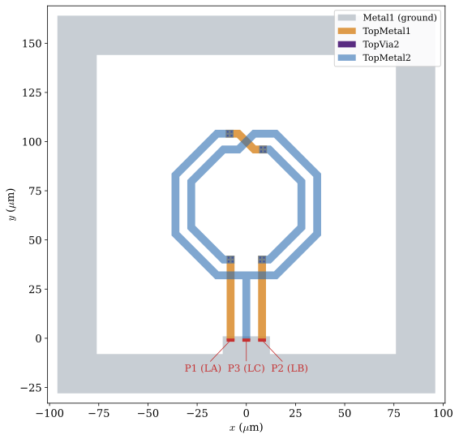{#fig-vco-ind-em-layout width=70%}

| Setting | Value |
| :--- | :--- |
| Process stackup | `SG13G2_200um.xml` of the PDK, with its 200 $\mu$m lossy substrate |
| Ports | three 50 $\Omega$ lumped ports at `LA`, `LB` and the center tap `LC` |
| Metal model | volume: the current is solved inside the metal, via arrays merged into blocks with their resistance corrected (`fill_factor_correction`) |
| Mesh | 2 $\mu$m cells in TopMetal1 and TopMetal2 |
| Element order | 3 |
| Frequency sweep | 0 Hz to 60 GHz in 0.75 GHz steps (gds2palace replaces 0 Hz by 10 MHz and 20 MHz), adaptive, to cover the third harmonic |
| Cost | 35 minutes and 9.8 GB with `NP=16` on a compute host |

: Palace settings of the coil. {#tbl-vco-em-settings tbl-colwidths="[25,75]"}

::: {.callout-important}
## Check the EM Result Against Something You Can Calculate
gds2palace models a metal either as a hollow shell with a surface impedance on every face (its default) or as a solid volume. The coil's traces are 4 $\mu$m wide and 2 $\mu$m to 3 $\mu$m thick, where the surface model is least accurate. The DC resistance shows which model is right, because it follows from the drawn lengths and the sheet resistances of the stackup by hand. For the first coil of this macro, the traces and the via fields add up to 2.8 $\Omega$. The volume model gave 2.93 $\Omega$ at 10 MHz, the surface model 1.65 $\Omega$, less than the traces alone, and a Q 46 % too high at 20 GHz. Check the mesh the same way: a finer mesh or a higher element order has to leave the result unchanged. Going from second to third order changed the Q of this coil by 2.3 % at 20 GHz.
:::

## Lumped-Element Models with snp2le {#sec-rf-snp2le}

A circuit simulator does not read S-parameters in a transient or a PSS. [snp2le](https://github.com/iic-jku/snp2le) turns a Touchstone file into a lumped-element netlist for both simulators of the flow, `netlist/spice/<name>.spice` for ngspice and `netlist/spectre/<name>.inc` for VACASK. It has two modes:

- **Universal.** A vector fit of the S-parameters with [scikit-rf](https://scikit-rf.org), synthesized into resistors, capacitors and controlled sources, with passivity enforced. It works for any structure and any number of ports, but its elements have no physical meaning. Its resistors are therefore noiseless, and `--thermal-noise` adds the thermal noise the passive really has.
- **Structure-specific.** A physical topology fitted to the data, so every element maps to the structure: `inductor-pi`, `inductor-wideband` and `inductor-ct` for coils, `mim-cap` for MIM and MoM capacitors, `tline-rlgc` for transmission lines, and models of the Wilkinson divider, the branch-line coupler and the balun. Its resistors are the loss of the structure and carry their thermal noise.

```sh
make snp2le                                                         # inductor-ct fit of verification/em/s-parameter/vco_ind.s3p
make snp2le EM=<structure> SNP=<file.sNp> LE_MODEL=universal ORDER=8
```

The coil uses `inductor-ct`, the wideband model of a center-tapped coil: two coupled half coils with their skin effect and substrate network, fitted over the whole band of the EM data. The file stem, the `.SUBCKT` name and the name of the symbol are the same (`vco_ind_le`), so a new fit drops into the schematic without an edit. The SPARX documentation explains both modes, the passivity enforcement and the noise in its [snp2le](https://iic-jku.github.io/SG13CMOS_SPARX/#sec-snp2le) chapter.

`vco_ind.sch` holds two views of the coil. The PDK's `inductor3` is what KLayout LVS compares with the layout, and every simulation netlist skips it. The model `vco_ind_le` is what the simulations use, and the LVS netlist skips it. The testbench `vco_ind_tb_acsp_vacask` checks the model against the EM data with VACASK's S-parameter analysis (ACSP), @fig-vco-ind-acsp. From 1.5 GHz to 40 GHz the model is within 2.9 % of the EM inductance and within 3.7 % of its Q, and at 20.25 GHz it gives 427 pH and a Q of 10.6 against 418 pH and 10.9 from EM.

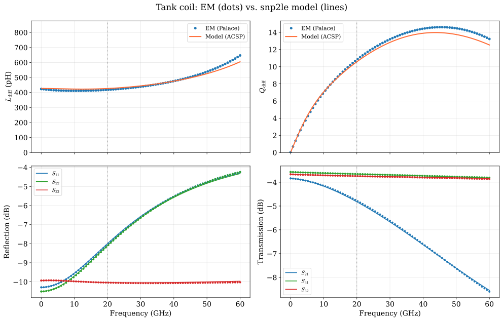{#fig-vco-ind-acsp}

::: {.callout-note}
The substrate network of the coil model returns to the global ground node `0`, so `VSS` has to be the ground of every testbench that uses it.
:::

## Circuit Simulation with Xschem and VACASK {#sec-rf-sim}

### Why VACASK

[VACASK](https://codeberg.org/arpadbuermen/VACASK) by Árpád Bűrmen is a circuit simulator with a Spectre-like netlist syntax, whose device models are Verilog-A compiled with OpenVAF. The IIC-OSIC-TOOLS container ships it with the complete set of RF analyses since its `2026.10` release: ACSP, transient noise, HB, HBAC, HBNOISE, PSS, PAC and PNOISE. ngspice, the other simulator of the flow, has an S-parameter analysis and transient noise, but no periodic small-signal or noise analysis in its releases. The `vco` therefore uses both simulators: ngspice for the transients (start-up, corners, power-up, post-layout), VACASK for everything that needs the periodic steady state and for the transient noise. Two simulators that share no solver code also check each other: the tuning transient of VACASK agrees with the transient of ngspice within 0.1 % in frequency.

Xschem netlists a testbench for VACASK in the Spectre format. The Makefile picks the simulator from the name of the testbench:

```sh
make sim-xschem                              # vco_top_tb_tran, ngspice
make sim-xschem TB=vco_top_tb_pss_vacask     # oscillator PSS, PNOISE and PAC, VACASK
make sim-xschem TB=vco_top_tb_tune_vacask    # tuning curve, one transient per tuning voltage, VACASK
make sim-xschem TB=vco_ind_tb_acsp_vacask    # S-parameters of the coil model, VACASK
make sim-all                                 # the testbenches of vco_top in sequence
make sim-view-xschem                         # plot what they wrote
```

A name with `_vacask` is netlisted with `xschem set netlist_type spectre` and run with VACASK, any other name with `ngspice -b`. Both write their results as text tables to `testbenches/xschem/plot_simulations/data/`: ngspice with `wrdata`, VACASK with a postprocess hook at the end of its control block that converts every rawfile ([`vacask2data.py`](https://github.com/iic-jku/ihp-sg13g2-ams-chip-template/blob/main/macros/vco/testbenches/xschem/plot_simulations/vacask2data.py)). The plot scripts read both the same way.

### Large-Signal Analyses

An oscillator has no input, and its DC operating point is the unstable solution it leaves at start-up. Everything that describes it, the frequency, the amplitude, the phase noise and the tuning gain, belongs to its large periodic solution, so an AC or noise analysis at the DC operating point says nothing about it. The RF analyses work in two steps instead:

1. **Large-signal step.** The periodic steady state is computed directly, either in the time domain by shooting (PSS) or in the frequency domain by harmonic balance (HB), without simulating the start-up.
2. **Small-signal step.** The circuit is linearized around that periodic solution, which gives a linear periodically time-varying system. PAC and HBAC compute its transfer from one sideband to another, PNOISE and HBNOISE its noise with all the noise folded in from the harmonics.

Transient noise is the exception: it injects random noise into an ordinary transient without any linearization, and shares no code with the periodic analyses, which makes it their independent cross-check (@sec-rf-trannoise).

| Analysis | What it computes | In the `vco` |
| :--- | :--- | :--- |
| `tran` | transient | start-up (`vco_top_tb_tran`), tuning curve (`vco_top_tb_tune_vacask`), corners, power-up and post-layout |
| `acsp` | S-parameters from an AC analysis with ports | the coil model against its EM data (`vco_ind_tb_acsp_vacask`) |
| `pss` | periodic steady state by shooting, for an oscillator with the period as an unknown (`oscillator=1`) | frequency, waveform and output power (`vco_top_tb_pss_vacask`, post-layout `vco_top_tb_pss_lpe_vacask`) |
| `pac` | small-signal transfer around the PSS, sideband to sideband | the tuning gain $K_\mathrm{VCO}$ from a small tone on `vtune` |
| `pnoise` | noise around the PSS, modulated and folded | the phase noise and its contributions |
| transient noise | `tran` with random noise sources | the phase noise of the schematic against PNOISE, and of the post-layout netlist (`vco_top_tb_trannoise_vacask`, `vco_top_tb_trannoise_lpe_vacask`) |
| `hb` | periodic or multi-tone steady state by harmonic balance | not used, it suits driven circuits such as the buffer, mixers and detectors |
| `hbac`, `hbnoise` | small-signal transfer and noise around the HB solution | not used, the HB counterparts of `pac` and `pnoise` |

: VACASK analyses and where the `vco` uses them. {#tbl-rf-analyses tbl-colwidths="[15,45,40]"}

::: {.callout-tip}
## RF Circuit Simulation in the RFIC Course
The appendix [RF Circuit Simulation](https://iic-jku.github.io/radio-frequency-integrated-circuits/rfic.html#sec-simulation) of the JKU course Radio-Frequency Integrated Circuits explains every analysis of @tbl-rf-analyses, from the DC operating point to PNOISE and HBNOISE, shows how to check their results against each other, and recommends analyses for LNAs, mixers, oscillators, switched-capacitor circuits, power detectors and power amplifiers. SPARX uses HB, HBAC, HBNOISE and transient noise on its 160 GHz power detector and checks them against PSS, PAC and PNOISE, see the [Circuit Simulation](https://iic-jku.github.io/SG13CMOS_SPARX/#sec-sim) chapter of its documentation.
:::

### Anatomy of the PSS Testbench {#sec-rf-tb-pss}

@fig-vco-tb-pss shows `vco_top_tb_pss_vacask`. The macro drives an AC-coupled 50 $\Omega$ load per output, and the sources set the supply, the enable and the tuning voltage. The analyses are in the VACASK control block, here without its comments:

```text
control
  abort always
  var vdd=1.5
  options strictsave=1 pss_minpts=8000 reltol=3e-5
  save v(vout_p) v(vout_n) v("x1:rf_p") v("x1:rf_n")
  save dv(vout_p) dv(vout_n) dv("x1:rf_p") dv("x1:rf_n")
  analysis pss pss oscillator=1 tper=44.3p tstab=12n stabstep=0.5p maxharm=20 ic={"x1:rf_p", 0.8, "x1:rf_n", 0.7} store="osc"
  options strictsave=1 pss_minpts=8000 reltol=3e-5 tran_fbr=0.02 relrefres="pointglobal"
  analysis pnoise pnoise psssolve=0 ic="osc" truncharm=20 in="Vtune" out=["vout_p", "vout_n"] outharm=1 from=10k to=100M mode="dec" points=10
  analysis pac pac psssolve=0 ic="osc" truncharm=20 outharm=1 from=10k to=100M mode="dec" points=10
  postprocess(PYTHON, "../plot_simulations/vacask2data.py", "vco_top_tb_pss_vacask")
endc
```

{#fig-vco-tb-pss}

- **`abort always`** stops VACASK with a nonzero exit code when an analysis fails. Without it, VACASK exits 0 and the plot scripts read the rawfiles of the previous run.
- **`pss oscillator=1`** solves for the period as well, with `tper` as the guess. The initial condition `ic` kicks the tank away from its symmetric operating point, and the stabilization transient `tstab` lets the oscillation build up before the shooting Newton starts. `stabstep` limits its first time step. `store="osc"` keeps the solution for the analyses that follow.
- **`pss_minpts=8000`** gives the shooting at least 8000 time steps per period. At the default 1000 its Newton iteration cycles without converging, and at 4000 it can settle on a period that reads false noise on one buffer device, 4 dB too much at 1 MHz, without an error.
- **`reltol=3e-5`** is for the bias filters of the buffer. Their time constant is 1 $\mu$s against a 44 ps period, so they barely move over one period, and at the default tolerance the shooting settled them 70 mV away from their DC values without an error.
- **`pnoise` and `pac`** start from the stored solution (`psssolve=0 ic="osc"`) and observe the first harmonic at the outputs (`outharm=1`). `pac` drives the small-signal tone of the source `Vtune` (`smag=1`, 1 V) and observes the sideband it modulates onto the carrier, from which the plot script computes the tuning gain.
- **`tran_fbr=0.02`** works around a VACASK bug that is fixed in its sources since commit `7c38094` (November 2026): the period that `pnoise` and `pac` integrate restarts with a backward-Euler step at every sample, which reads the phase noise and the tuning gain low at small offsets, here the phase noise by 3.3 dB at 1 MHz. **`relrefres="pointglobal"`** takes the residual reference of the Newton from the largest contribution at the time point, since the RF decaps `Cg1` and `Cg2` on the static `vbg_buf` make the reference of that node so small that the check fails on residuals of 1e-18. The options are global, so the second `options` line restates the others.

::: {.callout-warning}
## PSS Does Not Prove Start-Up
A PSS finds a periodic solution, but it does not show that the oscillator reaches it after power-up. The start-up is checked with transients, at every corner (@sec-rf-corners) and from the supply ramp (@sec-rf-powerup). And a PSS can settle a slow state wrongly without an error, so [`plot_vco_top.py`](https://github.com/iic-jku/ihp-sg13g2-ams-chip-template/blob/main/macros/vco/testbenches/xschem/plot_simulations/plot_vco_top.py) compares its frequency with the tuning transient at the same tuning voltage and warns above 0.3 %.
:::

### Results

The start-up transient of @fig-vco-tran reaches its full amplitude within a few periods of the kick and oscillates at 22.51 GHz, with the tank nodes swinging from 0.10 V to 1.53 V. The PSS of @fig-vco-pss agrees on the frequency within 0.2 % and gives the output power at the fundamental, -8.3 dBm per output.

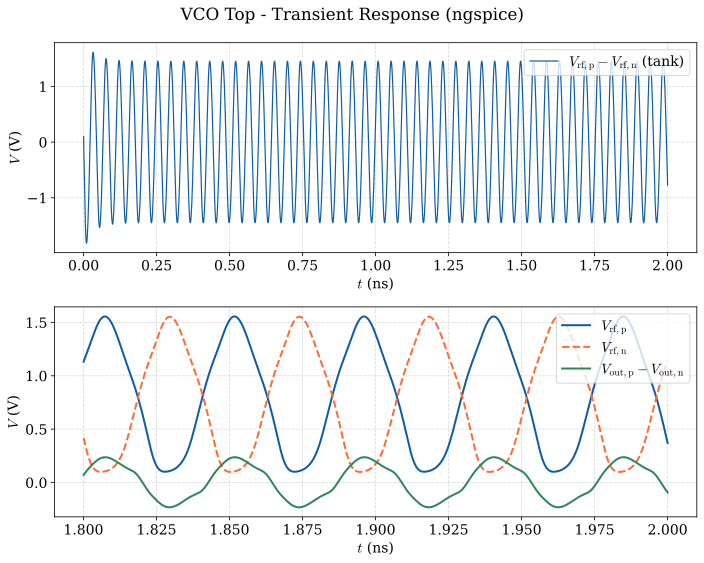{#fig-vco-tran}

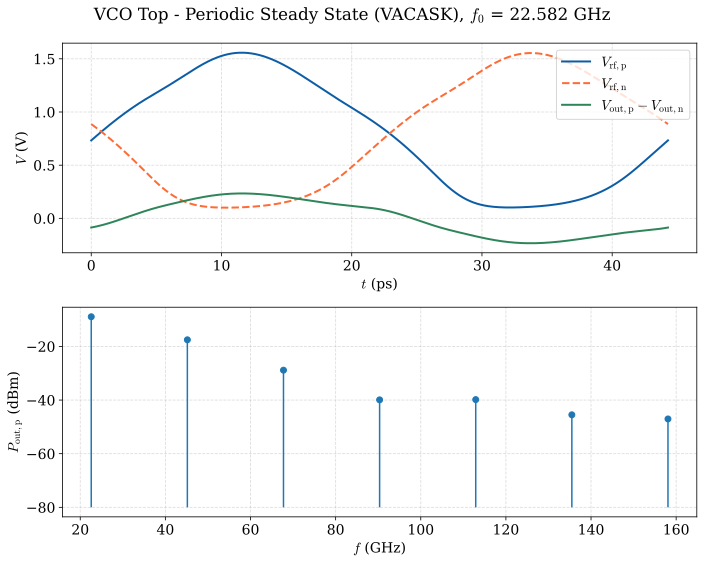{#fig-vco-pss}

The spectrum in @fig-vco-pss is that of one output. Its harmonics come from the buffer, a differential pair driven by the tank's full swing into resistive loads, and not from the tank. The second harmonic is -9.4 dBc and the third -20.9 dBc here, and -16.1 and -27.6 dBc post-layout. The second is common mode, so it cancels between the two outputs (-48.9 dBc in the schematic, -54.4 dBc post-layout).

@fig-vco-pnoise shows the phase noise from PNOISE and the tuning gain from PAC. The phase noise is -101.2 dBc/Hz at 1 MHz offset. Its contributions show where it comes from: 55 % from the core (pair, varactors and coil) and 36 % from the bias of the buffer, whose input capacitance loads the tank and moves the frequency with its bias current. Below 1 MHz that bias takes over: its noise passes the 170 kHz low-pass of the bias filters, so its share grows by 40 dB to 48 dB per decade towards lower offsets, against 20 dB for the core. The tuning gain from PAC, 1.87 GHz/V at 10 MHz, agrees within about 2 % with the slope of the tuning curve of @fig-vco-tune, whose frequencies the plot script takes from the zero crossings of each tuning transient.

{#fig-vco-pnoise}

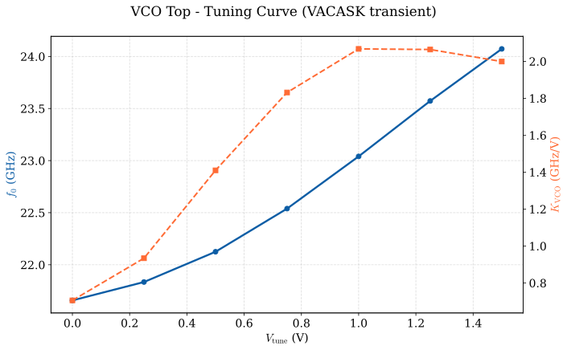{#fig-vco-tune}

{#fig-vco-tune-lpe}

The schematic has no leads, so @fig-vco-tune runs about 13 % high and never reaches 20 GHz. The macro is centered on @fig-vco-tune-lpe: 20 GHz is at `vtune` = 0.75 V, and it stays inside the tuning range at every corner (@sec-rf-corners).

::: {.callout-note}
With `oscillator=1`, VACASK's `pnoise` computes the noise as for a driven circuit, so it is the total output noise, phase and amplitude noise together. Close to the carrier that is the phase noise. Below about 100 kHz the result loses accuracy, post-layout already below about 1 MHz, so read it from there up, and check it against transient noise (@sec-rf-trannoise). The [Limitations](https://github.com/iic-jku/ihp-sg13g2-ams-chip-template/blob/main/macros/vco/README.md#limitations) of the README list what is known.
:::

Further traps of the testbenches, all documented in the README:

- **Symbols need `spectre_format`.** Without it, an instance drops out of the Spectre netlist without a warning (see @sec-pex).
- **VACASK is case sensitive** where ngspice is not, so `VSS` and `vss` are two nodes.
- **The PDK's VACASK model of the HV varactor** keeps an ngspice voltage term that VACASK cannot evaluate. Its coefficients are all 0, so the testbenches read a copy of the corner file from `testbenches/xschem/models/` with the term removed.
- **The ngspice transient needs `rshunt=1e12`**, because the varactor model has a node without a DC path, and the operating point otherwise takes more than a minute of gmin stepping.

## Corners {#sec-rf-corners}

```sh
make sim-corners                                    # SS, TT, FF at -40 C, 27 C, 85 C, vtune 0 V and 1.5 V
make sim-corners TB=vco_top_tb_tran_lpe             # the same with the post-layout netlist
make sim-corners TB=vco_top_tb_tran_lpe RES_CORNERS="res_typ res_wcs res_bcs" VDDS="1.35 1.5 1.65"
```

`sim-corners` netlists a transient testbench once and runs [`sim_corners.py`](https://github.com/iic-jku/ihp-sg13g2-ams-chip-template/blob/main/macros/vco/scripts/sim_corners.py), which writes one copy of the netlist per MOS corner, resistor corner, temperature, `VDD` and `vtune`, every combination of the lists, runs ngspice on four of them at a time, and writes a CSV table. It fails when a run does not oscillate or when a tank node passes 1.5 V on the post-layout testbench. The resistors count as much as the transistors here: `Rct` feeds the core and `Rb` sets the bias, so the weak end is the high resistor corner `res_wcs` with `VDD` at 1.35 V, and the strong end `res_bcs` with 1.65 V. @tbl-vco-corners shows the three cases from the committed post-layout table, 18 runs each.

| Resistors, `VDD` | Frequency | Center tap | `VDD` current | Highest node | Lowest output |
| :--- | :--- | :--- | :--- | :--- | :--- |
| `res_typ`, 1.5 V | 19.05 GHz to 21.31 GHz | 0.73 V to 0.81 V | 9.6 mA to 12.1 mA | 1.31 V | -12.3 dBm |
| `res_wcs`, 1.35 V | 19.10 GHz to 21.44 GHz | 0.68 V to 0.77 V | 7.1 mA to 9.2 mA | 1.16 V | -15.6 dBm |
| `res_bcs`, 1.65 V | 19.00 GHz to 21.16 GHz | 0.79 V to 0.86 V | 12.5 mA to 15.4 mA | 1.48 V | -10.1 dBm |

: Post-layout corners: SS, TT and FF at -40 C, 27 C and 85 C, `vtune` at 0 V and 1.5 V, for each resistor corner and supply. {#tbl-vco-corners}

Every one of the 162 post-layout runs starts, the tuning range covers 20 GHz at every corner (19.00 GHz to 21.44 GHz in all), and the highest tank node reaches 1.477 V. The window is narrow at the strong end, where the highest node comes close to the 1.5 V that the thin-oxide pair may see, see [Corners](https://github.com/iic-jku/ihp-sg13g2-ams-chip-template/blob/main/macros/vco/README.md#corners) in the README.

## Power-Up and Enable {#sec-rf-powerup}

A kick on the tank shows that the oscillator runs, not that it starts from a supply ramp. `vco_top_tb_powerup_lpe` simulates the post-layout macro from zero: `VDD` ramps in 10 ns, `di_en` rises at 100 ns and falls at 8.1 $\mu$s, and the run ends at 10.1 $\mu$s.

```sh
make sim-powerup                # 44 post-layout transients, hours on a compute host
make sim-view-xschem            # the plot of the nominal run, with the others
```

[`sim_powerup.py`](https://github.com/iic-jku/ihp-sg13g2-ams-chip-template/blob/main/macros/vco/scripts/sim_powerup.py) runs that sequence and five more: `di_en` low throughout, `di_en` tied to `VDD`, the same with a 1 ns ramp, `di_en` high before `VDD`, and `di_en` 300 ns after it, at the nominal point and at the corners closest to not starting and to the highest tank node. It measures each run period by period and fails when the tank does not start, a node passes 1.5 V, a disabled run oscillates, or the output has not settled.

{#fig-vco-powerup}

| Sequence | Runs | Result | Tank up after | Highest node |
| :--- | :--- | :--- | :--- | :--- |
| `VDD` first, `di_en` up at 100 ns and down at 8.1 us | 5 | 5 ok | 6.4 ns at most | 1.342 V |
| `di_en` low | 19 | 19 without oscillation, tank swing below 1 nV, at most 0.6 uA from `VDD` | | |
| `di_en` tied to `VDD`, 10 ns ramp | 5 | 5 ok | 3.6 ns at most | 1.337 V |
| `di_en` tied to `VDD`, 1 ns ramp | 5 | 5 ok | 5.3 ns at most | 1.339 V |
| `di_en` before `VDD` | 5 | 5 ok | 3.6 ns at most | 1.337 V |
| `di_en` 300 ns after `VDD` | 5 | 5 ok | 3.7 ns at most | 1.342 V |

: Post-layout power-up and enable, from `vco_top_tb_powerup_lpe_corners.csv`. {#tbl-vco-powerup}

Every run passes. With `di_en` rising at 100 ns, the tank is up after 3.8 ns at TT, 27 C, and after 6.4 ns at the slowest corner. The output takes longer: the bias filters of the buffer (170 kHz) set its current, so the output reaches 99 % of its final swing after 4.8 us at TT and 5.6 us at worst, and the frequency comes within 10 MHz of its final value after 3.6 us. When `di_en` falls, the output drops below 10 % within 3 ns, and the macro draws 9 nA from `VDD` at TT, 27 C with `di_en` low.

## Transient Noise and the Post-Layout Phase Noise {#sec-rf-trannoise}

PNOISE linearizes the circuit around one periodic solution. Transient noise does not: it adds random noise sources to an ordinary transient and reads the phase noise from the zero crossings of the result. It shares no code with PNOISE and checks it, on the schematic and on the post-layout netlist. The post-layout PSS, `vco_top_tb_pss_lpe_vacask`, runs the analyses of @sec-rf-tb-pss on the post-layout wrapper of @sec-rf-postlayout with gear integration, since with the trapezoidal rule its shooting does not converge ([VACASK#174](https://codeberg.org/arpadbuermen/VACASK/issues/174)). It needs VACASK `f29d2b0` or later ([VACASK#173](https://codeberg.org/arpadbuermen/VACASK/issues/173)).

```sh
make sim-trannoise        # the schematic, 8 seeds, against PNOISE
make sim-trannoise-lpe    # the post-layout netlist, 8 seeds
make sim-pss-lpe          # PSS, PNOISE and PAC of the post-layout netlist, about 1.5 hours
```

The benches settle the oscillation for 6 ns, store the state, and run a noisy transient of 5 $\mu$s (4 $\mu$s post-layout) from it, at a fixed step of 0.25 ps with noise from 100 kHz to 100 GHz, one VACASK process per seed. [`sim_trannoise.py`](https://github.com/iic-jku/ihp-sg13g2-ams-chip-template/blob/main/macros/vco/scripts/sim_trannoise.py) takes the zero crossings of the tank's differential voltage, computes the phase from the period-to-period differences, and averages the spectra of the seeds. Since every seed starts from the same state, what they share is a drift and not noise, and the script subtracts it. `make check-trannoise` tests that spectrum code on synthetic jitter with a known spectrum.

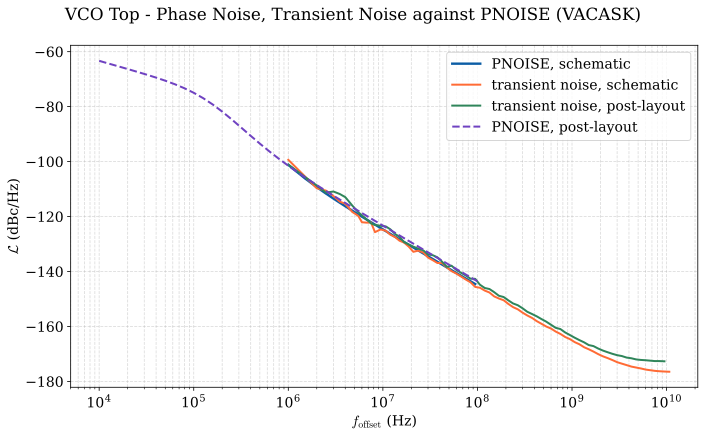{#fig-vco-trannoise}

| Offset | PNOISE, schematic | Transient noise, schematic | PNOISE, post-layout | Transient noise, post-layout |
| :--- | :--- | :--- | :--- | :--- |
| 1 MHz | -101.2 dBc/Hz | -99.4 dBc/Hz | -101.5 dBc/Hz | -101.1 dBc/Hz |
| 3 MHz | -113.5 dBc/Hz | -112.5 dBc/Hz | -112.4 dBc/Hz | -110.9 dBc/Hz |
| 10 MHz | -124.7 dBc/Hz | -124.9 dBc/Hz | -123.3 dBc/Hz | -123.5 dBc/Hz |
| 30 MHz | -134.5 dBc/Hz | -134.9 dBc/Hz | -133.0 dBc/Hz | -133.8 dBc/Hz |
| 100 MHz | -145.1 dBc/Hz | -145.8 dBc/Hz | -143.6 dBc/Hz | -143.7 dBc/Hz |

: Phase noise from PNOISE and from transient noise. {#tbl-vco-trannoise}

`make sim-trannoise` checks PNOISE with an analysis that shares no code with it: on the schematic, transient noise over 8 seeds and PNOISE differ by -0.7 dB to +1.9 dB from 1 MHz to 100 MHz, with a scatter of the seeds of about 0.9 dB at 1 MHz. Post-layout they differ by -0.8 dB to +1.5 dB, with a scatter of 1.0 dB at 1 MHz. At 1 MHz the post-layout PNOISE is 0.3 dB below the schematic's, less than the 1.0 dB that the lower carrier alone would give.

## Post-Layout Simulation {#sec-rf-postlayout}

The post-layout testbench `vco_top_tb_tran_lpe` is the start-up transient around the wrapper [`vco_top_lpe.sch`](https://github.com/iic-jku/ihp-sg13g2-ams-chip-template/blob/main/macros/vco/testbenches/xschem/vco_top_lpe.sch), which puts three models together: the extraction of the macro without the coil and the varactor array (@sec-rf-verify), the EM model of the coil at the coil's feeds, and the schematic of the varactor array at the middle of its buses. The corners, the power-up, the post-layout transient noise and the post-layout PSS place the same wrapper.

```sh
make klayout-pex-leads
make sim-xschem TB=vco_top_tb_tran_lpe
```

| TT, 27 C, `vtune` = 0.75 V | Schematic | Post-layout |
| :--- | :--- | :--- |
| Frequency | 22.51 GHz | 20.00 GHz |
| Tuning range, `vtune` 0 V to 1.5 V | 21.62 GHz to 24.01 GHz | 19.34 GHz to 21.18 GHz |
| Tank nodes | 0.10 V to 1.53 V | 0.24 V to 1.23 V |
| Output, from the peak-to-peak swing | -7.4 dBm | -10.0 dBm |
| Center tap | 0.78 V | 0.76 V |
| `VDD` current | 11.6 mA | 10.9 mA |

: Schematic against post-layout, both from the ngspice transient. {#tbl-vco-postlayout}

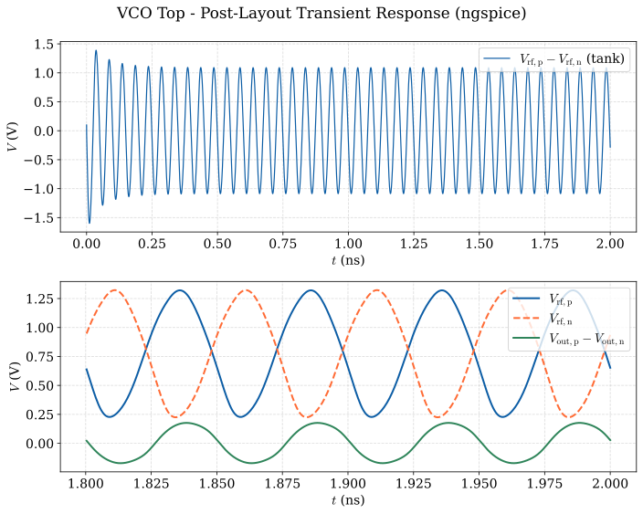{#fig-vco-tran-lpe}

- **The frequency falls by 11 %**, through the capacitance of the leads and of the buffer's input, which the tank sees through the coupling capacitors.
- **The swing is smaller**, because the resistance of the leads adds to the coil's own loss: from the coil's feed 1.3 $\Omega$ to the varactors, 2.1 $\Omega$ to the pair's drains and 4.8 $\Omega$ to its gates.
- **The macro is centered on this simulation.** The varactors are sized so that 20 GHz sits in the middle of the post-layout tuning range, and `Rct` so that every post-layout corner starts and stays below 1.5 V.

The post-layout simulation changed the layout three times. The first core joined the source bar of the pair to `VSS` through a single via stack, which the extraction showed as 14.7 $\Omega$ in series with the core current. Later, with every resistance extracted, half of the corners did not start: the leads had several ohms in series with the tank, and the `VSS` strap of the macro, 2 $\mu$m of the thin Metal5, put 5.1 $\Omega$ between the pin and the pair. Via rows along the gate pads, tank lines doubled on Metal4, via stacks along the source bar and a TopMetal2 strap over the `VSS` strap fixed both, and the path from the `VSS` pin to the sources has 1.4 $\Omega$ now. The gate lines of the buffer came last: Magic reads a net that only drives gates as one node, so a port on each input (`LEADS_PROBES`) had to make the extraction keep their resistance, and two via rows along the gate pads hold it at 5.8 $\Omega$.

## Full RF Macro Flow {#sec-full-rf-flow}

```sh
make all                  # layouts, verification, deliverables and simulations, about 28 minutes
make em-model             # EM simulation of the coil, its model and the ACSP check, 35 minutes on a compute host
make sim-corners TB=vco_top_tb_tran_lpe RES_CORNERS="res_typ res_wcs res_bcs" VDDS="1.35 1.5 1.65"
make sim-tune-lpe         # post-layout tuning curve, about a minute
make sim-powerup          # power-up and enable, hours on a compute host
make sim-trannoise        # transient noise of the schematic against PNOISE, hours
make sim-trannoise-lpe    # post-layout phase noise, hours
make sim-pss-lpe          # post-layout PSS, PNOISE and PAC, about 1.5 hours
```

A new RF macro starts as a renamed copy of this one: `make macro FROM=vco NAME=<name>` in [`macros/`](https://github.com/iic-jku/ihp-sg13g2-ams-chip-template/tree/main/macros/), as for the digital and the analog macro.

::: {.callout-tip}
## More Open-Source RF Designs
[SPARX](https://github.com/iic-jku/SG13CMOS_SPARX) goes further on every step of this chapter: a 160 GHz six-port receiver generated with GDSFactory, the EM simulation of multi-port passives, vector-fit models of its seven-port core, and HB, HBAC, HBNOISE and transient noise on a power detector. Its [documentation](https://iic-jku.github.io/SG13CMOS_SPARX/) walks through the flow.
:::


# Bondpad, RF Pad and Logo Implementation {#sec-ip}

The [`ip/`](https://github.com/iic-jku/ihp-sg13g2-ams-chip-template/tree/main/ip/) folder holds the three custom IP cells that the top-level chip relies on: a bondpad and two logos. These IPs are generated and require zero hand drawing. Each IP ships with a Python script and Makefile targets that produce the final GDS and LEF, and run KLayout and gdscheck DRC. This makes it easy to re-spin a different bondpad size or shape, swap the logo image, or move the artwork to another metal layer without touching layout tools.

The three IP cells covered in this section are:

- [`sg13g2_ip__bondpad_70x70`](https://github.com/iic-jku/ihp-sg13g2-ams-chip-template/tree/main/ip/sg13g2_ip__bondpad_70x70/), a 70 µm × 70 µm square bondpad built from IHP's `SG13_dev` KLayout PCell library,
- [`sg13g2_ip__jku`](https://github.com/iic-jku/ihp-sg13g2-ams-chip-template/tree/main/ip/sg13g2_ip__jku/), the [Johannes Kepler University Linz](https://www.jku.at/) logo, generated from a PNG image,
- [`sg13g2_ip__jku_names`](https://github.com/iic-jku/ihp-sg13g2-ams-chip-template/tree/main/ip/sg13g2_ip__jku_names/), a companion text block with the names of the institute, generated the same way as the JKU logo.

All three IPs follow the same folder structure (`script/`, `final/`, `verification/`) and the same Makefile conventions as the digital and analog macros (`make help`, `make all`, `make clean`, `make klayout-drc`, `make magic-drc`, `make gdscheck-drc`). The logo folders `sg13g2_ip__jku` and `sg13g2_ip__jku_names` have an additional `logo/` folder that contains the source PNG image. The folder also holds an RF pad, which the chip does not use by default, see @sec-rf-pad.

## Directory Structure

The IP design files are located in [`ip/`](https://github.com/iic-jku/ihp-sg13g2-ams-chip-template/tree/main/ip/), and the relevant folders are:

| Folder                                                                                                                                                                                  | Content                                                                                          |
| --------------------------------------------------------------------------------------------------------------------------------------------------------------------------------------- | ------------------------------------------------------------------------------------------------ |
| [`sg13g2_ip__bondpad_70x70/script/`](https://github.com/iic-jku/ihp-sg13g2-ams-chip-template/tree/main/ip/sg13g2_ip__bondpad_70x70/script/) | KLayout Python script ([`bondpad.py`](https://github.com/iic-jku/ihp-sg13g2-ams-chip-template/blob/main/ip/sg13g2_ip__bondpad_70x70/script/bondpad.py)) that instantiates the `SG13_dev::bondpad` PCell and writes the GDS and LEF. |
| [`sg13g2_ip__jku/logo/`](https://github.com/iic-jku/ihp-sg13g2-ams-chip-template/tree/main/ip/sg13g2_ip__jku/logo/) and [`sg13g2_ip__jku_names/logo/`](https://github.com/iic-jku/ihp-sg13g2-ams-chip-template/tree/main/ip/sg13g2_ip__jku_names/logo/) | Source PNG images (`jku_logo.png`, `jku_names.png`) for the two logos. |
| [`sg13g2_ip__jku/script/`](https://github.com/iic-jku/ihp-sg13g2-ams-chip-template/tree/main/ip/sg13g2_ip__jku/script/) and [`sg13g2_ip__jku_names/script/`](https://github.com/iic-jku/ihp-sg13g2-ams-chip-template/tree/main/ip/sg13g2_ip__jku_names/script/) | PNG-to-GDS converter ([`img2lay.py`](https://github.com/iic-jku/ihp-sg13g2-ams-chip-template/blob/main/ip/sg13g2_ip__jku/script/img2lay.py)) shared by both logos. |
| `final/gds/`, `final/lef/`, `final/lib/`, `final/vh/` | Build deliverables for top-level integration: GDS, LEF, Liberty, and Verilog blackbox stubs. |
| `verification/drc/` | DRC reports produced by `make klayout-drc`, `make magic-drc` and `make gdscheck-drc`. |

::: {.callout-tip}
Read the [bondpad README](https://github.com/iic-jku/ihp-sg13g2-ams-chip-template/blob/main/ip/sg13g2_ip__bondpad_70x70/README.md), the [JKU logo README](https://github.com/iic-jku/ihp-sg13g2-ams-chip-template/blob/main/ip/sg13g2_ip__jku/README.md), and the [JKU names README](https://github.com/iic-jku/ihp-sg13g2-ams-chip-template/blob/main/ip/sg13g2_ip__jku_names/README.md) first to get familiar with the Makefile targets and parameters. Most of the commands below are also documented there.
:::

## Bondpad Generation

The bondpad is generated by the Python script [`script/bondpad.py`](https://github.com/iic-jku/ihp-sg13g2-ams-chip-template/blob/main/ip/sg13g2_ip__bondpad_70x70/script/bondpad.py), which runs in KLayout batch mode (`klayout -zz`). It

1. instantiates the `bondpad` PCell from IHP's `SG13_dev` library,
2. places it in a top cell named after the output file, as the static child cell `bondpad`,
3. writes the layout as a GDSII file, and
4. generates a matching LEF macro description for OpenROAD / LibreLane.

Geometry and metal stack are parameterised through three Makefile variables. The defaults match the chip's padframe and the SG13G2 PDK defaults.

| Variable       | Default  | Description                                                                                                                                  |
| -------------- | -------- | -------------------------------------------------------------------------------------------------------------------------------------------- |
| `DIAMETER`     | `70.0`   | Bondpad diameter / side length in µm.                                                                                                        |
| `SHAPE`        | `square` | Pad geometry. Allowed: `square`, `octagon`, `circle`.                                                                                        |
| `BOTTOM_METAL` | `3`      | Lowest metal in the pad stack: `1`=`Metal1` .. `5`=`Metal5`, `6`=`TopMetal1`. Top is fixed to `TopMetal2`. Default `3` matches `bondpad_bottomMetal` in [`sg13g2_tech.json`](https://github.com/IHP-GmbH/IHP-Open-PDK/blob/main/ihp-sg13g2/libs.tech/klayout/python/sg13g2_pycell_lib/sg13g2_tech.json). |

The available Makefile targets for the bondpad are summarised below.

| Target        | What it does                                                                                                                                                                                            |
| ------------- | ------------------------------------------------------------------------------------------------------------------------------------------------------------------------------------------------------- |
| `bondpad`     | Generate GDS and LEF via [`bondpad.py`](https://github.com/iic-jku/ihp-sg13g2-ams-chip-template/blob/main/ip/sg13g2_ip__bondpad_70x70/script/bondpad.py) (`make bondpad [DIAMETER=<um>] [SHAPE=<square\|octagon\|circle>] [BOTTOM_METAL=<1-6>]`). |
| `verilog`     | Generate a Verilog blackbox stub.                                                                                                                                                                       |
| `klayout-drc` | Run KLayout DRC (`make klayout-drc [CELL=<cellname>] [DRC_LEVEL=<precheck\|macro\|regular>] [DRC_JOBS=<n>]`).                                                                                                                                                 |
| `magic-drc`   | Run Magic DRC (`make magic-drc [CELL=<cellname>]`), not part of `make all`.                                                                                                                                                     |
| `gdscheck-drc` | Run gdscheck DRC (`make gdscheck-drc [CELL=<cellname>] [DRC_LEVEL=<precheck\|macro\|regular>] [GDSCHECK_SUITE=<suite>\|GDSCHECK_DECKS=<decks>] [DRC_JOBS=<n>]`). |
| `open`        | Browse this folder with `sak-open.py` and open each file in its tool (needs the VNC/X11 desktop).                                                                                                        |
| `clean`       | Remove the `final/` and `verification/drc/` output directories.                                                                                                                                         |

To execute the `clean`, `bondpad`, `verilog`, `klayout-drc`, and `gdscheck-drc` targets in sequence, run:

```sh
cd ip/sg13g2_ip__bondpad_70x70
make all
```

View the bondpad layout in KLayout with:

```sh
ke final/gds/sg13g2_ip__bondpad_70x70.gds
```

{#fig-bondpad-layout width=60%}

The bondpad goes from `Metal3` up to `TopMetal2` by default, but the `BOTTOM_METAL` Makefile variable can be set to change the lowest metal in the stack. The pad is surrounded by the pad recognition layer `dfpad` (`41/0`).

The `bondpad` target accepts the geometry and metal-stack variables as command-line overrides. For example, to build an octagonal 80 µm bondpad from `Metal2` up to `TopMetal2`, run:

```sh
make bondpad DIAMETER=80 SHAPE=octagon BOTTOM_METAL=2
```

## RF Pad Generation {#sec-rf-pad}

A signal in the GHz range feels the load of `sg13g2_IOPadAnalog`: about 475 fF at the pad, from 144 fF of devices (ngspice, 20 GHz), 229 fF of cell metal and 100 fF of bondpad (Magic). [`sg13g2_ip__rfpad_70x70`](https://github.com/iic-jku/ihp-sg13g2-ams-chip-template/tree/main/ip/sg13g2_ip__rfpad_70x70/) is one cell of 80 µm × 250 µm that takes the slot of an analog pad plus its bondpad and loads the node with about 204 fF in total, metal and ESD included, with a defined return path under the pad. Its generator [`script/rfpad.py`](https://github.com/iic-jku/ihp-sg13g2-ams-chip-template/blob/main/ip/sg13g2_ip__rfpad_70x70/script/rfpad.py) has no parameters, the cell is fixed:

```sh
cd ip/sg13g2_ip__rfpad_70x70
make all
ke final/gds/sg13g2_ip__rfpad_70x70.gds
```

{#fig-rfpad-layout width=30%}

The capacitance comes down through four layout decisions:

- **A Metal1 shield under the plate.** Metal below TopMetal2 is only a ring in the `bondpad` PCell, so the plate looks straight down into the substrate, a lossy return path. A solid Metal1 plate on `vss` turns it into a capacitor to a defined ground.
- **A corridor through the rails.** The TopMetal2 and TopMetal1 rails are cut around the RF line, 5 µm clear on either side, and `iovss` and `iovdd` cross it on Metal3 to Metal5 and Metal2. Cutting TopMetal1, the layer right under the line, is worth 6.8 fF, the 5 µm gap against the `TM2.b` minimum of 2.0 µm another 2.5 fF (Magic).
- **A teardrop exit.** TopMetal2 allows only 0°, 45° and 90°, and `Pad.fR` asks for 7 µm of unchanged metal past the pad, so the line holds 14.92 µm for 7 µm and then tapers at 45° onto 4.92 µm. Past the ESD tap it narrows to 2.0 µm, because it no longer carries the strike.
- **Small ESD devices on the core rails.** `diodevss_2kv` and `diodevdd_2kv` add 52 fF. They connect to `vss` and `vdd`, so an RC-triggered clamp between `vdd` and `vss` sits in the same cell, under the IO bands.

Two kinds of faults are invisible to the usual checks: LVS compares devices, and the rails carry none, while DRC reads two touching shapes as one polygon. A pad shorted to a rail or a floating shield therefore passes both. `rfpad.py` checks the geometry and probes the connectivity before it writes any view, and stops if a check fails. Try it: set `TM2_RAIL_GAP` in the script to `4.0` and run `make rfpad`.

KLayout reports 7 `Pad.fR_M1` markers on the cell, because the shield's 3 µm collar crosses `dfpad` and the 80 µm cell has no room for the 7 µm the recommended rule asks for. The collar is what keeps the rim field of the pad off the substrate, so `make klayout-drc` waives exactly those 7 markers and fails on any other count. gdscheck flags the same collar as 3 `Pad.fR` in its `recommended` suite and is clean otherwise, and `make klayout-lvs` matches the schematic.

The chip does not use this pad by default. Its height needs a change in the pad ring step, because the rail bands of the cell abut its neighbours only when its outer edge sits where the outer edges of the bondpads are. The [RF pad README](https://github.com/iic-jku/ihp-sg13g2-ams-chip-template/blob/main/ip/sg13g2_ip__rfpad_70x70/README.md#using-the-rf-pad-on-a-chip) lists what a chip needs in its `config.yaml`, together with the capacitance budget and what the ESD diodes draw when a circuit on a higher supply lifts the pad above `vdd`.

## Logo Generation

Both logo IPs share the same Makefile targets and PNG-to-GDS converter [`script/img2lay.py`](https://github.com/iic-jku/ihp-sg13g2-ams-chip-template/blob/main/ip/sg13g2_ip__jku/script/img2lay.py), built on the `klayout.db` Python module. The conversion proceeds in five steps:

1. Open the source PNG (`logo/jku_logo.png` or `logo/jku_names.png`) and convert it to a binary mask using a brightness threshold (default `128`).
2. Optionally invert the mask (`--invert`) so that the dark logo regions become the foreground.
3. For each foreground pixel, draw a square of side `--pixel-size` µm on the selected metal layer.
4. Merge adjacent rectangles into larger polygons (`--merge`) to keep the GDS small and DRC-friendly.
5. Add the block-bounding rectangle on the boundary layers `prBoundary` (`189/0`) and `NoMetFiller` (`160/0`).

The Makefile derives the foreground GDS layer number (e.g. `67/0` for `Metal5`) and the LEF obstruction layer name from the same `LAYER` variable, so the artwork in the GDS and the blockage exposed to the router always stay consistent.

Both logos share the same set of Makefile variables as shown below. The `jku_names` logo uses a finer standard pixel size to ensure the readability of the smaller text elements.

| Variable      | Default (`jku` / `jku_names`) | Description                                                                                       |
| ------------- | ----------------------------- | ------------------------------------------------------------------------------------------------- |
| `IMG_SIZE_PX` | `750` / `750`                 | Source image side length in pixels. Used to compute the scale factor automatically.               |
| `BLOCK_SIZE`  | `100`  / `100`                | Physical side length of the rendered logo in µm.                                                  |
| `PIXEL_SIZE`  | `0.50` / `0.25`               | Edge of one rendered pixel in µm. Must stay ≥ the layer's minimum width (`0.21` µm on `Metal5`).  |
| `LAYER`       | `Metal5` / `Metal5`           | Foreground metal layer. One of `Metal1`..`Metal5`, `TopMetal1`, `TopMetal2`.                      |

The image scale factor is computed automatically as `BLOCK_SIZE / (IMG_SIZE_PX * PIXEL_SIZE)`, so changing any of the three keeps the rendered block at the target physical size.

The available Makefile targets for the logos are summarised below.

| Target        | What it does                                                                                       |
| ------------- | -------------------------------------------------------------------------------------------------- |
| `logo`        | Convert the PNG into a GDSII layout using [`img2lay.py`](https://github.com/iic-jku/ihp-sg13g2-ams-chip-template/blob/main/ip/sg13g2_ip__jku/script/img2lay.py). |
| `lef`         | Emit a minimal LEF macro (`CLASS BLOCK`, full-area `OBS` on `LAYER_NAME`).                         |
| `lib`         | Emit a Liberty timing stub (empty cell) so the LibreLane flow can pick the cell up.                |
| `verilog`     | Emit a Verilog blackbox stub (`module sg13g2_ip__jku;`) with no ports.                             |
| `klayout-drc` | Run KLayout DRC (same `DRC_LEVEL` selection as the bondpad).                                            |
| `magic-drc`   | Run Magic DRC, not part of `make all`.                                                                                     |
| `gdscheck-drc` | Run gdscheck DRC (same `DRC_LEVEL`, `GDSCHECK_SUITE` and `GDSCHECK_DECKS` selection as the bondpad). |
| `open`        | Browse this folder with `sak-open.py` and open each file in its tool (needs the VNC/X11 desktop).  |
| `clean`       | Remove `final/` and `verification/drc/`.                                                           |

To execute the `clean`, `logo`, `lef`, `lib`, `verilog`, `klayout-drc`, and `gdscheck-drc` targets in sequence, run:

```sh
cd ip/sg13g2_ip__jku                # or ip/sg13g2_ip__jku_names
make all
```

View the JKU logo or JKU names layout in KLayout with:

```sh
ke final/gds/sg13g2_ip__jku.gds     # or sg13g2_ip__jku_names.gds
```

::: {#fig-jku-logo-layout layout-ncol=2 fig-cap="`sg13g2_ip__jku` logo (left) and `sg13g2_ip__jku` layout in KLayout (right)."}
{width=100%}

{width=100%}
:::

::: {.callout-tip}
To replace the logo with your own artwork, drop a square PNG image into `logo/` and either rename it to `jku_logo.png` / `jku_names.png`, or override `IMG_FILE` in the Makefile. A clean black-on-white image with a few hundred pixels per side and high contrast works best.
:::

## Top-Level Assembly

For top-level assembly, the [top-level Makefile](https://github.com/iic-jku/ihp-sg13g2-ams-chip-template/blob/main/Makefile) exposes two wrapper targets that descend into the IP folders and call `make all`:

```sh
make build-bondpad      # build ip/sg13g2_ip__bondpad_70x70
make build-rfpad        # build ip/sg13g2_ip__rfpad_70x70
make build-logos        # build ip/sg13g2_ip__jku and ip/sg13g2_ip__jku_names
```

All three targets are part of `make build-all` (see @sec-top), so the IP cells are refreshed automatically before the chip is hardened with LibreLane. The generated GDS, LEF, Verilog stub and Liberty files are referenced by [`flow/librelane/config.yaml`](https://github.com/iic-jku/ihp-sg13g2-ams-chip-template/blob/main/flow/librelane/config.yaml) when assembling the chip top-level. Furthermore, the Verilog stubs are instantiated in [`rtl/chip_top.sv`](https://github.com/iic-jku/ihp-sg13g2-ams-chip-template/blob/main/rtl/chip_top.sv).


# Top-Level Implementation {#sec-top}

This section covers the top-level assembly and padframe generation. The top-level files that need to be understood and modified for a new chip are:

- [`rtl/chip_top.sv`](https://github.com/iic-jku/ihp-sg13g2-ams-chip-template/blob/main/rtl/chip_top.sv), the padframe wrapper. It instantiates one I/O cell per pad and exposes the global `clk_PAD`, `rst_n_PAD`, `input_PAD`, `output_PAD`, `bidir_PAD`, and `analog_PAD` signals.
- [`rtl/chip_core.sv`](https://github.com/iic-jku/ihp-sg13g2-ams-chip-template/blob/main/rtl/chip_core.sv), the core logic. It instantiates the digital and analog macros (`counter1`, `counter2`, `inverter1`, `inverter2`, `sram_0`) and wires them together and to the I/O pads.
- [`flow/librelane/config.yaml`](https://github.com/iic-jku/ihp-sg13g2-ams-chip-template/blob/main/flow/librelane/config.yaml), the top-level LibreLane configuration. It defines the padframe order (`PAD_WEST`, `PAD_NORTH`, `PAD_SOUTH`, `PAD_EAST`), the chip area (`DIE_AREA`, `CORE_AREA`), the PDN core ring (`PDN_CORE_RING_VWIDTH`, `PDN_CORE_RING_HWIDTH`, `PDN_CORE_RING_VSPACING` and `PDN_CORE_RING_HSPACING`), the clock settings (`CLOCK_PORT`, `CLOCK_NET` and `CLOCK_PERIOD`), the macro list (`MACROS`), the bondpads, the logos, non-default routing rules (`NON_DEFAULT_RULES`, `DRT_ASSIGN_NDR`, and `RSZ_DONT_TOUCH_LIST`), STA corners, and references to `pdn_cfg.tcl` and `chip_top.sdc`.
- [`flow/librelane/pdn_cfg.tcl`](https://github.com/iic-jku/ihp-sg13g2-ams-chip-template/blob/main/flow/librelane/pdn_cfg.tcl), the Tcl script that builds the OpenROAD PDN. The bottom of the file contains the custom PDN connects for `inverter1`, `inverter2`, and `sram_0`. This is the part that has to be touched when adding new macros.
- [`flow/librelane/chip_top.sdc`](https://github.com/iic-jku/ihp-sg13g2-ams-chip-template/blob/main/flow/librelane/chip_top.sdc), timing constraints (clock period, input/output delays).
- Reference documentation for the chip, [specifications.md](https://github.com/iic-jku/ihp-sg13g2-ams-chip-template/blob/main/doc/specifications.md), [pinout.md](https://github.com/iic-jku/ihp-sg13g2-ams-chip-template/blob/main/doc/pinout.md), and [floorplan.md](https://github.com/iic-jku/ihp-sg13g2-ams-chip-template/blob/main/doc/floorplan.md).

For your own chip, `make project` renames these files and every reference to them in one step (@sec-new-chip), and their content is what you then adapt.

## Planning the Chip with PREP-IC {#sec-prep-ic}

Before you edit the files below, plan the chip as a whole: which pad sits where, how far each macro is from its pads, and whether everything fits on the die. [PREP-IC](https://github.com/iic-jku/prep-ic) (Pinout, Ring and Early floorplan Planner for ICs) does that for the IHP SG13G2 and SG13CMOS5L PDKs and their IO cells, and it knows the EUROPRACTICE packages. It needs neither RTL nor a LibreLane run, and one project file holds the whole plan.

[`doc/prep-ic/chip_top.json`](https://github.com/iic-jku/ihp-sg13g2-ams-chip-template/blob/main/doc/prep-ic/chip_top.json) is this chip as a PREP-IC project. @fig-prep-ic-gui shows it in the GUI, and @fig-prep-ic-floorplan shows the floorplan on its own.

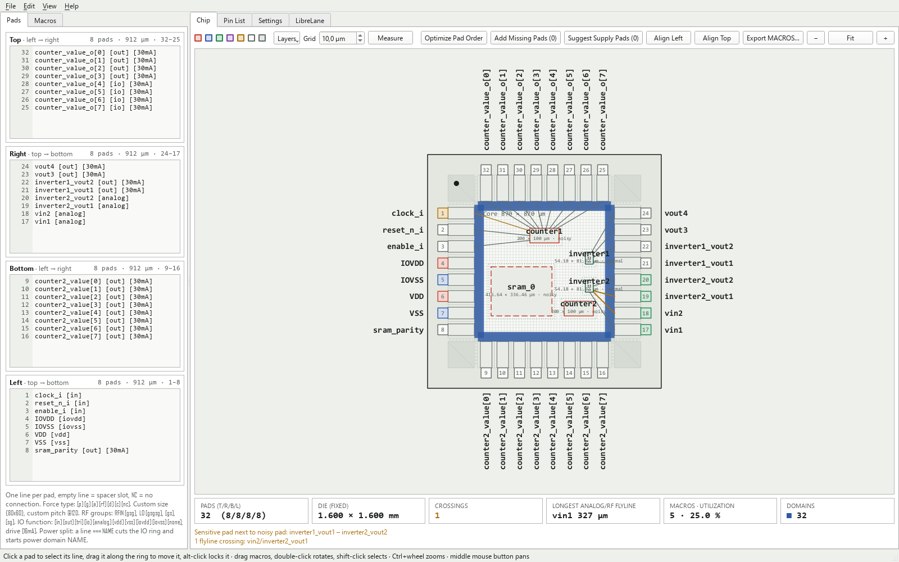{#fig-prep-ic-gui}

{#fig-prep-ic-floorplan width=75%}

### Installing and Starting

The IIC-OSIC-TOOLS container ships PREP-IC from tag `2026.11` on. On an older image, or on your own machine with Python 3.10 or newer, install it with pip:

```sh
pip install prep-ic
```

Then, from the top of the repository:

```sh
prep-ic doc/prep-ic/chip_top.json          # open this chip in the GUI, blocks until the window closes
prep-ic check doc/prep-ic/chip_top.json    # print the findings, exit code 1 if there are any
```

The GUI needs the container desktop. `prep-ic check` needs version 0.1.2 or newer, which `pip install --upgrade prep-ic` installs. The GUI does not follow the file on disk, so reopen a project you changed from outside.

### What It Can Do

**Pad ring and die.** The *Pads* tab has one editor per side, with one line per pad. The tag selects the IO cell:

| Line | Pad |
| --- | --- |
| `clk [in]` | digital input |
| `dout[0] [out] [4mA]` | digital output with its drive strength, `[tri]` and `[io]` alike |
| `ain [analog]` | analog pad |
| `VDD [vdd]` | core supply, `[vss]`, `[iovdd]` and `[iovss]` alike |
| `RFIN [gsg]`, `LO [gsgsg]` | an RF pad between two grounds, a differential pair with three grounds |
| empty line | a free slot of one pitch |
| `=== NAME` | a power split that cuts the ring and starts the domain `NAME` |

Tag every pad: without a tag, PREP-IC guesses the function from the name, and the guess can be wrong without a message. The PDK, the package, the pad pitch and whether the die size is fixed are in the *Settings* tab, and a die that is not fixed follows the pads.

**Macros.** In the *Macros* tab, *Add Macro...* reads the size and the pins of a macro from the `final/lef/` folder of its directory, and *Add Placeholder...* stands in for a macro that does not exist yet. Tick the pins that go off-chip and drag the macro in the *Chip* tab. A flyline then runs from each ticked pin to its pad. *Add Missing Pads* adds a pad per ticked pin without one, *Suggest Supply Pads* proposes supply pads for macros without one in reach, and *Optimize Pad Order* sorts the connected pads of each side by their macro pins.

**Checks.** The stat tiles and the warning line under the chip view report pads that do not fit, missing supply pads, a signal used twice, crossing flylines, pins without a pad, split differential pairs, a sensitive pad next to a noisy one, long analog flylines, and macros that overlap or leave the core. They are planning hints: a flyline is a straight line and not a route, and the limits are defaults you set in the *Settings* tab. A supply check only asks whether a supply pad is in reach, it knows nothing about current or ESD.

**Export.** The same plan gives the pin list, a drawing of the pad ring and the LibreLane files:

```sh
prep-ic export doc/prep-ic/chip_top.json \
    --csv pins.csv --svg padframe.svg --librelane <folder>
```

The folder receives `pad_cfg.tcl` and `padring_config.yaml` (pad positions and die area), `macros.yaml` (macro views and positions), `chip_top.sv` and `chip_core_template.sv` (the pad instances and a starting point for the core), and `bondplan_pinout.yaml` for the bonding diagram of @sec-packaging. Existing files are overwritten without asking, so do not point it at `flow/librelane/` of this chip. In the GUI, the *File* menu exports the same files.

### Reading the Plan of This Chip

- **A pad belongs to a macro pin by its name**, so the pads carry pin names such as `clock_i` and `counter_value_o[0]`, not the port names of [`doc/pinout.md`](https://github.com/iic-jku/ihp-sg13g2-ams-chip-template/blob/main/doc/pinout.md). When two instances tick the same pin, the pad name needs the instance as well: `inverter1_vout1` and `inverter2_vout1`, while only `inverter1` ticks `vout3`, which stays `vout3`. A pad connects to one pin only, so `clock_i` draws a line to `counter1`, although the clock also feeds `counter2` and the SRAM.
- **`sram_0` is a placeholder of the size of its LEF**, drawn dashed, because the SRAM comes from the PDK and has no macro directory.
- **`counter2` has no flylines.** PREP-IC rotates a macro but does not mirror it, and `counter2` is placed with the orientation `FS`.
- **Two findings remain:** `inverter1_vout1` sits next to `inverter2_vout2`, and the flylines of `vin2` and `inverter2_vout1` cross. Both come from the pad order of this chip and do not stop the flow. Swap `vin2` and `inverter2_vout1` in the *Pads* tab and the crossing disappears.

### From the Plan to This Flow

This chip keeps its own [`rtl/chip_top.sv`](https://github.com/iic-jku/ihp-sg13g2-ams-chip-template/blob/main/rtl/chip_top.sv) and the `PAD_*` lists instead of the export, because the export has no `padbare` connection: its analog pads reach the core through `padres`, behind the secondary ESD resistor, which the analog outputs of this chip avoid. It also writes no PDN and no timing constraints, those stay in [`pdn_cfg.tcl`](https://github.com/iic-jku/ihp-sg13g2-ams-chip-template/blob/main/flow/librelane/pdn_cfg.tcl) and [`chip_top.sdc`](https://github.com/iic-jku/ihp-sg13g2-ams-chip-template/blob/main/flow/librelane/chip_top.sdc). So use the plan to settle the pad order and the positions, then carry them over by hand:

| In the plan | In this repository |
| --- | --- |
| Pad order per side | `PAD_WEST`, `PAD_NORTH`, `PAD_SOUTH`, `PAD_EAST` in `config.yaml`. The GUI shows the left and right sides top to bottom, `PAD_WEST` and `PAD_EAST` list them bottom to top. |
| Pad pitch | `PAD_SPACING_MULTIPLE` in `config.yaml`, see the comment above it for the arithmetic |
| Macro positions | The `instances` of the `MACROS` block in `config.yaml`. *Export MACROS...* in the *Chip* tab shows them in that form. PREP-IC does not know the strap grid of the PDN, so check the result with `--to OpenROAD.GeneratePDN` or a full run. |
| Pad and macro tables | [`doc/pinout.md`](https://github.com/iic-jku/ihp-sg13g2-ams-chip-template/blob/main/doc/pinout.md) and [`doc/floorplan.md`](https://github.com/iic-jku/ihp-sg13g2-ams-chip-template/blob/main/doc/floorplan.md) |

## Understanding `chip_top.sv`

The padframe wrapper [`chip_top.sv`](https://github.com/iic-jku/ihp-sg13g2-ams-chip-template/blob/main/rtl/chip_top.sv) declares the chip's parameters and ports. The parameter block at the top of the module controls the number of pads of each type and is the place to update when the pinout changes.

```{.systemverilog filename="rtl/chip_top.sv (code snippet)"}
module chip_top #(
    // Power / ground pads for digital core / analog front-end
    parameter int unsigned NUM_VDD_PADS    = 1,
    parameter int unsigned NUM_VSS_PADS    = 1,

    // Power / ground pads for I/O
    parameter int unsigned NUM_IOVDD_PADS  = 1,
    parameter int unsigned NUM_IOVSS_PADS  = 1,

    // Signal pads
    parameter int unsigned NUM_INPUT_PADS  = 1,  // excluding clock and reset pads
    parameter int unsigned NUM_OUTPUT_PADS = 17,
    parameter int unsigned NUM_BIDIR_PADS  = 4,
    parameter int unsigned NUM_ANALOG_PADS = 4
) ( ... );
```

The remaining code does not need to be modified for a pinout change, since the `generate` blocks automatically instantiate the correct number of I/O cells based on the parameter values. One `generate` block per pad type (`g_vdd_pads`, `g_vss_pads`, `g_iovdd_pads`, `g_iovss_pads`, `g_inputs`, `g_outputs`, `g_bidirs`, `g_analogs`) instantiates the matching IHP I/O cell, plus single instances for the clock and reset pads. An example code snippet of the input pad generation with a `generate` block is shown below. The `input_PAD` signals are exposed as ports of the `chip_top` module and are connected to the pads of the I/O cell, while the `input_PAD2CORE` signals are connected to the internal core logic in `chip_core.sv`. The same structure, or a very similar one, applies to the other pad types.

::: {.callout-note}
Normally, only the parameter counts need to be edited in `chip_top.sv`. Only multi-clock and multi-reset chips would require modifications to the clock and reset pad generation, since the current template supports only one clock and one reset pad.
:::

```{.systemverilog filename="rtl/chip_top.sv (code snippet)"}
generate
    for (genvar i = 0; i < NUM_INPUT_PADS; i++) begin : g_inputs
        sg13g2_IOPadIn input_pad (
            `ifdef USE_POWER_PINS
            .iovdd (IOVDD),
            .iovss (IOVSS),
            .vdd   (VDD),
            .vss   (VSS),
            `endif
            .p2c   (input_PAD2CORE[i]),
            .pad   (input_PAD[i])
        );
    end
endgenerate
```

::: {.callout-note}
The `sg13g2_IOPadAnalog` cell exposes two internal core-side nodes per analog pad:

- `padres`: path through the pad's **secondary** ESD resistor
- `padbare`: **direct** path to the pad metal (only primary ESD diodes)

In this template, `inverter2` uses both paths:

- `vin1`/`vin2` are connected to `analog_PADRES[0:1]` (resistor-protected input path)
- `vout1`/`vout2` are driven onto `analog_PADBARE[2:3]` (direct output path to avoid extra RC)

Inside `chip_core.sv`, these nets appear as the corresponding lowercase core signals `analog_padres[*]` and `analog_padbare[*]`.

```{.systemverilog filename="rtl/chip_top.sv (code snippet)"}
generate
    for (genvar i = 0; i < NUM_ANALOG_PADS; i++) begin : g_analogs
        (* keep *)
        sg13g2_IOPadAnalog analog_pad (
            `ifdef USE_POWER_PINS
            .iovdd   (IOVDD),
            .iovss   (IOVSS),
            .vdd     (VDD),
            .vss     (VSS),
            `endif
            .pad     (analog_PAD[i]),
            .padres  (analog_PADRES[i]),
            .padbare (analog_PADBARE[i])
        );
    end
endgenerate
```
:::

## Understanding `chip_core.sv`

The core [`chip_core.sv`](https://github.com/iic-jku/ihp-sg13g2-ams-chip-template/blob/main/rtl/chip_core.sv) is where the macros are instantiated and wired to the chip's I/O pads. The `enable` signal is mapped to `input_PAD[0]`, the two `counter_top` instances share the clock and reset, the two `inverter_top` instances are wired up (one digital, one analog), and the SRAM output is XOR-reduced to a single bit on `output_PAD[16]`. The input and output assignments at the top and bottom of the file correspond to the bit-to-role mapping documented in [pinout.md](https://github.com/iic-jku/ihp-sg13g2-ams-chip-template/blob/main/doc/pinout.md). For improved clarity, every assignment is written on a separate line. Advanced designers can also use bus notation for more compact code.

```{.systemverilog filename="rtl/chip_core.sv (code snippet)"}
// ======================================================
// Input Assignments
// ======================================================
logic enable;
assign enable = input_in[0];

// Inverter 1
wire inv1_din1 = bidir_in[0];
wire inv1_din2 = bidir_in[1];
wire inv1_din3 = bidir_in[2];
wire inv1_din4 = bidir_in[3];

// Inverter 2
wire inv2_vin1 = analog_padres[0];
wire inv2_vin2 = analog_padres[1];
// ======================================================
```

```{.systemverilog filename="rtl/chip_core.sv (code snippet)"}
// ======================================================
// Output Assignments
// ======================================================
// Digital outputs
// Counter 1
assign output_out[0]  = counter1_value[0];
assign output_out[1]  = counter1_value[1];
assign output_out[2]  = counter1_value[2];
assign output_out[3]  = counter1_value[3];

// Counter 2
assign output_out[4]  = counter2_value[0];
assign output_out[5]  = counter2_value[1];
assign output_out[6]  = counter2_value[2];
assign output_out[7]  = counter2_value[3];
assign output_out[8]  = counter2_value[4];
assign output_out[9]  = counter2_value[5];
assign output_out[10] = counter2_value[6];
assign output_out[11] = counter2_value[7];

// Inverter 1
assign output_out[12] = inv1_dout1;
assign output_out[13] = inv1_dout2;
assign output_out[14] = inv1_dout3;
assign output_out[15] = inv1_dout4;

// SRAM
// Reduce the 32-bit SRAM output to a single bit by computing the parity.
// output_out[16] = 1 when an odd number of bits in sram_0_out are 1.
// output_out[16] = 0 when an even number of bits in sram_0_out are 1.
assign output_out[16] = ^sram_0_out;

// Digital bidirectionals (output side)
// Bidir output enable: drive when `enable` is high (counter visible),
// float as input when low (so external stimuli can drive inverter1).
assign bidir_out[0] = counter1_value[4];
assign bidir_oe[0]  = enable;

assign bidir_out[1] = counter1_value[5];
assign bidir_oe[1]  = enable;

assign bidir_out[2] = counter1_value[6];
assign bidir_oe[2]  = enable;

assign bidir_out[3] = counter1_value[7];
assign bidir_oe[3]  = enable;

// Analog outputs
assign analog_padbare[2] = inv2_vout1;
assign analog_padbare[3] = inv2_vout2;
// ======================================================
```

## Understanding `config.yaml`

The top-level LibreLane configuration [`config.yaml`](https://github.com/iic-jku/ihp-sg13g2-ams-chip-template/blob/main/flow/librelane/config.yaml) covers the following sections and references `pdn_cfg.tcl` and `chip_top.sdc`.

1. **Padframe generation.** `PAD_WEST`, `PAD_NORTH`, `PAD_SOUTH`, and `PAD_EAST`, in the order documented in [`doc/pinout.md`](https://github.com/iic-jku/ihp-sg13g2-ams-chip-template/blob/main/doc/pinout.md).
2. **PDN core ring.** `PDN_CORE_RING`, `PDN_CORE_RING_VWIDTH`, `PDN_CORE_RING_HWIDTH`, `PDN_CORE_RING_VSPACING`, and `PDN_CORE_RING_HSPACING`.
3. **Clock settings.** `CLOCK_PORT`, `CLOCK_NET`, and `CLOCK_PERIOD`.
4. **STA corners.**
   - `nom_fast_1p32V_m40C`
   - `nom_fast_1p65V_m40C`
   - `nom_slow_1p08V_125C`
   - `nom_slow_1p35V_125C`
   - `nom_typ_1p20V_25C`
   - `nom_typ_1p50V_25C`
5. **Non-default routing rules.** `NON_DEFAULT_RULES`, `DRT_ASSIGN_NDR`, and `RSZ_DONT_TOUCH_LIST`.
6. **Macro, bondpad, and logo placement.** `MACROS` with per-macro files and placement (`location`, `orientation`), plus top-level bondpad and logo placement settings, together with chip area and placement constraints (`DIE_AREA`, `CORE_AREA`, `FP_SIZING`, `PL_TARGET_DENSITY_PCT`).

::: {.callout-note}
The `NON_DEFAULT_RULES` section defines a dedicated routing rule for the analog traces of `inverter2` (`PADRES` and `PADBARE`). In this template, `NDR_analog` sets a wider wire width and larger spacing for the selected metals and vias, which helps reduce coupling and preserve analog signal quality.

The `DRT_ASSIGN_NDR` section applies this rule during detailed routing by matching net names with regular expressions (`^.*PADRES.*$` and `^.*PADBARE.*$`). The `RSZ_DONT_TOUCH_LIST` then protects the same analog nets from resizing, buffering, or other optimization steps, so the routed analog paths remain unchanged.
:::

## Understanding `pdn_cfg.tcl`

[`pdn_cfg.tcl`](https://github.com/iic-jku/ihp-sg13g2-ams-chip-template/blob/main/flow/librelane/pdn_cfg.tcl) is the OpenROAD callback that builds the power-distribution network (PDN). Most of the file follows the standard structure provided by LibreLane and OpenLane.

For macro changes, the bottom of the file is the relevant part. It defines per-instance PDN grids and macro connections. The current chip provides the following.

- A default macro grid (`TopMetal2` to `TopMetal1`) used by the two counters.
- A custom grid for `inverter1` and `inverter2` (`TopMetal2` to `TopMetal1` and `TopMetal2` to `Metal5`, because each inverter macro has its own internal `Metal5` / `TopMetal1` ring).
- A custom grid for `sram_0` (`Metal5` stripes bridged to `Metal4` and `TopMetal1`, because the SRAM exposes its supplies on `Metal4` and `Metal5`).

When new macros are added, the matching `define_pdn_grid` plus `add_pdn_connect` block at the bottom must be extended (or the default grid is used if the macro layers line up with the top-level grid). The custom grid for the inverters is shown below as an example. The comments explain the reasoning behind the layer choices and the connection structure.

```{.tcl filename="flow/librelane/pdn_cfg.tcl (code snippet)"}
# Custom connect for the inverter macros (inverter1, inverter2).
# The top-level power ring is on TM1 (horizontal) and TM2 (vertical).
# Each inverter has its own power ring on M5 (horizontal) and TM1 (vertical),
# so the connection between the top-level power ring and the inverter power rings crosses cleanly.
# Note: within an inverter's power ring no top-level TM1 or TM2 power rails are routed.
define_pdn_grid \
    -macro \
    -instances "i_chip_core.inverter1 i_chip_core.inverter2" \
    -name inverter_top \
    -starts_with POWER \
    -halo "$::env(PDN_HORIZONTAL_HALO) $::env(PDN_VERTICAL_HALO)"

add_pdn_connect \
    -grid inverter_top \
    -layers "$::env(PDN_VERTICAL_LAYER) $::env(PDN_HORIZONTAL_LAYER)"

add_pdn_connect \
    -grid inverter_top \
    -layers "$::env(PDN_VERTICAL_LAYER) Metal5"
```

## Top-Level Simulation

The same RTL and gate-level cocotb flow as in @sec-digital is available at top level.

```sh
make sim-rtl-cocotb
make sim-gl-cocotb
make sim-view-cocotb                                # use GTKWave as waveform viewer
make sim-view-cocotb WAVEFORM_VIEWER=surfer         # use Surfer as waveform viewer
```

The cocotb testbench at top level is [`testbenches/cocotb/chip_top_tb.py`](https://github.com/iic-jku/ihp-sg13g2-ams-chip-template/blob/main/testbenches/cocotb/chip_top_tb.py), and it covers the global enable, reset, counters, and bidir behaviour documented in [`doc/specifications.md`](https://github.com/iic-jku/ihp-sg13g2-ams-chip-template/blob/main/doc/specifications.md). The result is shown in @fig-chip-top-cocotb-gtkwave.

{#fig-chip-top-cocotb-gtkwave}

For mixed-signal simulation, the [`testbenches/xschem/chip_top_tb_tran.sch`](https://github.com/iic-jku/ihp-sg13g2-ams-chip-template/blob/main/testbenches/xschem/chip_top_tb_tran.sch) testbench can be opened in Xschem for interactive simulation, the same way as for the counter or the inverter, and is shown in @fig-chip-top-tb-tran-schematic.

```sh
cd testbenches/xschem
xschem chip_top_tb_tran.sch
```

{#fig-chip-top-tb-tran-schematic}

Again, the simulation and plotting can be run non-interactively from the command line with the following targets.

```sh
make sim-gl-xschem
make sim-view-xschem SCRIPT=plot_chip_top
```

`sim-gl-xschem` runs in batch mode: it netlists the testbench with `xschem netlist` and then calls `ngspice -b` directly, so `make` blocks until the run finishes and sees its exit status. The testbench is selected with `TB=<testbench_name>` (default: `<CELL>_tb_tran`). Since the run is headless, the `plot` commands in the testbench's `.control` block are a no-op. The testbench exports its results with `wrdata` to [`testbenches/xschem/plot_simulations/data/`](https://github.com/iic-jku/ihp-sg13g2-ams-chip-template/tree/main/testbenches/xschem/plot_simulations/data), from where `sim-view-xschem` plots them with Matplotlib.

::: {.callout-note}
The top-level Xschem testbench converges, but it may take a long time depending on the hardware used. `make sim-gl-xschem` is part of `sim-all`, so a full `make sim-all` includes it. For this tutorial, the simulation data is already available in the repository in [`testbenches/xschem/plot_simulations/data/chip_top_tb_tran.txt`](https://github.com/iic-jku/ihp-sg13g2-ams-chip-template/blob/main/testbenches/xschem/plot_simulations/data/chip_top_tb_tran.txt), so `make sim-view-xschem SCRIPT=plot_chip_top` can be run without running the simulation first.
:::

The following plots show the results of the top-level transient simulation. The first plot shows the analog inverter response, while the other three plots show the digital outputs of the two counters, the digital inverter, and the bidirs.

{#fig-chip-top-tb-tran-analog-inv-sim width=75%}

{#fig-chip-top-tb-tran-digital1-sim}

{#fig-chip-top-tb-tran-digital2-sim}

{#fig-chip-top-tb-tran-digital3-sim}

When the testbench is opened in Xschem, the schematic of `chip_top` can be inspected with the shortcuts **`e`** / **`Ctrl + e`**, and the symbol can be shown with **`i`** / **`Ctrl + e`** as explained in @sec-analog. The symbol and schematic are shown in @fig-chip-top-symbol and @fig-chip-top-schematic, respectively. The schematic shows the connections between the padframe and the core macros, while the symbol shows the pinout of the chip. The SRAM is not included in the schematic, since IHP does not ship a SPICE model or an Xschem symbol for the `RM_IHPSG13_1P_1024x32_c2_bm_bist` macro.

{#fig-chip-top-symbol width=60%}

{#fig-chip-top-schematic}

## Building the Chip

When the floorplan and pinout are planned and configured, the chip can be built from scratch with the following command.

```sh
make build-all
```

This runs the steps in order, `init-submodules`, `build-bondpad`, `build-rfpad`, `build-logos`, `build-macros`, and `build-top`. It is the right starting point on a fresh machine after cloning the repository and entering the IIC-OSIC-TOOLS container.

To re-run only the top-level flow (for example after a change in [`config.yaml`](https://github.com/iic-jku/ihp-sg13g2-ams-chip-template/blob/main/flow/librelane/config.yaml) or [`chip_core.sv`](https://github.com/iic-jku/ihp-sg13g2-ams-chip-template/blob/main/rtl/chip_core.sv)), without rebuilding the bondpad, logos, or macros, run the following command.

```sh
make build-top
```

Internally, `build-top` runs `librelane-nodrc`, `copy-reports`, `copy-gds`, `copy-netlist`, `copy-render`, `add-logo-fill`, and
`render-gds`. The final GDS is written to [`layout/chip_top_logo_fill.gds.gz`](https://github.com/iic-jku/ihp-sg13g2-ams-chip-template/blob/main/layout/chip_top_logo_fill.gds.gz).

The renders generated by `sak-render.py`, which runs during the `render-gds` step, are located in [`render/img/`](https://github.com/iic-jku/ihp-sg13g2-ams-chip-template/tree/main/render/img/). The verification reports (Yosys, antenna, STA, IR-drop, LVS, manufacturability) from the top-level LibreLane flow can be found in [`verification/reports/`](https://github.com/iic-jku/ihp-sg13g2-ams-chip-template/tree/main/verification/reports/). The netlists are located in [`netlist/`](https://github.com/iic-jku/ihp-sg13g2-ams-chip-template/tree/main/netlist/).

::: {.callout-note}
Note that currently the LibreLane flow streams out the top-level GDS `layout/chip_top.gds.gz` without the logos and the fill structures. To add the chip logo (PNG → GDS) and the fill structures on top of the LibreLane output, run:

```sh
make add-logo-fill
```

This calls `scripts/add_logo_fill.sh` with `TOP` and writes `layout/chip_top_logo_fill.gds.gz`. This step is already called by `make build-top`. In the future, it is planned to replace this script and Makefile target with a custom LibreLane step.
:::

::: {.callout-tip}
The difference between `chip_top.gds.gz` and `chip_top_logo_fill.gds.gz` is that the former is the raw top-level layout without any logos or filler cells, while the latter includes the logos and filler cells added for manufacturability and cosmetic purposes. For visual debugging in KLayout, it is recommended to use `chip_top.gds.gz` to avoid the visual clutter of the logos and filler, while for DRC and LVS, `chip_top_logo_fill.gds.gz` should be used since it is the actual layout that will be taped out.
:::

## Viewing the Chip

After a successful build, the chip can be opened with KLayout.

```sh
ke layout/chip_top.gds.gz             # Chip layout without logos and filler
ke layout/chip_top_logo_fill.gds.gz   # Chip layout with logos and filler
```

{#fig-chip-top-layout width=75%}

{#fig-chip-top-layout-tm2 width=75%}

## Top-Level Verification

DRC, LVS, and PEX are also available for the full chip.

### DRC

The following DRC targets are available for the top-level.

```sh
make magic-drc CELL=chip_top              # Magic DRC on the bare chip
make magic-drc CELL=chip_top_logo_fill    # Magic DRC including logo + filler
make klayout-drc-minimum                  # fast pre-check KLayout DRC on chip_top_logo_fill.gds.gz
make klayout-drc-regular                  # full KLayout DRC on chip_top_logo_fill.gds.gz (slower)
make klayout-drc-regular DRC_JOBS=16      # the same on a server with 16 KLayout processes
make gdscheck-drc-minimum                 # gdscheck precheck suite on chip_top_logo_fill.gds.gz
make gdscheck-drc-regular                 # gdscheck main suite on chip_top_logo_fill.gds.gz
```

`klayout-drc-minimum` is a quick pre-check on the final top-level layout including the logo and the fill structures. `klayout-drc-regular` does the full check, but takes longer, and KLayout is the sign-off deck. `DRC_JOBS` raises the number of KLayout processes above the default of 4, which pays off for the full chip on a server with enough RAM (about 0.5 GiB per process plus the layout). `magic-drc` and the `gdscheck-drc` targets add a second and a third opinion with their own rule decks. On this chip both report violations in IHP's own cells that the KLayout deck passes: Magic in the IO pads and the SRAM macro, which it reads hierarchically, and both Magic and gdscheck 0.2.0 at the nBuLay ring of the inverter's guard ring. `make all` runs `klayout-drc-regular` and `gdscheck-drc-regular`, stops on a violation, and leaves `magic-drc` out, so it stops at gdscheck until the fix is in the container.

### LVS

The following LVS targets are available for the top-level.

```sh
make klayout-lvs                          # top-level KLayout LVS
make magic-lvs                            # top-level Magic + Netgen LVS
```

::: {.callout-warning}
The top-level LVS is currently under construction. The flow is in place, but some issues and limitations in the ihp-sg13g2 PDK must be fixed before it can run successfully.
:::

### PEX

The following PEX target is available for the top-level.

```sh
make magic-pex                            # only chip_top (without logo and filler), default EXT_MODE=1
make magic-pex EXT_MODE=3 THRESHOLD=5000 MINRES=500 MINDELAY=2   # full-RC with custom extresist settings
```

For full-RC extraction (`EXT_MODE=3`), `magic-pex` also exposes the `sak-pex.sh` `extresist` tuning parameters `THRESHOLD` (`-t`, default `10000` mOhm), `MINRES` (`-r`, default `1000` mOhm) and `MINDELAY` (`-y`, default `1` ps; `0` = gate by resistance). They are ignored in `EXT_MODE=1`/`2`.

As in the macros, `magic-pex` starts by running `make symbol-pex`, which rebuilds [`schematic/xschem/chip_top_pex.sym`](https://github.com/iic-jku/ihp-sg13g2-ams-chip-template/blob/main/schematic/xschem/chip_top_pex.sym) from `chip_top.sym` with `type=subcircuit` changed into `type=primitive`, so the PEX symbol always matches the current chip symbol.

::: {.callout-warning}
At the top level, PEX is only run on `chip_top` (without logo and filler), and the default `EXT_MODE=1` (C-decoupled) is used to keep the runtime manageable. However, the extracted netlist [`chip_top_magic_pex_1.spice`](https://github.com/iic-jku/ihp-sg13g2-ams-chip-template/blob/main/netlist/pex/chip_top_magic_pex_1.spice) is still huge (~75 MB, ~566k lines), and the post-layout simulation must be run on a powerful server.
:::

## Packaging {#sec-packaging}

The die is packaged in a QFN-32 (5 × 5 mm) open-molded plastic package ([OmPP](https://www.qptechnologies.com/products/ompp/)) from the [EUROPRACTICE ASIC packaging](https://europractice-ic.com/services/packaging/asic-packaging/) offering. The package matches the padframe exactly: all 32 bondpads (8 per side, see @sec-top) are wired one-to-one to the 32 package leads (8 per side). Bonding is done with 25 µm gold wire, the longest wire measures 1.70 mm, and the cover is glued on after bonding.

The bonding diagram below is generated fully automatically with `make bondplan` from the final chip GDS ([`layout/chip_top_logo_fill.gds.gz`](https://github.com/iic-jku/ihp-sg13g2-ams-chip-template/blob/main/layout/chip_top_logo_fill.gds.gz)) and the EUROPRACTICE package library [`EP_PACKAGES_08022018.gds`](https://europractice-ic.com/wp-content/uploads/2019/07/EP_PACKAGES_08022018.gds_.gz). The flow extracts the die bondpads together with their names, places the die in the package cavity, draws the bondwires, fills in the title block, and checks wire lengths, crossings, spacing, lead skew, and the clearance around the sensitive analog wires. The [pinout](https://github.com/iic-jku/ihp-sg13g2-ams-chip-template/blob/main/packaging/config.yaml) and all flow settings are kept in a single configuration file, so the diagram never goes out of sync with the chip. Details are documented in the [packaging README](https://github.com/iic-jku/ihp-sg13g2-ams-chip-template/tree/main/packaging).

```sh
make bondplan                        # uses the default VERSION (1.0.0)
make bondplan VERSION=2.1.0          # stamp another version on the sheet
```

The `VERSION` variable is passed to the flow and printed in the title block (`DIE: CHIP_TOP - V.1.0.0`), so the version number is maintained in the Makefile only. The outputs are the bondplan GDS (`packaging/layout/chip_top_bondplan.gds`), the bond report with summary and bond table ([`packaging/result.md`](https://github.com/iic-jku/ihp-sg13g2-ams-chip-template/blob/main/packaging/result.md)), and the bonding diagram images (`packaging/render/chip_top_bondplan_{white,black}.{png,svg}`).

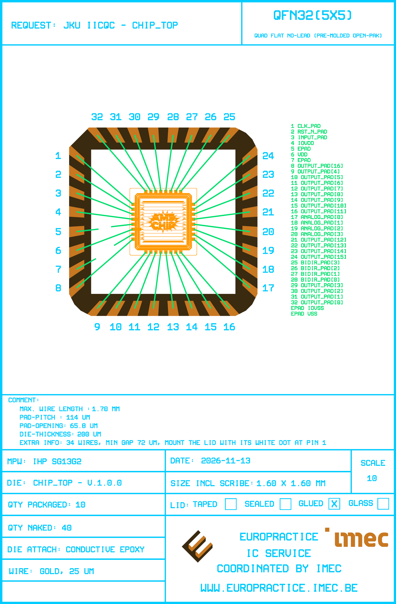{#fig-chip-top-bondplan width=70%}

::: {.callout-tip}
Check the flow log and [`packaging/result.md`](https://github.com/iic-jku/ihp-sg13g2-ams-chip-template/blob/main/packaging/result.md) after every run. Unbonded named pads and NC package pins are reported explicitly, so a forgotten connection in the `PINOUT` table is immediately visible. Warnings are raised for bondwires that are too long (`BONDWIRE_MAX_LENGTH`), cross each other, come too close to each other, land skewed on their lead (`BONDWIRE_MAX_SKEW`), or violate the guard clearance of sensitive wires (`GUARDED_PINS` / `GUARD_SPACING`).
:::

## Full Flow at Once

The comprehensive simulation, build, and DRC pass for the complete chip is run with the following command.

```sh
make all
```

This calls `build-all` first, then the regular KLayout and gdscheck DRC of `chip_top_logo_fill`, which stops the flow on a violation (see the DRC section above), then `sim-all` (RTL and gate-level cocotb plus the gate-level Xschem run), and finally `bondplan`. The simulations therefore run on the netlists that this build has just produced. Depending on the hardware used, `make all` can take a while.

## Releasing for Tapeout

When the chip is clean, the `release` target copies the GDS, the netlists, and the renders into a versioned folder for tapeout submission.

```sh
make release VERSION=2.1.0
```

The artifacts are written to [`release/v.2.1.0/`](https://github.com/iic-jku/ihp-sg13g2-ams-chip-template/tree/main/release/) (`gds/`, `netlist/{schematic,layout,pnl,spice}/`, `img/`).

::: {.callout-important}
Run `make all` before `make release`. The release target only copies files, it does not rebuild or re-verify the chip.
:::


# Start Your Own Chip {#sec-new-chip}

The template is meant to become your own chip. Work through this tutorial on the template as it is, then start your chip from a copy of it: create your own repository with the green "Use this template" button on GitHub (or fork or copy the repository) and name it `ihp-sg13g2-<name>` after the chip, clone it, and enter the IIC-OSIC-TOOLS container. In the top-level folder of the clone, one target turns the copy into a new chip with its own name:

```sh
make project NAME=<name> DRY_RUN=1   # list the changes, touch nothing
make project NAME=<name>             # start the chip <name>
```

`NAME` is a lowercase letter followed by lowercase letters, digits or underscores, for example `mychip`. It must not be the name of a macro or an IP: with `NAME=counter`, the chip top `counter_top` would be the same cell as the top cell of the counter macro. The target needs no PDK.

::: {.callout-tip}
With the repository named `ihp-sg13g2-<name>`, for example `ihp-sg13g2-mychip`, `git clone` gives its folder the same name, and `make project` writes that name into the directory tree of the README. If your clone has another name, rename it before `make project`: rename the repository on GitHub (Settings > General, the old URLs redirect), point `origin` at the new URL with `git remote set-url origin <URL>`, close VS Code and every terminal in the folder, and rename the folder from its parent folder. `make project` lists the same steps when the folder name differs.
:::

## What `make project` Does

1. **It checks before it changes anything.** It refuses to run in a git tree with uncommitted changes, so that `git reset --hard && git clean -fd` can undo the run completely, and in a checkout whose `origin` is still the template repository. `FORCE=1` skips both checks. Every change is planned first, so a refused run, for example because of a name that is already in use, leaves the tree untouched.
2. **It deletes the outputs of the template chip** with `make clean`: the GDS in `layout/`, the netlists, the renders, the reports, the simulation results and the bondplan. They carry the old name and come from a build of the template chip. The macros and IPs keep their committed views, so the new chip builds without rebuilding them.
3. **It removes what only makes sense in the template**: this tutorial (`tutorial/`) and the workflow that publishes it, `doc/ihp-structure-proposals/`, `CITATION.cff`, the content of `release/`, and every block between `template-only` markers in the README, `AGENTS.md`, the `Makefile` and the configuration files. Figures that a remaining file still shows move to `doc/fig/`, and `ToDo.md` starts empty.
4. **It renames the chip.** `chip_top`, `chip_core` and `chip_logo` become `<name>_top`, `<name>_core` and `<name>_logo`, in file names and in file contents (see @tbl-new-chip-names). `TOP` in the `Makefile` follows, and with it every target that takes the name from `TOP`, including the logo and fill step and the bondplan.
5. **It gives the README a new header** that records the template version it started from, and deletes itself: `scripts/new_project.py` and the `project` target are gone afterwards.
6. **It checks the result.** No old name, no link into a deleted path and no `template-only` marker may be left, and `reuse lint` has to pass when it is installed. The report at the end lists what is left for you.

| Template                                    | After `make project NAME=mychip`                |
| ------------------------------------------- | ----------------------------------------------- |
| `TOP = chip_top` in the `Makefile`          | `TOP = mychip_top`                              |
| `DESIGN_NAME: chip_top` in `config.yaml`    | `DESIGN_NAME: mychip_top`                       |
| `rtl/chip_top.sv`, `rtl/chip_core.sv`       | `rtl/mychip_top.sv`, `rtl/mychip_core.sv`       |
| `flow/librelane/chip_top.sdc`               | `flow/librelane/mychip_top.sdc`                 |
| `schematic/xschem/chip_top.sch`, `.sym`     | `schematic/xschem/mychip_top.sch`, `.sym`       |
| cocotb `chip_top_tb.py`                     | `mychip_top_tb.py`                              |
| Xschem `chip_top_tb_tran.sch`               | `mychip_top_tb_tran.sch`                        |
| the instance `i_chip_core`                  | `i_mychip_core`                                 |
| `flow/logo/chip_logo_mono.png`              | `flow/logo/mychip_logo_mono.png`                |
| `layout/chip_top_logo_fill.gds.gz`          | `layout/mychip_top_logo_fill.gds.gz`, written by the first build |

: Names in the template and after `make project NAME=mychip`. {#tbl-new-chip-names}

## After `make project`

Review the result, commit it, and build the new chip:

```sh
git status             # undo: git reset --hard && git clean -fd
git add -A
git commit -m "started <name> from ihp-sg13g2-ams-chip-template"
make init-submodules   # the logo and fill step needs flow/artistic
make build-top         # or make all, which also fetches it
```

The first build writes the layout, the netlists, the renders and the reports under the new name (see @sec-top). Then make the chip your own:

- **Your own blocks.** In `macros/`, start a digital or an analog macro as a renamed copy of an example (see @sec-digital, @sec-analog and @sec-exercise3):

  ```sh
  make macro FROM=counter NAME=<macro>    # digital macro
  make macro FROM=inverter NAME=<macro>   # analog macro
  ```

  The [macros README](https://github.com/iic-jku/ihp-sg13g2-ams-chip-template/blob/main/macros/README.md#register-the-macro-at-the-chip-top-level) lists every place where a new macro is registered at the chip top-level. Remove the example macros once your own ones replace them.
- **Floorplan, pinout and package.** Adapt the die area, the pad ring and the macro placements in `flow/librelane/config.yaml` (see @sec-top), the `PINOUT` map in `packaging/config.yaml` (see @sec-packaging), and the chip documentation in `doc/`. @sec-exercise4 and @sec-exercise5 walk through exactly these changes.
- **Regression.** The `regression` target, which the nightly workflow runs, tests the counter and inverter macros. Point it at your own macros once the examples are gone.

::: {.callout-important}
The logos stay, and they put the template's identity on the die. Replace them before a tapeout, @sec-ip shows how the logo IPs are generated from PNG images:

- [`ip/sg13g2_ip__jku_names/`](https://github.com/iic-jku/ihp-sg13g2-ams-chip-template/tree/main/ip/sg13g2_ip__jku_names/) draws the names of the template authors.
- `flow/logo/<name>_logo_mono.png` draws the "AMS CHIP" artwork on TopMetal2 (see @fig-chip-top-layout-tm2).
- [`ip/sg13g2_ip__jku/`](https://github.com/iic-jku/ihp-sg13g2-ams-chip-template/tree/main/ip/sg13g2_ip__jku/) draws the JKU logo, replace it where it does not apply.
:::

::: {.callout-note}
`make project` deletes this tutorial from the new chip, but it stays available online. The template's [top-level README](https://github.com/iic-jku/ihp-sg13g2-ams-chip-template/blob/main/README.md#start-a-new-chip-from-this-template) describes the target as well.
:::


# Additional Exercises {#sec-exercises}

The following exercises repeat the corresponding sections of this tutorial with modifications to the design.

## Exercise 1: From 8-bit Up-Counter to 16-bit Down-Counter {#sec-exercise1}

Repeat @sec-digital for a 16-bit synchronous down-counter that wraps from 0 back to $2^{16} - 1 = 65535$. The recommended steps are:

1. Update the RTL ([`counter.sv`](https://github.com/iic-jku/ihp-sg13g2-ams-chip-template/blob/main/macros/counter/rtl/counter.sv), [`counter_top.sv`](https://github.com/iic-jku/ihp-sg13g2-ams-chip-template/blob/main/macros/counter/rtl/counter_top.sv), [`constants.sv`](https://github.com/iic-jku/ihp-sg13g2-ams-chip-template/blob/main/macros/counter/rtl/constants.sv)). Change the bitwidth and turn the increment block into a decrement, with wrap-around from 0 to `CTR_MAX`.
2. Update the testbenches in [`testbenches/verilog/`](https://github.com/iic-jku/ihp-sg13g2-ams-chip-template/tree/main/macros/counter/testbenches/verilog/), [`testbenches/cocotb/`](https://github.com/iic-jku/ihp-sg13g2-ams-chip-template/tree/main/macros/counter/testbenches/cocotb/), and [`testbenches/xschem/`](https://github.com/iic-jku/ihp-sg13g2-ams-chip-template/tree/main/macros/counter/testbenches/xschem/) to cover the new behaviour. Adjust the bus width in the waveform view files (`*.gtkw`, `*.surf.ron`) as well.
3. Run `make sim-all` to validate the new RTL.
4. Re-run the LibreLane flow with `make build-top`. Check the timing reports. A 16-bit counter at 50 MHz must still pass timing constraints. Then run `make lec`, which proves the new netlist equivalent to the new RTL, now in 16 partitions (see @sec-lec).
5. Update the bus range of the output pin in the Xschem symbol ([`counter_top.sym`](https://github.com/iic-jku/ihp-sg13g2-ams-chip-template/tree/main/macros/counter/schematic/xschem/)), and re-run the gate-level Xschem simulation. The XSPICE model itself is regenerated automatically by `make build-top` (or manually with `make generate-xspice`), and the PEX symbol `counter_top_pex.sym` together with the extracted netlist by `make magic-pex`. Forgetting this step no longer costs you a debugging session: `make symbol-check` runs inside `generate-xspice` and names the eight ports the symbol is now missing. Run `make symbol-gl FORCE=1` in a scratch copy of the macro if you would rather read the widened pin off a fresh scaffold than edit the range by hand.

::: {.callout-tip}
## Bonus for advanced designers

Replace the binary counter with a 16-bit Gray counter (only one bit toggles per transition). Keep only the Gray register, and `make lec` proves the design in seconds. With a binary register next to the Gray output, `make lec` fails on a correct netlist, with some partitions running into `LEC_TIMEOUT`, so `make all` stops there (see @sec-lec).
:::

## Exercise 2: Self-Biased Single-Ended Inverter Amplifier {#sec-exercise2}

Repeat @sec-analog with a self-biased single-ended inverter amplifier by adding a feedback resistor $R_\mathrm{f}$ between the output and the input of the inverter. As discussed in @sec-cace, the bare CMOS inverter has poor PVT robustness because nothing pins the gate bias to $V_\mathrm{DD}/2$. A feedback resistor closes a DC loop that forces the operating point to the high-gain crossover ($V_\mathrm{in} \approx V_\mathrm{out} \approx V_\mathrm{DD}/2$) regardless of process corner, which also linearises the small-signal transfer characteristic and turns the inverter into a usable single-ended amplifier. The disadvantage of this technique is the reduced input resistance, which equals $R_\mathrm{in} \approx 1 / (g_\mathrm{m,NMOS} + g_\mathrm{m,PMOS})$. The recommended steps are:

1. Open the inverter schematic ([`inverter.sch`](https://github.com/iic-jku/ihp-sg13g2-ams-chip-template/blob/main/macros/inverter/schematic/xschem/inverter.sch)) in Xschem and add a resistor between the `vin` and `vout` nets of the inverter. Use the `rhigh.sym` device from the `sg13g2_pr` PDK library, the high-sheet poly resistor. Keep `spiceprefix=X` and connect its `body` terminal to `VSS`. The symbol computes the value from the geometry: with a sheet resistance of $1360\,\mathrm{\Omega/sq}$ this is roughly $2.7\,\mathrm{k\Omega}$ per $\mathrm{\mu m}$ of length at $W = 0.5\,\mathrm{\mu m}$, so keep $W$ at $0.5\,\mathrm{\mu m}$ and set the value with $L$ (the `b` parameter folds a long resistor into segments). Start with a value of $R_\mathrm{f} = 1\,\mathrm{M\Omega}$ and adjust as needed. What can you observe?
2. Re-run the schematic-level testbenches from @sec-analog and observe the change in behaviour. First, always carefully think about what the expected behaviour would be before running the simulations, and then check if the results match your expectations. Note that the ac open-loop testbench drives `vin` directly with a voltage source, which overrides the self-biasing. To observe it, also try removing the dc bias from the input (for example by coupling the source through a large capacitor) and let the feedback set the operating point.
3. Re-run the full schematic-level simulation suite with `make sim-all` to refresh the plotted results in [`fig/inverter_top/`](https://github.com/iic-jku/ihp-sg13g2-ams-chip-template/tree/main/tutorial/fig/inverter_top).
4. Re-run the CACE flow with `make sim-cace` and compare the new process and mismatch plots against @fig-inverter-cace-aol and @fig-inverter-cace-fcu. The spread of $A_\mathrm{ol}$ across corners should be visibly narrower than the open-loop reference.
5. [Optional] Sweep $R_\mathrm{f}$ in the CACE characterisation YAML ([`inverter.yaml`](https://github.com/iic-jku/ihp-sg13g2-ams-chip-template/blob/main/macros/inverter/verification/cace/inverter.yaml)) to study the circuit behaviour across a range of feedback resistor values.
6. [Optional] Once the schematic results are convincing, propagate the resistor to the layout in [`layout/`](https://github.com/iic-jku/ihp-sg13g2-ams-chip-template/tree/main/macros/inverter/layout/) with the `rhigh` PCell, using the same $W$ and $L$ as in the schematic and dummy resistors of minimum length above and below it, and re-run the verification chain (`make klayout-verify`, `make magic-verify`) plus `make build-top`. Compare the post-layout gain and bandwidth against the schematic level as in @sec-postlayout.

::: {.callout-tip}
Choose $R_\mathrm{f}$ carefully. Too small, and the loop loads the amplifier output and degrades the closed-loop gain. Too large, and the time constant with the input parasitic capacitance dominates, so the amplifier loses gain at the low end of the signal band. A value in the $1$–$10\,\mathrm{M\Omega}$ range is a sensible starting point for this inverter sizing.
:::

## Exercise 3: Three-Stage Ring Oscillator with Output Buffer {#sec-exercise3}

Repeat @sec-analog for a three-stage ring oscillator with an output buffer, derived from the existing quad inverter. The recommended steps are:

1. Start the new macro as a renamed copy of the [inverter](https://github.com/iic-jku/ihp-sg13g2-ams-chip-template/tree/main/macros/inverter/) with `make macro FROM=inverter NAME=ringosc` in `macros/`. The target renames the files, the cells inside the GDS files and every reference, see the [macros README](https://github.com/iic-jku/ihp-sg13g2-ams-chip-template/blob/main/macros/README.md) for what it does and what is left.
2. Update the schematic in Xschem. Connect three inverters in a ring, and tap the output of the last stage through a buffer. The fourth inverter of the quad inverter can naturally be used as the buffer.
3. Update the symbol of the macro ([`schematic/xschem/inverter_top.sym`](https://github.com/iic-jku/ihp-sg13g2-ams-chip-template/blob/main/macros/inverter/schematic/xschem/inverter_top.sym)) to expose a single output net, instead of `vin1..vin4` and `vout1..vout4`. The PEX symbol `inverter_top_pex.sym` is rebuilt from it by `make symbol-pex`, which the PEX targets run automatically.
4. Update the transient testbench ([`testbenches/xschem/inverter_top_tb_tran.sch`](https://github.com/iic-jku/ihp-sg13g2-ams-chip-template/blob/main/macros/inverter/testbenches/xschem/inverter_top_tb_tran.sch)) to measure the oscillation frequency. Remove the input source. Since the delay per stage is small, simulate a few hundred nanoseconds with a fine step, and measure the period between two consecutive rising crossings of $V_\mathrm{cm}$ on the output net:

   ```spice
   meas tran t_rise1 when v(vout)=Vcm rise=1
   meas tran t_rise2 when v(vout)=Vcm rise=2
   let T_osc = t_rise2 - t_rise1
   let f_osc = 1/T_osc
   print f_osc
   ```

   `Vcm` is visible inside the `.control` block only through a `.csparam Vcm=Vcm` line next to `.param Vcm=VDD/2`, as the dc testbench shows (see @sec-tb-ac). The expected relation is $f_\mathrm{osc} = 1/(2 \cdot N \cdot t_\mathrm{d})$ with $N = 3$ stages and $t_\mathrm{d}$ the effective stage delay. An ideal simulation can rest on the metastable point where all stages sit at $V_\mathrm{cm}$, so if the ring does not start, kick it with an initial condition on one ring node, for example `.ic v(osc)=0`. Delete testbenches that are no longer relevant.
5. Resize the unit inverter and watch the frequency. Vary `w`, `l`, and the finger count `ng` of $M_1$ and $M_2$ in the unit cell schematic (`ringosc.sch`), and re-run the transient simulation for each variant. Predict the outcome before you simulate, and use @sec-tradeoffs as your guide.
6. [Optional] Adapt the CACE [`inverter.yaml`](https://github.com/iic-jku/ihp-sg13g2-ams-chip-template/blob/main/macros/inverter/verification/cace/inverter.yaml) to characterise the oscillation frequency across PVT.
7. Update the layout in KLayout. The existing `inverter_top.klay.gds` can be used as a starting point, but the internal routing has to be modified to form the ring and the buffer stage. After editing, export a clean `ringosc_top.gds`. Keep the box on the `prBoundary` layer (`189/0`) and resize it with the macro, otherwise the top-level flow cannot place it. `make check-boundary` verifies this.
8. Re-run the verification chain, `make klayout-verify`, `make magic-verify`, and `make build-top`. Then compare the post-layout oscillation frequency against the schematic level as in @sec-postlayout. The parasitics add delay per stage, so the frequency drops.

## Exercise 4: Update Pinout and Floorplan of the Top-Level {#sec-exercise4}

Building on @sec-exercise1 and @sec-exercise3, swap `inverter2` for the ring oscillator, delete `counter2`, and connect the now 16-bit `counter1` to the freed-up south-side pads. Try the new pad order and the macro positions in PREP-IC first (@sec-prep-ic). The recommended steps are:

1. Replace `inverter2` with the ring oscillator macro in [`chip_core.sv`](https://github.com/iic-jku/ihp-sg13g2-ams-chip-template/blob/main/rtl/chip_core.sv).
2. Replace three of the four analog pads with VSS pads, and connect the ring oscillator's output to the fourth analog pad.
3. Delete `counter2` and rewire all eight south-side pads to the new 16-bit `counter1` values.
4. Update the parameters of [`chip_top.sv`](https://github.com/iic-jku/ihp-sg13g2-ams-chip-template/blob/main/rtl/chip_top.sv) so that `NUM_OUTPUT_PADS`, `NUM_BIDIR_PADS`, `NUM_ANALOG_PADS`, and `NUM_VSS_PADS` match the new pin count (see @sec-top).
5. Update the macro instantiation and wiring in [`chip_core.sv`](https://github.com/iic-jku/ihp-sg13g2-ams-chip-template/blob/main/rtl/chip_core.sv).
6. Update the placement coordinates in the `MACROS` block of [`config.yaml`](https://github.com/iic-jku/ihp-sg13g2-ams-chip-template/blob/main/flow/librelane/config.yaml). Keep the [`doc/floorplan.md`](https://github.com/iic-jku/ihp-sg13g2-ams-chip-template/blob/main/doc/floorplan.md) constraints in mind, namely stay in the core, no overlaps, and respect the `Metal3` grid for inverter-like macros.
7. Update the PAD lists (`PAD_WEST`, `PAD_NORTH`, `PAD_SOUTH`, `PAD_EAST`) in [`config.yaml`](https://github.com/iic-jku/ihp-sg13g2-ams-chip-template/blob/main/flow/librelane/config.yaml) to match the new pinout.
8. Update [`pdn_cfg.tcl`](https://github.com/iic-jku/ihp-sg13g2-ams-chip-template/blob/main/flow/librelane/pdn_cfg.tcl) so that the new macros are covered by the correct PDN grid (default for digital, `inverter_top`-style for analog).
9. Rebuild the chip from scratch with `make build-all`, then verify with `make klayout-drc-regular` and `make gdscheck-drc-regular`.

## Exercise 5: Update the Bondplan Configuration {#sec-exercise5}

Building on @sec-exercise4, update the bondplan configuration in [`packaging/config.yaml`](https://github.com/iic-jku/ihp-sg13g2-ams-chip-template/blob/main/packaging/config.yaml) so that the packaged chip matches the new pinout (ring oscillator instead of `inverter2`, 16-bit `counter1`, no `counter2`, three additional VSS pads). The recommended steps are:

1. Rebuild the final GDS of the modified chip (`make build-all` from @sec-exercise4), since the bondplan flow reads the die pads and their names directly from [`layout/chip_top_logo_fill.gds.gz`](https://github.com/iic-jku/ihp-sg13g2-ams-chip-template/blob/main/layout/chip_top_logo_fill.gds.gz).
2. Update the `PINOUT` table in [`packaging/config.yaml`](https://github.com/iic-jku/ihp-sg13g2-ams-chip-template/blob/main/packaging/config.yaml): the south-side pads now carry `counter1_value[15:8]`, three of the four east-side analog pads became VSS pads, and the fourth carries the ring-oscillator output. Keep the geometric order in mind (pins 1-8 left top→bottom, 9-16 bottom left→right, 17-24 right bottom→top, 25-32 top right→left) so that the bondwires do not cross.
3. Connect the freed-up VSS pads as downbonds to the exposed pad by adding an `EPAD` list (e.g. `EPAD: ["VSS", "VSS", "VSS"]`) and marking their former leads as NC (`~`). The exposed pad of the QFN-32 is the package ground, and the die is attached with conductive epoxy, so ground downbonds are shorter and lower-inductance than wires to leads.
4. Re-run `make bondplan` and read the flow log and [`packaging/result.md`](https://github.com/iic-jku/ihp-sg13g2-ams-chip-template/blob/main/packaging/result.md) carefully: only the deliberately unbonded pads may appear as *unbonded named pads* (plus the seal-ring artifact), and there must be no wire-length, crossing, spacing, lead-skew, or guard-clearance warnings.
5. Inspect the generated bonding diagram in [`packaging/render/`](https://github.com/iic-jku/ihp-sg13g2-ams-chip-template/tree/main/packaging/render/) and the bondplan GDS in KLayout (`ke packaging/layout/chip_top_bondplan.gds`). The title block of the A4 drawing sheet (die size, pad pitch, wire count, maximum wire length) is refilled automatically on every run.
6. [Optional] Experiment with the die placement: rotate the die with `DIE_PLACEMENT.orientation` (e.g. `E`) or move it off-center with `DIE_PLACEMENT.location`, re-run the flow, and observe how the wire-length, spacing, and skew checks react. Restore a placement where all checks pass.

## Exercise 6: Re-Harden the Counter with Another Standard Cell Library {#sec-exercise6}

Repeat the hardening of @sec-digital on another library and measure what it changes. The counter uses IHP LV by default, now re-harden it with IHP HV or ETH LV, keeping the RTL, the die, the constraints and `SYNTH_STRATEGY`. What differences can you see in area, speed, and power? The recommended steps are:

1. Run `make librelane` in `macros/counter/` on the unchanged configuration and keep the run folder `flow/librelane/runs/<run>/` as the reference.
2. Switch the library as described in @sec-hardening-libraries. Stay with `make librelane`, since `make build-top` stops at `copy-reports` on another library.
3. Run `make librelane` and confirm that the run finishes with 0 DRC, LVS and antenna errors (`final/metrics.csv`: `magic__drc_error__count`, `klayout__drc_error__count`, `design__lvs_error__count`, `antenna__violating__nets`).
4. **Area.** Compare the `Chip area` line in `*-yosys-synthesis/reports/stat.rpt` and, after place and route, `design__instance__area__stdcell` and `design__instance__utilization` in `final/metrics.csv`. Which cells does Yosys choose for the flip-flops, and why does IHP LV need a `sg13g2_tiehi` per bit? For ETH LV, subtract `design__instance__area__class:tap_cell`. For IHP HV, compare `design__core__area`: the core margins scale with the site, so the taller rows lose core area to the fixed die.
5. **Speed.** Read `timing__setup__ws` in `final/metrics.csv`, then shorten `CLOCK_PERIOD` step by step (for example 5, 3, 2.5, 2, 1.8 and 1.6 ns) with `make librelane-nodrc` until `timing__setup__ws` turns negative, and compare the shortest period that closes. The flow stops with `Setup violations found` at a violating period. Note in which corner each library is slowest: the corners of IHP LV and ETH LV end at 1.08 V, those of IHP HV at 3.0 V.
6. **Power.** Read `*-openroad-stapostpnr/nom_typ_1p20V_25C/power.rpt` for IHP LV and ETH LV, and `nom_typ_3p30V_25C/power.rpt` for IHP HV. `power__total` in `final/metrics.csv` is the value of the last entry of `STA_CORNERS`, which is 1.5 V for IHP LV and 1.2 V for ETH LV, so it does not compare the two. The report of IHP HV shows 0 W of internal and switching power, because its Liberty has no dynamic power data. Why does the leakage of ETH LV come out larger than that of IHP LV, although its logic is smaller? Count the decap cells in `final/nl/counter_top.nl.v` and look up their `cell_leakage_power` in the Liberty files.
7. Restore the macro with `git restore .` in `macros/counter/` and delete `tracks_ez130.info`.

::: {.callout-tip}
## Bonus for advanced designers

The clock tree of IHP LV uses `sg13g2_buf_16` as root buffer, far more than eight flip-flops need. Set `CTS_ROOT_BUFFER` and `CTS_CLK_BUFFERS` to smaller cells in both libraries, for example `sg13g2_buf_4` and `BUFX12`, and repeat the power comparison. Then measure the supply current at transistor level, the only way to get a dynamic power number for IHP HV: `make copy-final` and `make magic-pex EXT_MODE=2` write `netlist/pex/counter_top_magic_pex_2.spice`. Include it in an ngspice deck with the nominal supply, 6 fF on each output and a 50 MHz clock, and average `i(vdd)` over 16 counting cycles with `meas tran`. A run takes 15 to 45 minutes, so it is not part of the routine flow.
:::

::: {.callout-note collapse="true"}
## Reference results

These are the results for the 200 µm × 100 µm die, `SYNTH_STRATEGY: DELAY 4` and the configurations of @sec-hardening-libraries in image tag `2026.10`, with the typical corner at 1.2 V for IHP LV and ETH LV and at 3.3 V for IHP HV.

| | IHP LV | IHP HV | ETH LV |
|---|---|---|---|
| Synthesised cell area (`stat.rpt`) | 742 µm² | 2293 µm² | 401 µm² |
| Standard cell area after place and route | 1285 µm² | 2910 µm² | 1184 µm², 748 µm² without tap cells |
| Core area and rows | 12802 µm², 18 | 8061 µm², 6 | 13395 µm², 21 |
| Utilisation | 10.0 % | 36.1 % | 8.8 % |
| Flip-flops | `sg13g2_dfrbpq_1` + `sg13g2_tiehi` | `sg13g2_hv_dfrbpq_1` + `sg13g2_hv_tiehi` | `DFFQX1` |
| Worst setup slack at 20 ns | 13.44 ns | 13.75 ns | 14.50 ns |
| Shortest period that closes | 1.6 ns | 3.0 ns | 1.7 ns |
| Total power in `power.rpt`, 50 MHz | 52.6 µW | leakage only | 46.0 µW |
| Supply power at transistor level, 50 MHz | 57.2 µW | 779 µW | 55.7 µW |
| Static power at transistor level | 0.74 µW | 0.0036 µW | 1.70 µW |

ETH LV nearly halves the synthesised area, mostly because of the flip-flop without reset: IHP LV spends 56 µm² per bit on a flip-flop with an unused asynchronous reset plus its tie cell, ETH LV 23 µm². After place and route the gap narrows: timing repair adds hold buffers (20 `sg13g2_dlygate4sd3_1` with 327 µm² in IHP LV, 29 `BUFX3` with 164 µm² in ETH LV), and the tap cells of ETH LV follow the core and not the logic, which costs 436 µm² on this large, nearly empty die. IHP HV costs three times the area of IHP LV but needs no hold buffers.

In speed, the two thin-oxide libraries are close. At 20 ns the worst path starts at `enable_i` and runs through the hold buffers, so that slack says little about the library. The shortest period compares register-to-register paths, where IHP LV is slightly ahead. IHP HV closes at about 1.9 times that period.

The power numbers come with three caveats. First, on this nearly empty die the leakage is almost entirely decap fill (97 % in IHP LV and 99 % in ETH LV), which leaks more per area in ETH LV, while the logic of ETH LV alone leaks 12 nW against 22 nW in IHP LV. Second, the clock buffers decide more than the library: with `sg13g2_buf_4` and `BUFX12` as root buffer, the supply power drops to 37.2 µW for IHP LV and 29.4 µW for ETH LV, and the advantage of ETH LV grows from 2.5 % to 21 %. Third, the `power.rpt` numbers are vectorless estimates: they sit below the transistor-level values, more for ETH LV than for IHP LV, and for IHP HV the dynamic part is missing altogether. At 3.3 V, the supply power of IHP HV is 13.6 times that of IHP LV.
:::


# Acknowledgements

This project is funded by the JKU/SAL [IWS Lab](https://research.jku.at/de/projects/jku-lit-sal-intelligent-wireless-systems-lab-iws-lab/), a collaboration of [Johannes Kepler University](https://jku.at) and [Silicon Austria Labs](https://silicon-austria-labs.com).

<table width="100%">
  <tr>
    <td align="left" width="50%">
      <a href="https://iic.jku.at" target="_blank">
        
      </a>
    </td>
    <td align="right" width="50%">
      <a href="https://silicon-austria-labs.com" target="_blank">
        
      </a>
    </td>
  </tr>
</table>
